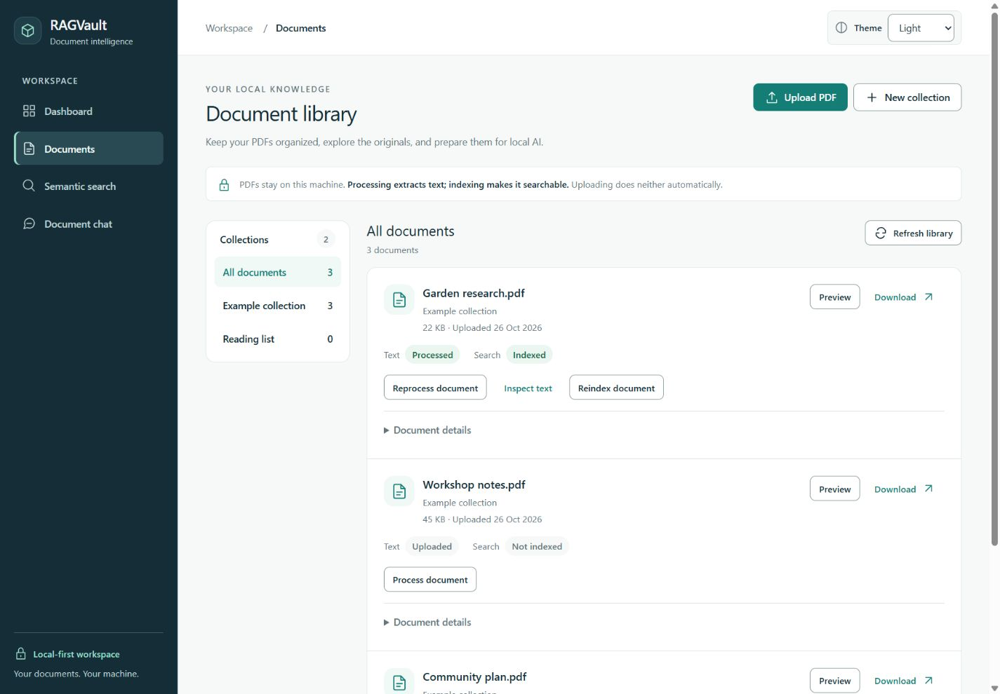
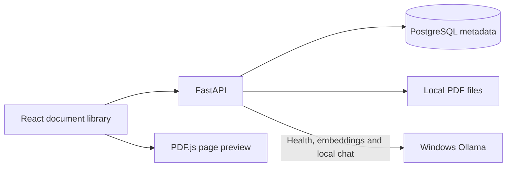
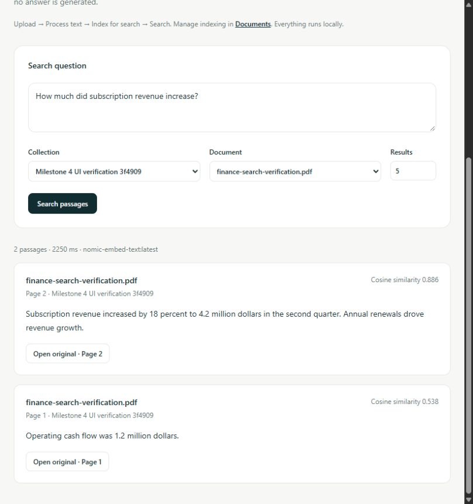
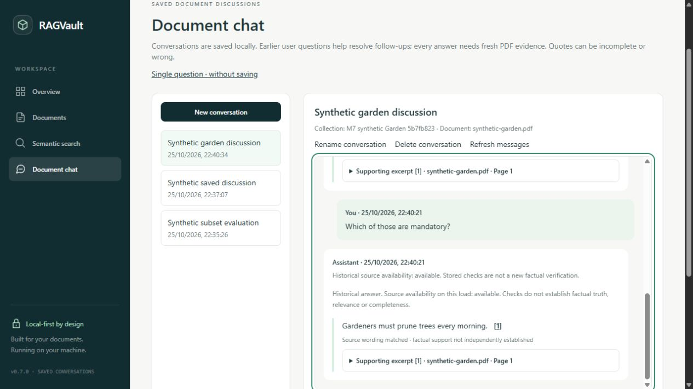
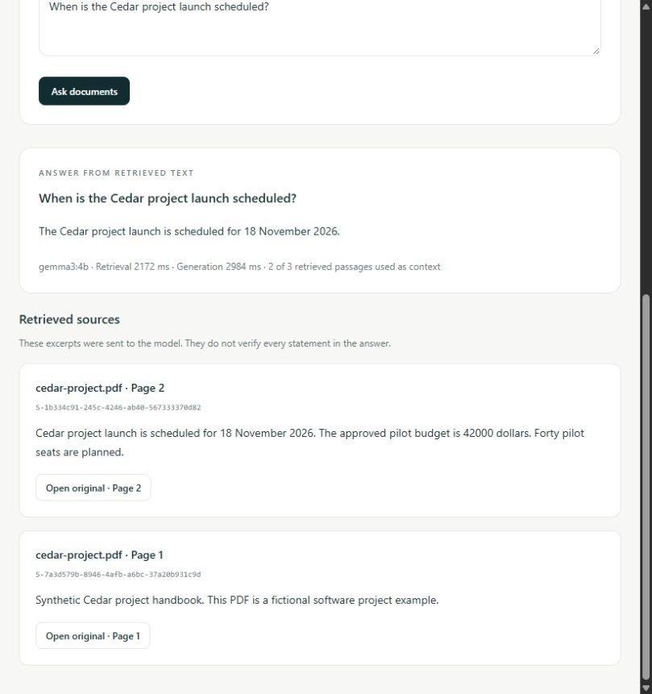
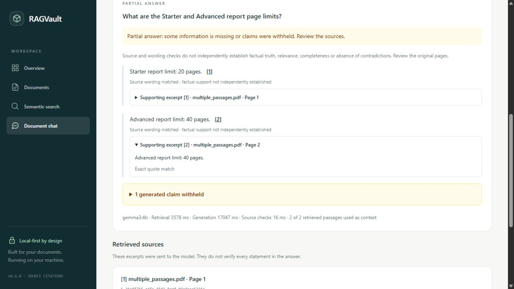

# RAGVault

A local-first document intelligence portfolio project, built in explicit milestones.

See [conversation architecture](docs/architecture/conversations.md) and [Milestone 7 verification](docs/verification-milestone-7.md) for the current lifecycle, context policy, measurements and limitations. [Source citations](docs/architecture/source-citations.md), [Milestone 6 verification](docs/verification-milestone-6.md) and its [reliability investigation](docs/citation-reliability-investigation.md) document the grounding baseline.

**Current UI stage: 8.4 — AI Chat and Conversations.** The shared design system now extends to saved and single-question chat: responsive conversation history, a multiline composer, clear message roles, compact numbered citations and expandable source/verification details. Fixed scopes, request-key recovery and source safeguards remain intact. Navigation, dashboard and document-library redesigns are complete; Search and the PDF reader retain their existing page contents. See the [design-system guide](docs/design-system.md), [Stage 8.3 verification](docs/verification-milestone-8-3.md) and [Stage 8.4 verification](docs/verification-milestone-8-4.md). In development, inspect shared components at `/dev/design-system`; the preview is excluded from production builds.

**Application features from Milestones 1–7:** Save scoped document discussions, revisit ordered messages after reload/restart, and use bounded prior user-question topics for fresh-evidence follow-ups. Extractive claims retain numbered source references, checked quotations and original PDF page controls. PDF management, processing, semantic search and stateless chat remain available.

**Single user. Local machine only. No authentication. Do not expose this service publicly.** Saved messages and cited excerpts are private local database data, not encrypted conversation storage. Source checks do not prove truth, relevance or completeness. Multi-user access, semantic entailment verification, streaming, OCR and background queues are not implemented.



Sanitized visual fixture; the real library displays local API data. Historical milestone screenshots remain in their original reports.


See [semantic search architecture](docs/architecture/semantic-search.md), [Milestone 4 verification](docs/verification-milestone-4.md), [PDF processing architecture](docs/architecture/pdf-processing.md), [Milestone 3 verification](docs/verification-milestone-3.md), [document-library foundations](docs/architecture/document-library.md), [Milestone 2 verification](docs/verification-milestone-2.md), and the [historical Milestone 1 report](docs/verification.md).

## Stack

- Python 3.12+, FastAPI, Pydantic Settings, SQLAlchemy 2.x, psycopg, PostgreSQL 17 with pgvector, Alembic.
- PyMuPDF validates uploads; original PDFs live on disk rather than in PostgreSQL.
- React, TypeScript, Vite, Tailwind CSS, React Router, and PDF.js preview.
- Docker Compose, Pytest, Ruff, Vitest, React Testing Library, ESLint, Prettier, and GitHub Actions.
- Ollama runs locally for health checks, `nomic-embed-text` embeddings and `gemma3:4b` document answers.





## Features and policies

- Collections use UUIDs, trimmed names up to 120 characters, UTC timestamps, and case-insensitive unique names. Only empty collections can be deleted; otherwise the API returns 409.
- Documents have UUIDs, collection relationships, display names, internal UUID storage keys, byte sizes, fixed PDF MIME, SHA-256 checksums, status, and UTC timestamps. Internal paths are not exposed by metadata responses.
- Identical bytes in the same collection return 409, even with another filename. The same PDF in another collection is allowed and stored independently. Rename preserves bytes and checksum.
- Uploads start as `uploaded`. Explicit processing transitions through `processing` to `processed`, `no_text` or `failed`. Retry and reprocessing replace chunks atomically. Processing status alone does not mean indexed; indexing has a separate lifecycle.
- Upload validation checks extension, safe display name, byte limit, PDF header, PyMuPDF structure/repair state, encryption, and page count. Client MIME is ignored. Path components from upload filenames are discarded; rename inputs reject path separators and control characters.
- The browser offers accessible dialogs, file selection and drag/drop, a clear uploading indicator, loading/empty/error states, collection filtering, pagination, confirmation before deletion, and a local PDF.js page preview. Original download remains available.

## Text processing and inspection

Use **Process document** in the library. Processing is synchronous and bounded; it does
not run automatically during upload. PyMuPDF reads stored PDFs page by page, normalizes
whitespace and produces character-based chunks within individual pages. The inspector
shows one-based PDF page numbers and paginated source text rendered as plain text.
Image-only PDFs finish as **No extractable text**; OCR is not included.

Defaults are 1,200 characters per chunk with up to 200 characters of overlap, a
60-second parser timeout, 100,000 raw characters per page, 1,000,000 raw characters per
document and 5,000 chunks. Set `CHUNK_SIZE_CHARS`, `CHUNK_OVERLAP_CHARS`,
`PROCESSING_TIMEOUT_SECONDS`, `MAX_PAGE_TEXT_CHARS`, `MAX_EXTRACTED_CHARS` and
`MAX_DOCUMENT_CHUNKS` in your existing `.env` only if you want different limits.
Overlap must be smaller than chunk size. Character counts are not model token counts.

- `POST /api/documents/{id}/process`: process, retry or replace an extraction.
- `GET /api/documents/{id}/processing`: current lifecycle metadata.
- `GET /api/documents/{id}/chunks?limit=20&offset=0`: deterministic ordered chunks,
  optionally filtered with `page_number`; maximum page size is 100.

Reprocessing first invalidates old chunks, then atomically commits all replacement
chunks with the final status. Failures retain the original PDF and a safe retry message.
Only one parser runs per API process. Active duplicate attempts and deletion while
processing return 409. A claim interrupted by a crash can be retried after the timeout
plus 60 seconds; use **Retry expired processing** or the same process endpoint.
Paragraph/layout detection is heuristic and chunks do not cross pages. OCR is not included. Processing, indexing and document chat are separate explicit actions. See the processing architecture for resource limits and restart behavior.

## Semantic passage search

In Documents, first **Process document**, then **Index for search**. Indexing embeds stored
chunks without reparsing the PDF. Open [Semantic search](http://localhost:5173/search),
enter a natural-language question, and optionally select a collection/document and top-K
(1–20). Results show original text, filenames, one-based PDF pages and cosine similarity;
**Open original** opens that PDF page. No answer or conversation is generated.

The actual local `nomic-embed-text` response was verified as 768-dimensional. Dimensions
are validated from responses rather than hardcoded in production. Model name/digest,
actual dimension and prefix settings identify compatible indexes. Changing any of them
requires reindexing; incompatible indexes are excluded with a UI notice. Reprocessing
removes old embeddings, deletion cascades cleanup, and retries atomically replace vectors.

- `POST /api/documents/{id}/index`: index, retry or reindex a processed document.
- `GET /api/documents/{id}/indexing`: stored indexing state/model metadata.
- `POST /api/search`: query, optional `top_k`, `collection_id`, `document_id`.

Default indexing is batched (16 chunks), with a 180-second budget, 60-second provider
request timeouts, at most 2,000 chunks/2,000,000 vector values per document, and bounded
query concurrency. See `.env.example` for optional limits/prefix settings; keep your
private `.env` unchanged unless you choose different values. Source passages may be
irrelevant despite being nearest neighbors; similarity is not confidence. Exact cosine
search is used initially, with no approximate index or text-similarity fallback.

## AI document chat

Open [Document chat](http://localhost:5173/chat), choose a collection/document, and ask a
question about processed and indexed PDFs. The existing filtered pgvector search retrieves
evidence; a bounded context is sent to local `gemma3:4b` through Ollama's non-streaming
chat API. Answers show original excerpts and PDF page controls. By default, create a
saved conversation with an immutable collection/document scope; the URL retains its
UUID for refresh. Ordered user/assistant messages live in PostgreSQL and survive API
restarts. Rename/delete controls and older-message pagination are available. A failed
generation stays visibly failed; explicit retry creates a new turn, while an uncertain
submission reuses its request key. The [single-question mode](http://localhost:5173/chat?mode=single)
and existing `POST /api/chat` remain stateless.

Follow-ups use up to four completed prior **user questions**, at most 600 characters
total, as untrusted topic hints. Assistant answers are never added as authoritative
facts or evidence. A deterministic query expansion retrieves fresh scoped passages;
history is separately labelled and counted inside the unchanged context budget. This
is limited English reference handling, not full conversation understanding. In live
testing Gemma repeated optional material in a mandatory-only follow-up; see the
Milestone 7 report for the successful one-fact example and the mixed-requirements failure.
The [Milestone 7 stabilization report](docs/milestone-7-stabilization.md) records the
subsequent scrolling/keyboard improvements, category follow-up fixes and real GIQ comparison.
The direct advanced page-limit question still sometimes has all generated claims withheld.
Source-checked original excerpts can then be inspected separately under **Retrieved source
excerpts · not an answer**; those excerpts are not accepted claims or verified facts.

Saved source metadata is checked on load. Reprocessed sources become stale; deleted
sources become unavailable, with historical text retained and citation buttons disabled.
Deleting a scoped target never broadens retrieval: create another conversation instead.
Deleting a conversation cascades only its messages and preserves library documents.
See the [conversation architecture](docs/architecture/conversations.md) for endpoints,
transaction failures, interrupted-turn recovery, privacy and exact limits.



Empty or low-relevance retrieval returns insufficient evidence without calling Gemma.
With usable passages, the model can still abstain or hallucinate. Milestone 6 requests
bounded selections of original quotations, without a separate model paraphrase field.
Application checks allow only supplied source
IDs, recheck current database metadata and scope before and after generation, and require
claim wording inside each cited quotation. Invalid references, unsupported wording and
heuristic numeric conflicts are withheld. Narrow category/page-limit checks reject
source-valid answers to the wrong explicit category or numeric field. Results distinguish `answered`, `partial`,
`insufficient_evidence` and `unreliable`; partial answers can omit important facts.
Numbered controls open the checked document page, and disclosures show the original
supporting quotation. These checks establish source/wording integrity rather than factual
support: false or misleading source text can pass. All model output is inert
plain text. Document commands are treated as untrusted data; the model has no tools,
filesystem/database access or application secrets. Prompt injection is not solved by
instructions alone.

Default budgets: one chat per API process, top-K 5, 6,000 serialized context characters,
1,600 per passage, conservative UTF-8 packing into a 4,096-token model context, 512
response tokens, 4,000 answer characters and a 180-second generation timeout. The byte
packing budget often fits fewer passages. Minimum similarity 0.5 is a tunable exclusion
heuristic, not confidence. See `.env.example` and the [chat architecture](docs/architecture/document-chat.md)
for the exact policy, trade-offs, error codes and manual checks. Existing `.env` values
are preserved; no larger model or new dependency is required.

The active packing ceiling is **3,456 UTF-8 bytes** for system and user content
(`4096 - 512 - 128`), including a 1,024-byte system prompt. Greedy selection
can fill the remaining space with two passages even when top-K retrieves ten. Later
relevant passages may be excluded and the last included excerpt truncated. The 6,000
character cap does not override this tighter byte cap. This is an application estimate,
not Gemma's actual token count or a two-passage model limit.

The [context-budget investigation](docs/context-budget-review.md) reproduced both
abstention and readable answers, but also observed incorrect category-specific numeric
claims with evidence present. An `answered` status is not factual verification. The
metadata-compaction experiment was not adopted; retrieval, context limits and
grounding boundaries remain unchanged. After the real-world investigation, a bounded
stable priority promotes matching report sections or explicit category/page-limit
clauses within retrieved top-K before packing. Milestone 6 changes the output contract and
checks, with an updated structured-output prompt. Conservative wording matching rejects
paraphrases, and conflict detection can overflag numeric fragments or miss differently
worded contradictions. Broad questions can still omit important sections; inspect the
source pages. The nine-case live evaluation covered 11 of 12 expected fact items, with
one omitted broad-answer item and a conservative numeric false positive. See the
Milestone 6 report for the initial sample. The [real-world citation investigation](docs/citation-reliability-investigation.md)
records the current extractive contract, retained changes, false rejections, remaining
alias errors and measured before/after accuracy and latency. Neither report establishes
general semantic correctness or complete coverage of a private document.

```json
{"question":"How long are backups retained?","collection_id":null,"document_id":null,"top_k":5}
```

`POST /api/chat` returns `answer`, `status`, structured `sources`, model names, retrieved
and context counts, excluded incompatible-document count, claim-level `citations`,
`verification` diagnostics and separate retrieval, generation, verification and total
timings. `verification.factual_support` remains `not_established`. Filters apply before generation and cannot be bypassed by
the model. Failed retrieval/generation never falls back to general AI knowledge.





## Existing database compatibility

The pgvector image builds on the same pinned PostgreSQL 17 Alpine runtime. This upgrade
verified PostgreSQL 17.11, Alpine/libc, byte-identical server/runtime binaries and the
unchanged PostgreSQL cluster identity before retaining the existing named volume.
**For another existing installation, check its major version/runtime and take a private
backup before changing the image. Stop if they differ; do not reset the volume or switch
libc families as a shortcut.** See the [upgrade runbook](docs/architecture/semantic-search.md#database-image-and-upgrade-runbook).

## Windows setup or upgrade from earlier milestones

Prerequisites: Python 3.12+, Node.js 24 with npm, Git, Docker Desktop with Linux containers/Compose, and running Ollama with `nomic-embed-text` for indexing/search and `gemma3:4b` for document answers. Library management can operate without Ollama. The tested workstation uses Python 3.12.10 and Node 24.16.0. Existing models are reused; the app does not download or switch to larger models.

Commands below are PowerShell. Substitute your checkout path. Existing `.env` settings and database volumes should be retained. `npm.cmd` avoids PowerShell execution-policy problems, and direct virtual-environment Python paths avoid activation requirements.

```powershell
Set-Location 'C:\Projects\ragvault'
if (-not (Test-Path .env)) { Copy-Item .env.example .env }
# On a new checkout, edit .env and set your own POSTGRES_PASSWORD.
# Keep an existing configured .env unchanged unless you want different settings.
if (-not (Test-Path backend/.venv/Scripts/python.exe)) { python -m venv backend/.venv }
.\backend\.venv\Scripts\python.exe -m pip install -e './backend[dev]'
npm.cmd --prefix frontend ci

docker compose --profile app config --quiet
docker compose build postgres
# For existing volumes, complete the compatibility checks linked above first.
docker compose up -d --no-deps --wait postgres
Set-Location backend
.\.venv\Scripts\python.exe -m alembic upgrade head
.\.venv\Scripts\python.exe -m alembic current
.\.venv\Scripts\python.exe -m alembic check
```

Expect PostgreSQL to become healthy, revision `0004_conversations (head)`, and `No new upgrade operations detected.` Startup never creates tables or runs migrations automatically. Migration 0003 adds pgvector/indexing metadata; migration 0004 adds conversations and messages while preserving the existing library tables, PDFs and database volume. Do not downgrade 0004 on retained conversation data: that explicit downgrade drops saved history.

Start the backend in one terminal:

```powershell
Set-Location 'C:\Projects\ragvault\backend'
.\.venv\Scripts\python.exe -m app --reload
```

Start the frontend in another:

```powershell
Set-Location 'C:\Projects\ragvault\frontend'
npm.cmd run dev
```

Open [the dashboard](http://localhost:5173) or [document library](http://localhost:5173/documents). Create a collection before uploading a PDF. Expect the library to list the validated original with Uploaded status. Preview, rename, download, and delete operate on real stored files. Delete each document before deleting its collection.

The `predev` and `prebuild` scripts copy PDF.js fonts, character maps, and codecs from node_modules to ignored `frontend/public/pdfjs`. The worker and renderer are bundled locally. No CDN, hosted AI service, or model download is used.

## Configuration

Both apps read the root `.env`; shell environment values take precedence. Existing configuration continues to work. New settings have defaults and do not require overwriting `.env`.

| Setting | Default / behavior |
| --- | --- |
| `APP_ENV` | `development`; also accepts `test` and `production`, without adding authentication |
| `BACKEND_HOST`, `BACKEND_PORT` | `127.0.0.1`, `8000`; keep the bind local |
| `FRONTEND_ORIGIN` | `http://localhost:5173`; exact allowed browser origin |
| `POSTGRES_HOST`, `POSTGRES_PORT` | `localhost`, `5432` in native mode |
| `POSTGRES_DB`, `POSTGRES_USER`, `POSTGRES_PASSWORD` | Existing database/role; password is required and private |
| `DATABASE_TIMEOUT_SECONDS` | 3 seconds |
| `UPLOAD_DIR` | `<repository>/data/uploads`; relative paths resolve against the repository root |
| `MAX_UPLOAD_BYTES` | 26214400 (25 MiB), enforced per PDF |
| `MAX_PDF_PAGES` | 2000 |
| `PDF_VALIDATION_TIMEOUT_SECONDS` | 15 seconds; synchronous parser subprocess deadline |
| `OLLAMA_BASE_URL` | Native backend uses `http://localhost:11434` |
| `OLLAMA_DOCKER_BASE_URL` | Container backend uses `http://host.docker.internal:11434` |
| `OLLAMA_CHAT_MODEL`, `OLLAMA_EMBEDDING_MODEL` | `gemma3:4b` for chat; `nomic-embed-text` for indexing/query embeddings |
| `OLLAMA_TIMEOUT_SECONDS`, `LOG_LEVEL` | 3 seconds, `INFO` |
| `VITE_API_BASE_URL` | `http://localhost:8000`; public build-time setting, never a place for secrets |

An additional 64 KiB bounds multipart overhead. The entire request is limited before/during form parsing, then the file limit is enforced again while copying in chunks. PyMuPDF runs in a synchronous subprocess with a wall-clock deadline, avoiding unsafe concurrent thread use and isolating parser crashes from the API. Its memory buffer is bounded by file size; raising the limit increases memory use. Header bytes must start with `%PDF-`; PDFs requiring repair are rejected. Encryption is rejected even if opening needs no user password.

Use `http://localhost:5173`, matching CORS; `127.0.0.1` is a different origin. Browser POST/PATCH/DELETE requests with an unapproved Origin are rejected, and Host headers are restricted to local names. Native clients without Origin remain usable. These controls do not replace authentication or permit public deployment.

## API

[Swagger documentation](http://localhost:8000/docs) describes the schemas and multipart input. Upload exactly one file in the `file` field.

| Method | Route | Behavior |
| --- | --- | --- |
| GET | `/` | Application liveness |
| GET | `/api/health` | Dependency health: 200 healthy, structured 503 degraded |
| GET | `/api/library/config` | Public upload/page limits |
| GET | `/api/collections` | Collections with current document counts |
| POST | `/api/collections` | Create using `{ "name": "Research" }` |
| PATCH | `/api/collections/{id}` | Rename using `{ "name": "References" }` |
| DELETE | `/api/collections/{id}` | Delete only when empty; 204 or 409 |
| POST | `/api/collections/{id}/documents` | Upload PDF as multipart `file`; 201 |
| GET | `/api/documents` | Paginated metadata; optional `collection_id`, `limit` (1–100, default 20), `offset` |
| GET | `/api/documents/{id}` | One document's metadata |
| PATCH | `/api/documents/{id}` | Rename using `{ "filename": "report.pdf" }` |
| GET | `/api/documents/{id}/file` | Stream original PDF inline |
| GET | `/api/documents/{id}/file?download=true` | Download the original |
| DELETE | `/api/documents/{id}` | Remove metadata and stored PDF; 204 |

Common errors: 404 missing collection/document/file, 409 duplicate content/name or nonempty collection, 413 oversized upload, 415 unsupported filename/type, 422 invalid signature/PDF/encryption/pages/validation, 403 unapproved browser write origin, and 503 dependency/storage failure. Library operation errors include safe `detail.code` and `detail.message`; standard Pydantic field-validation errors retain FastAPI's validation format.

Verify services without exposing settings:

```powershell
curl.exe -i http://localhost:8000/api/health
Invoke-RestMethod 'http://localhost:11434/api/tags'
```

Healthy output has application `ok`, database `connected`, and Ollama `connected`. Ollama failure does not disable document management. PostgreSQL and file storage must be available for library operations.

## Storage, consistency, and security

Original PDFs are stored as `<uuid hex>.pdf`, with `.tmp` staging and `.trash` quarantine directories below the configured root. The client never supplies an internal storage path. There is no static directory exposing arbitrary files. Controlled serving sends safe disposition headers, PDF MIME, nosniff, no-store, and a frame-ancestor policy. PDF.js renders pages without annotation, scripting, or XFA layers; advanced interactive PDF features remain available only in the downloaded original.

Upload failures roll back metadata and clean up staged/promoted files. Duplicate constraints are checked before promotion. Deletion quarantines a file, commits metadata removal, then unlinks it; a failed database deletion restores the original file. Collection locking and a restricted foreign key prevent unsafe collection removal. Logs identify safe error classes rather than leaking connection strings or raw database exceptions.

SQL and files cannot form one atomic transaction. Hard crashes, ambiguous commits, or disk/recovery failures can leave files requiring operator reconciliation; no startup routine automatically deletes them. Quarantined filenames retain their storage keys for recovery. Back up PostgreSQL and the upload directory together with writers stopped. If Windows blocks a move while another client is downloading, deletion returns an error and can be retried after that download ends.

PDF validation is not malware scanning, content sanitization, or proof of safety. Files remain untrusted; the parser subprocess has a timeout but no OS memory/CPU sandbox or reduced filesystem privileges. Upload storage is not encrypted by the app. Preview is one page at a time with a bounded canvas; original-file streaming does not offer range/resume support. Authentication, OCR and lexical/full-text search are not implemented. Scoped persistent conversations are available. Semantic retrieval and document answers are available for explicitly indexed chunks; answers can hallucinate, and source/wording checks do not establish factual truth or complete relevance. Extraction has additional timeout, page/text/output/concurrency limits; the Linux child has a 1 GiB address-space ceiling. Windows transient page memory is not hard-capped. See the processing and chat architectures for details.

## Tests and quality checks

Backend unit tests use temporary SQLite databases and upload directories. Explicit PostgreSQL vector tests use isolated disposable schemas with mocked embeddings. Tests never process user uploads. Direct `create_all` exists only in isolated fixtures. Live verification separately checks the Alembic-managed PostgreSQL schema. To run real pgvector tests after migration, set `$env:RAGVAULT_TEST_POSTGRES="1"` and run `python -m pytest -m postgres`; remove that variable afterward. Ollama remains mocked in automated tests. The existing Starlette TestClient HTTPX deprecation warning is recorded in the verification report.

```powershell
Set-Location 'C:\Projects\ragvault\backend'
.\.venv\Scripts\python.exe -m pytest
.\.venv\Scripts\python.exe -m ruff check .
.\.venv\Scripts\python.exe -m ruff format --check .
.\.venv\Scripts\python.exe -m pip check
Set-Location ../frontend
npm.cmd run lint
npm.cmd run format:check
npm.cmd test
npm.cmd run typecheck
npm.cmd run build
```

Expect passing tests, no lint/type errors, compliant formatting, consistent Python dependencies, and a Vite `dist/` build including local PDF.js assets. GitHub Actions runs these checks, real PostgreSQL migration/schema checks, and container builds after push; remote execution is not implied by local success.

## Optional Docker application mode

Stop native servers before publishing the same ports. Keep existing `.env`, PostgreSQL volume, and upload directory. The backend's nonroot user needs write access to the mounted upload directory. Native and Docker application modes should not write the same library concurrently.

```powershell
Set-Location 'C:\Projects\ragvault'
docker compose --profile app config --quiet
docker compose up -d --wait postgres
docker compose --profile app build
docker compose --profile app run --rm backend python -m alembic upgrade head
docker compose --profile app up -d --wait
```

The same URLs apply. Backend storage is `/app/data/uploads`, bind-mounted from `./data/uploads`; PostgreSQL uses its existing named volume. Host Ollama is addressed through `host.docker.internal`. Frontend API settings are baked into the image and require a rebuild if changed. Application health probes use liveness, while `/api/health` checks dependencies. To stop containers without deleting volumes, run `docker compose --profile app down`; never add volume-deletion options unless intentionally discarding data.

## Repository orientation

- `backend/app/api`: health, library/file-serving, indexing, semantic-search and chat routes.
- `backend/app/models`, `schemas`, `services`: SQLAlchemy metadata, validation/response schemas, file storage, and transactional library operations.
- `backend/app/core`: settings, structured logging, upload-body bounds, and local browser-origin enforcement.
- `backend/alembic`: the explicit library, processing and pgvector/indexing migrations.
- `backend/tests`: isolated health/configuration, collection/document CRUD, PDF validation, cleanup, persistence, and failure tests.
- `frontend/src/pages`: overview, document library, semantic search and document chat; `features/documents`: indexing, dialogs and lazy PDF renderer.
- `frontend/src/lib`, `hooks`, `types`: typed API client, state/loading/cancellation, and shared types.
- `frontend/scripts/copy-pdf-assets.mjs`: local preview resource preparation.
- `docs/architecture`, `docs/screenshots`: current design and actual verification captures.

The root `.env`, virtual environments, data/uploads, caches, build output, generated PDF.js resources, and local `.artifacts` are ignored. `.env.example`, source, migrations, tests, package lockfile, documentation, and synthetic screenshots belong in Git. Milestone 5 publication includes the investigation findings and preserves the original RAG implementation. See [GitHub Actions](https://github.com/Amrincode/ragvault/actions/workflows/ci.yml) for checks on published commits.
