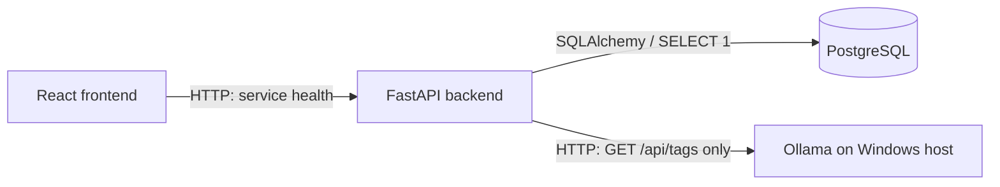

# RAGVault

A local-first AI Document Intelligence System, built incrementally as a professional portfolio project.

**Current status: Milestone 1 — Project Foundation, verified locally on 24 October 2026.** The React dashboard, FastAPI application, PostgreSQL infrastructure, Alembic configuration, and Ollama connectivity checks are implemented. PostgreSQL and Ollama connectivity, both Docker image builds, and the automated checks passed on Windows. See the [verification evidence](docs/verification.md) for exact results and remaining optional checks.

PDF uploads, document processing, embeddings, pgvector retrieval, RAG, AI chat, and authentication are **planned and not implemented**. No models or uploaded documents are required for this milestone.

## Stack and architecture

| Layer | Technology |
| --- | --- |
| Frontend | React, TypeScript, Vite, Tailwind CSS |
| Backend | Python 3.12+, FastAPI, Pydantic Settings, HTTPX |
| Database | PostgreSQL 17, SQLAlchemy 2.x, psycopg 3, Alembic |
| Local AI runtime | Ollama on the Windows host (connectivity check only) |
| Infrastructure | Dockerfiles, Docker Compose, named PostgreSQL volume |
| Checks | Pytest, Ruff, ESLint, Prettier, Vitest, TypeScript, GitHub Actions |



The default development setup runs PostgreSQL in Docker and both applications on Windows. An optional Compose `app` profile runs the backend and a built frontend in containers. Ollama stays on the host. See [architecture decisions](docs/architecture/foundation.md) and [verification evidence](docs/verification.md).


## Prerequisites

Install Python 3.12 or newer, Node.js 24 LTS with npm, Git, Docker Desktop with Linux containers and Compose v2, and Ollama for Windows. Start Docker Desktop before running Compose. Ollama must be running for an entirely healthy response, but it is optional for development and automated tests.

The commands below use **PowerShell** and assume the repository is at `C:\Projects\ragvault`. Substitute your checkout path where necessary. `npm.cmd` avoids PowerShell script execution-policy issues. Virtual environment activation is unnecessary because the commands call its Python executable directly.

Verify prerequisites:

```powershell
python --version
node --version
npm.cmd --version
git --version
docker --version
docker compose version
ollama --version
```

Expect version strings, with Python >=3.12 and Node 24 recommended. Docker must have a running engine; `docker info` should show a Server section. A missing command requires installing that prerequisite before its steps below.

## Windows setup

In a PowerShell terminal, from the repository root:

```powershell
Set-Location 'C:\Projects\ragvault'
Copy-Item .env.example .env
notepad .env
```

Set `POSTGRES_PASSWORD` to your own local password and save. The example contains a placeholder, not a real credential. Skip the copy if `.env` already exists. Do not commit `.env`.

Install the applications:

```powershell
python -m venv backend/.venv
.\backend\.venv\Scripts\python.exe -m pip install -e './backend[dev]'
npm.cmd --prefix frontend ci
```

Expect pip installation to succeed and npm to install the lockfile's dependencies. The generated `.venv` and `node_modules` are ignored by Git.

### Environment configuration

Both applications read the root `.env`. Python locates it from the source path, regardless of the working directory. Shell environment variables override `.env`. Compose substitutes root `.env` variables and passes settings into the backend container.

| Variable | Purpose / default |
| --- | --- |
| `APP_ENV` | `development`, `test`, or `production` |
| `BACKEND_HOST`, `BACKEND_PORT` | Native bind address, `127.0.0.1:8000` |
| `FRONTEND_ORIGIN` | Single allowed CORS origin, `http://localhost:5173` |
| `POSTGRES_HOST`, `POSTGRES_PORT` | Native DB connection, `localhost:5432` |
| `POSTGRES_DB`, `POSTGRES_USER` | Local database and role, both `ragvault` |
| `POSTGRES_PASSWORD` | Required, nonempty local database password |
| `DATABASE_TIMEOUT_SECONDS` | Connection, pool acquisition, and statement timeouts, default 3 |
| `OLLAMA_BASE_URL` | Native backend uses `http://localhost:11434` |
| `OLLAMA_DOCKER_BASE_URL` | Compose backend uses `http://host.docker.internal:11434` |
| `OLLAMA_TIMEOUT_SECONDS` | HTTPX connect/read/write/pool timeouts, default 3 |
| `OLLAMA_CHAT_MODEL`, `OLLAMA_EMBEDDING_MODEL` | Reserved configuration; unused in Milestone 1 |
| `LOG_LEVEL` | Application log threshold, default `INFO` |
| `VITE_API_BASE_URL` | Browser-visible API address, `http://localhost:8000` |

`localhost` and `127.0.0.1` are different CORS origins: open the frontend at `http://localhost:5173`, or update `FRONTEND_ORIGIN` to match the URL you use. CORS does not use a wildcard. Vite exposes `VITE_*` values to the browser; never put secrets there. Restart native apps after changing settings. Rebuild the containerized frontend after changing `VITE_API_BASE_URL` because Vite embeds it at build time. If changing the backend port, update the browser API URL too.

### Start PostgreSQL

From the repository root:

```powershell
docker compose config --quiet
docker compose up -d --wait postgres
docker compose ps
docker compose exec postgres sh -c 'pg_isready -U "$POSTGRES_USER" -d "$POSTGRES_DB"'
```

Expect `config --quiet` to exit 0 without output, PostgreSQL to become `healthy`, and `pg_isready` to report `accepting connections`. PostgreSQL binds only to loopback and persists data in the `ragvault_postgres_data` named volume.

Initialize and verify the migration environment:

```powershell
Set-Location backend
.\.venv\Scripts\python.exe -m alembic upgrade head
.\.venv\Scripts\python.exe -m alembic current
.\.venv\Scripts\python.exe -m alembic check
```

Expect all commands to exit 0. There are **no application tables or migration revisions yet**, so `current` has no revision ID to print. `upgrade head` verifies connectivity and prepares Alembic's version tracking table. `check` should report `No new upgrade operations detected.` Models and meaningful schema revisions belong to later milestones; no empty initial revision is created.

### Start Ollama

The Windows Ollama app normally serves in the background. Check it in another terminal:

```powershell
Invoke-RestMethod 'http://localhost:11434/api/tags'
```

Expect a response with a `models` array; an empty array is valid. If the service is stopped, launch the installed Ollama app or run `ollama serve` in a separate terminal. If `ollama serve` reports the address is already in use, check `/api/tags` because another Ollama process may already be serving. **Do not pull models for Milestone 1**: connectivity does not require one.

### Start the backend (terminal 1)

```powershell
Set-Location 'C:\Projects\ragvault\backend'
.\.venv\Scripts\python.exe -m app --reload
```

Expect `Application startup complete` and Uvicorn listening on `http://127.0.0.1:8000`, plus JSON application lifecycle logs. Startup creates reusable clients but makes no dependency connections. A stopped database or Ollama does not prevent startup. The factory can also be run through `python -m uvicorn app.main:create_app --factory`; the supplied `python -m app` entry point applies the configured host and port.

### Start the frontend (terminal 2)

```powershell
Set-Location 'C:\Projects\ragvault\frontend'
npm.cmd run dev
```

Expect a Vite ready message on port 5173. Open [the dashboard](http://localhost:5173). It checks the API immediately, every 30 seconds, and when you press Refresh. It displays actual dependency states and distinguishes an unreachable backend from an HTTP 503 dependency failure. Documents and Chat are explanatory sections with planned badges, without upload or chat controls.

### Verify the API (terminal 3)

```powershell
Set-Location 'C:\Projects\ragvault'
curl.exe -i http://localhost:8000/
curl.exe -i http://localhost:8000/api/health
```

Expect root HTTP 200 with `name`, `status: ok`, and the configured `environment`. With PostgreSQL and Ollama available, expect health HTTP 200:

```json
{
  "status": "ok",
  "application": "ok",
  "database": { "status": "connected" },
  "ollama": { "status": "connected" }
}
```

If a dependency is unavailable, expect HTTP 503 and a structured body such as:

```json
{
  "status": "degraded",
  "application": "ok",
  "database": { "status": "connected" },
  "ollama": {
    "status": "unavailable",
    "detail": "Ollama connectivity check failed"
  }
}
```

The API remains running. Application logs identify the dependency and error class without exposing passwords, connection strings, or service response bodies. Health means connectivity, not model availability or successful AI inference. Interactive API documentation is at [Swagger UI](http://localhost:8000/docs).

To verify database failure and recovery while the applications remain running:

```powershell
docker compose stop postgres
curl.exe -i http://localhost:8000/api/health
docker compose up -d --wait postgres
curl.exe -i http://localhost:8000/api/health
```

Expect the first health response to be HTTP 503 with `database.status: unavailable`. After recovery it should return `connected`; the overall status returns to `ok` when Ollama is also available. Refresh the dashboard to verify the same behavior. Ollama failure handling is also covered by mocked tests, so there is no need to interrupt an Ollama process used by other applications.

## Tests and static checks

Backend (no real PostgreSQL or Ollama required):

```powershell
Set-Location 'C:\Projects\ragvault\backend'
.\.venv\Scripts\python.exe -m pytest
.\.venv\Scripts\python.exe -m ruff check .
.\.venv\Scripts\python.exe -m ruff format --check .
.\.venv\Scripts\python.exe -m pip check
.\.venv\Scripts\python.exe -m alembic history
```

Expect all tests to pass, Ruff `All checks passed!`, formatting already compliant, and pip `No broken requirements found.` Alembic history exits 0 with no revisions. Unlike tests, Alembic reads the required password from your `.env`. See [verification evidence](docs/verification.md) for the exact observed results and upstream warning.

Frontend:

```powershell
Set-Location 'C:\Projects\ragvault\frontend'
npm.cmd run lint
npm.cmd run format:check
npm.cmd test
npm.cmd run typecheck
npm.cmd run build
```

Expect lint/typecheck to exit 0 without diagnostics, Prettier to report matching formatting, all five API client tests to pass, and Vite to create `dist/`. Optionally run `npm.cmd run preview` after stopping the dev server to inspect the production build at the same frontend URL.

GitHub Actions runs these checks on Linux, plus real PostgreSQL connectivity, Alembic checks, Compose validation, and both container builds. It does not need Ollama. Workflow execution must be verified after pushing to GitHub; generating the workflow does not prove it passes.

## Optional: containerized applications

Stop the native backend and frontend first to free ports 8000 and 5173. Keep Ollama on Windows. From the repository root:

```powershell
Set-Location 'C:\Projects\ragvault'
docker compose --profile app config --quiet
docker compose --profile app up -d --build --wait
docker compose --profile app ps
docker compose --profile app exec backend python -m alembic upgrade head
docker compose --profile app exec backend python -m alembic check
curl.exe -i http://localhost:8000/api/health
```

Expect three healthy containers and the same dashboard and API URLs. The backend container uses Compose hostname `postgres` and internal port 5432, while its Ollama check uses `host.docker.internal`. A browser still connects to `localhost:8000`; Docker service names are not browser addresses. Container health probes use application liveness so temporary Ollama failure does not mark the API container unhealthy. `/api/health` remains the dependency readiness check.

If containerized Ollama connectivity fails but native connectivity works, verify the host service's bind address and Windows firewall configuration; Docker Desktop's host reachability depends on those settings. The dashboard should remain usable and report Ollama as unavailable. Prefer the native backend setup until host connectivity is configured. Do not expose the Ollama service publicly.

Stop the stack while preserving database data:

```powershell
docker compose --profile app down
```

The named volume is retained. Changing `POSTGRES_PASSWORD` in `.env` after the volume was initialized does not change the existing PostgreSQL role password. Update the existing role deliberately or restore the original local password; this guide does not erase your volume.

## Repository layout

```text
RAGVault/
├── .github/workflows/ci.yml
├── backend/
│   ├── app/
│   │   ├── api/health.py
│   │   ├── core/{config,logging}.py
│   │   ├── db/{base,session}.py
│   │   ├── schemas/health.py
│   │   ├── services/ollama.py
│   │   ├── __init__.py
│   │   ├── __main__.py
│   │   └── main.py
│   ├── tests/{conftest,test_config,test_health,test_lifecycle,test_logging,test_ollama}.py
│   ├── alembic/
│   │   ├── env.py
│   │   ├── script.py.mako
│   │   └── versions/README.md
│   ├── alembic.ini
│   ├── pyproject.toml
│   ├── .dockerignore
│   └── Dockerfile
├── frontend/
│   ├── src/
│   │   ├── components/{AppShell,Icon,StatusBadge}.tsx
│   │   ├── hooks/useHealth.ts
│   │   ├── lib/{api.ts,api.test.ts}
│   │   ├── pages/DashboardPage.tsx
│   │   ├── types/health.ts
│   │   ├── main.tsx
│   │   └── styles.css
│   ├── public/favicon.svg
│   ├── index.html
│   ├── package.json
│   ├── package-lock.json
│   ├── tsconfig{,.app,.node}.json
│   ├── vite.config.ts
│   ├── eslint.config.js
│   ├── .prettierrc.json
│   ├── .prettierignore
│   ├── .dockerignore
│   ├── nginx.conf
│   └── Dockerfile
├── docs/
│   ├── architecture/foundation.md
│   ├── screenshots/foundation.png
│   └── verification.md
├── .env.example
├── .gitattributes
├── .gitignore
├── docker-compose.yml
└── README.md
```

Python subpackages also contain `__init__.py` files. Generated files and local settings are omitted. Empty `models`, `features`, `data/uploads`, and `scripts` directories are intentionally not committed; they will be added when there is an implementation to put in them. Uploaded documents and local generated data are already ignored.

## Milestone 1 verification checklist

- [x] Prerequisite versions are available and Docker Desktop is running.
- [x] Local `.env` is configured, unchanged during verification, and ignored by Git.
- [x] PostgreSQL container is healthy and uses the existing named volume.
- [x] Alembic upgrade/current/check/history succeed against the running database.
- [x] Backend liveness during dependency failures is covered by passing tests.
- [x] Live health returns 200 with both dependencies connected.
- [x] Structured 503 responses and recovery are covered by passing tests.
- [x] Dashboard reflects actual connectivity, Refresh works, and planned areas are explicit.
- [x] Backend and frontend tests, lint, formatting, typecheck, and build pass.
- [x] Both Docker images build; backend connectivity and frontend HTTP container smoke checks pass.
- [ ] Optional full Compose application profile is exercised together on published ports.
- [ ] GitHub Actions has passed after pushing the repository.
- [x] No uploads, processing, embeddings, retrieval, AI chat, or authentication have been added.

The local Milestone 1 setup is verified and ready for Milestone 2. The optional combined container deployment and remote GitHub Actions execution remain separate checks; Milestone 2 has not been started.
