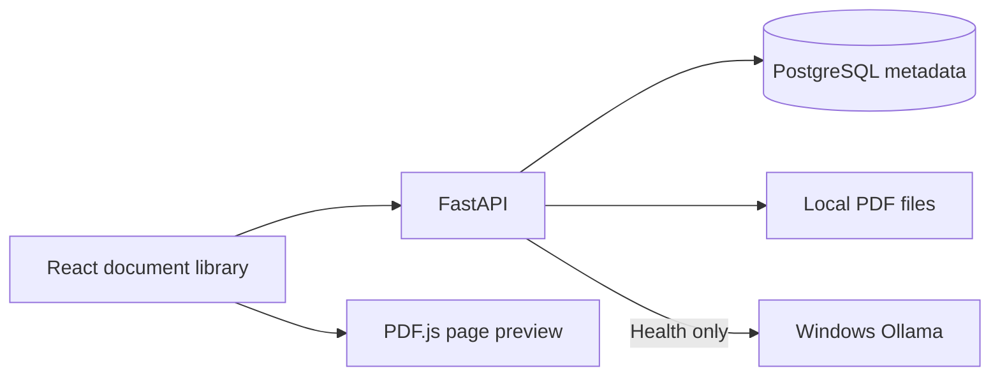

# RAGVault

A local-first document intelligence portfolio project, built in explicit milestones.

**Current milestone: 3 — PDF Text Extraction and Chunking.** Organize collections, upload validated PDFs, preview originals, and process documents into page-aware text chunks. Inspect extracted text, retry failures, reprocess, rename, download and delete files. The dashboard still reports FastAPI, PostgreSQL, and Ollama health.

**Single user. Local machine only. No authentication. Do not expose this service publicly.** OCR, embeddings, pgvector retrieval, RAG, AI chat, and background queues are not implemented.


See [PDF processing architecture](docs/architecture/pdf-processing.md), [Milestone 3 verification](docs/verification-milestone-3.md), [document-library foundations](docs/architecture/document-library.md), [Milestone 2 verification](docs/verification-milestone-2.md), and the [historical Milestone 1 report](docs/verification.md).

## Stack

- Python 3.12+, FastAPI, Pydantic Settings, SQLAlchemy 2.x, psycopg, PostgreSQL 17, Alembic.
- PyMuPDF validates uploads; original PDFs live on disk rather than in PostgreSQL.
- React, TypeScript, Vite, Tailwind CSS, React Router, and PDF.js preview.
- Docker Compose, Pytest, Ruff, Vitest, React Testing Library, ESLint, Prettier, and GitHub Actions.
- Ollama runs on Windows for connectivity checks only; models are not invoked in this milestone.



## Features and policies

- Collections use UUIDs, trimmed names up to 120 characters, UTC timestamps, and case-insensitive unique names. Only empty collections can be deleted; otherwise the API returns 409.
- Documents have UUIDs, collection relationships, display names, internal UUID storage keys, byte sizes, fixed PDF MIME, SHA-256 checksums, status, and UTC timestamps. Internal paths are not exposed by metadata responses.
- Identical bytes in the same collection return 409, even with another filename. The same PDF in another collection is allowed and stored independently. Rename preserves bytes and checksum.
- Uploads start as `uploaded`. Explicit processing transitions through `processing` to `processed`, `no_text` or `failed`. Retry and reprocessing replace chunks atomically. No status means embedded, indexed or RAG-ready.
- Upload validation checks extension, safe display name, byte limit, PDF header, PyMuPDF structure/repair state, encryption, and page count. Client MIME is ignored. Path components from upload filenames are discarded; rename inputs reject path separators and control characters.
- The browser offers accessible dialogs, file selection and drag/drop, a clear uploading indicator, loading/empty/error states, collection filtering, pagination, confirmation before deletion, and a local PDF.js page preview. Original download remains available.

## Text processing and inspection

Use **Process document** in the library. Processing is synchronous and bounded; it does
not run automatically during upload. PyMuPDF reads stored PDFs page by page, normalizes
whitespace and produces character-based chunks within individual pages. The inspector
shows one-based PDF page numbers and paginated source text rendered as plain text.
Image-only PDFs finish as **No extractable text**; OCR is not included.

Defaults are 1,200 characters per chunk with up to 200 characters of overlap, a
60-second parser timeout, 100,000 raw characters per page, 1,000,000 raw characters per
document and 5,000 chunks. Set `CHUNK_SIZE_CHARS`, `CHUNK_OVERLAP_CHARS`,
`PROCESSING_TIMEOUT_SECONDS`, `MAX_PAGE_TEXT_CHARS`, `MAX_EXTRACTED_CHARS` and
`MAX_DOCUMENT_CHUNKS` in your existing `.env` only if you want different limits.
Overlap must be smaller than chunk size. Character counts are not model token counts.

- `POST /api/documents/{id}/process`: process, retry or replace an extraction.
- `GET /api/documents/{id}/processing`: current lifecycle metadata.
- `GET /api/documents/{id}/chunks?limit=20&offset=0`: deterministic ordered chunks,
  optionally filtered with `page_number`; maximum page size is 100.

Reprocessing first invalidates old chunks, then atomically commits all replacement
chunks with the final status. Failures retain the original PDF and a safe retry message.
Only one parser runs per API process. Active duplicate attempts and deletion while
processing return 409. A claim interrupted by a crash can be retried after the timeout
plus 60 seconds; use **Retry expired processing** or the same process endpoint.
Paragraph/layout detection is heuristic, chunks do not cross pages, and no OCR, embeddings,
search, model execution or AI chat is performed. See the architecture for resource limits,
restart behavior and future pgvector integration.

## Windows setup or upgrade from earlier milestones

Prerequisites: Python 3.12+, Node.js 24 with npm, Git, Docker Desktop with Linux containers/Compose, and optionally running Ollama for a completely healthy dashboard. The tested workstation uses Python 3.12.10 and Node 24.16.0. No new Ollama models are needed.

Commands below are PowerShell. Substitute your checkout path. Existing `.env` settings and database volumes should be retained. `npm.cmd` avoids PowerShell execution-policy problems, and direct virtual-environment Python paths avoid activation requirements.

```powershell
Set-Location 'C:\Projects\ragvault'
if (-not (Test-Path .env)) { Copy-Item .env.example .env }
# On a new checkout, edit .env and set your own POSTGRES_PASSWORD.
# Keep an existing configured .env unchanged unless you want different settings.
if (-not (Test-Path backend/.venv/Scripts/python.exe)) { python -m venv backend/.venv }
.\backend\.venv\Scripts\python.exe -m pip install -e './backend[dev]'
npm.cmd --prefix frontend ci

docker compose --profile app config --quiet
docker compose up -d --wait postgres
Set-Location backend
.\.venv\Scripts\python.exe -m alembic upgrade head
.\.venv\Scripts\python.exe -m alembic current
.\.venv\Scripts\python.exe -m alembic check
```

Expect PostgreSQL to become healthy, revision `0002_document_processing (head)`, and `No new upgrade operations detected.` Startup never creates tables or runs migrations automatically. The new additive migration extends document statuses and adds `document_chunks`; it preserves existing collections, documents, PDFs and database volumes.

Start the backend in one terminal:

```powershell
Set-Location 'C:\Projects\ragvault\backend'
.\.venv\Scripts\python.exe -m app --reload
```

Start the frontend in another:

```powershell
Set-Location 'C:\Projects\ragvault\frontend'
npm.cmd run dev
```

Open [the dashboard](http://localhost:5173) or [document library](http://localhost:5173/documents). Create a collection before uploading a PDF. Expect the library to list the validated original with Uploaded status. Preview, rename, download, and delete operate on real stored files. Delete each document before deleting its collection.

The `predev` and `prebuild` scripts copy PDF.js fonts, character maps, and codecs from node_modules to ignored `frontend/public/pdfjs`. The worker and renderer are bundled locally. No CDN, hosted AI service, or model download is used.

## Configuration

Both apps read the root `.env`; shell environment values take precedence. Existing configuration continues to work. New settings have defaults and do not require overwriting `.env`.

| Setting | Default / behavior |
| --- | --- |
| `APP_ENV` | `development`; also accepts `test` and `production`, without adding authentication |
| `BACKEND_HOST`, `BACKEND_PORT` | `127.0.0.1`, `8000`; keep the bind local |
| `FRONTEND_ORIGIN` | `http://localhost:5173`; exact allowed browser origin |
| `POSTGRES_HOST`, `POSTGRES_PORT` | `localhost`, `5432` in native mode |
| `POSTGRES_DB`, `POSTGRES_USER`, `POSTGRES_PASSWORD` | Existing database/role; password is required and private |
| `DATABASE_TIMEOUT_SECONDS` | 3 seconds |
| `UPLOAD_DIR` | `<repository>/data/uploads`; relative paths resolve against the repository root |
| `MAX_UPLOAD_BYTES` | 26214400 (25 MiB), enforced per PDF |
| `MAX_PDF_PAGES` | 2000 |
| `PDF_VALIDATION_TIMEOUT_SECONDS` | 15 seconds; synchronous parser subprocess deadline |
| `OLLAMA_BASE_URL` | Native backend uses `http://localhost:11434` |
| `OLLAMA_DOCKER_BASE_URL` | Container backend uses `http://host.docker.internal:11434` |
| `OLLAMA_CHAT_MODEL`, `OLLAMA_EMBEDDING_MODEL` | Reserved settings; configured model names do not trigger processing |
| `OLLAMA_TIMEOUT_SECONDS`, `LOG_LEVEL` | 3 seconds, `INFO` |
| `VITE_API_BASE_URL` | `http://localhost:8000`; public build-time setting, never a place for secrets |

An additional 64 KiB bounds multipart overhead. The entire request is limited before/during form parsing, then the file limit is enforced again while copying in chunks. PyMuPDF runs in a synchronous subprocess with a wall-clock deadline, avoiding unsafe concurrent thread use and isolating parser crashes from the API. Its memory buffer is bounded by file size; raising the limit increases memory use. Header bytes must start with `%PDF-`; PDFs requiring repair are rejected. Encryption is rejected even if opening needs no user password.

Use `http://localhost:5173`, matching CORS; `127.0.0.1` is a different origin. Browser POST/PATCH/DELETE requests with an unapproved Origin are rejected, and Host headers are restricted to local names. Native clients without Origin remain usable. These controls do not replace authentication or permit public deployment.

## API

[Swagger documentation](http://localhost:8000/docs) describes the schemas and multipart input. Upload exactly one file in the `file` field.

| Method | Route | Behavior |
| --- | --- | --- |
| GET | `/` | Application liveness |
| GET | `/api/health` | Dependency health: 200 healthy, structured 503 degraded |
| GET | `/api/library/config` | Public upload/page limits |
| GET | `/api/collections` | Collections with current document counts |
| POST | `/api/collections` | Create using `{ "name": "Research" }` |
| PATCH | `/api/collections/{id}` | Rename using `{ "name": "References" }` |
| DELETE | `/api/collections/{id}` | Delete only when empty; 204 or 409 |
| POST | `/api/collections/{id}/documents` | Upload PDF as multipart `file`; 201 |
| GET | `/api/documents` | Paginated metadata; optional `collection_id`, `limit` (1–100, default 20), `offset` |
| GET | `/api/documents/{id}` | One document's metadata |
| PATCH | `/api/documents/{id}` | Rename using `{ "filename": "report.pdf" }` |
| GET | `/api/documents/{id}/file` | Stream original PDF inline |
| GET | `/api/documents/{id}/file?download=true` | Download the original |
| DELETE | `/api/documents/{id}` | Remove metadata and stored PDF; 204 |

Common errors: 404 missing collection/document/file, 409 duplicate content/name or nonempty collection, 413 oversized upload, 415 unsupported filename/type, 422 invalid signature/PDF/encryption/pages/validation, 403 unapproved browser write origin, and 503 dependency/storage failure. Library operation errors include safe `detail.code` and `detail.message`; standard Pydantic field-validation errors retain FastAPI's validation format.

Verify services without exposing settings:

```powershell
curl.exe -i http://localhost:8000/api/health
Invoke-RestMethod 'http://localhost:11434/api/tags'
```

Healthy output has application `ok`, database `connected`, and Ollama `connected`. Ollama failure does not disable document management. PostgreSQL and file storage must be available for library operations.

## Storage, consistency, and security

Original PDFs are stored as `<uuid hex>.pdf`, with `.tmp` staging and `.trash` quarantine directories below the configured root. The client never supplies an internal storage path. There is no static directory exposing arbitrary files. Controlled serving sends safe disposition headers, PDF MIME, nosniff, no-store, and a frame-ancestor policy. PDF.js renders pages without annotation, scripting, or XFA layers; advanced interactive PDF features remain available only in the downloaded original.

Upload failures roll back metadata and clean up staged/promoted files. Duplicate constraints are checked before promotion. Deletion quarantines a file, commits metadata removal, then unlinks it; a failed database deletion restores the original file. Collection locking and a restricted foreign key prevent unsafe collection removal. Logs identify safe error classes rather than leaking connection strings or raw database exceptions.

SQL and files cannot form one atomic transaction. Hard crashes, ambiguous commits, or disk/recovery failures can leave files requiring operator reconciliation; no startup routine automatically deletes them. Quarantined filenames retain their storage keys for recovery. Back up PostgreSQL and the upload directory together with writers stopped. If Windows blocks a move while another client is downloading, deletion returns an error and can be retried after that download ends.

PDF validation is not malware scanning, content sanitization, or proof of safety. Files remain untrusted; the parser subprocess has a timeout but no OS memory/CPU sandbox or reduced filesystem privileges. Upload storage is not encrypted by the app. Preview is one page at a time with a bounded canvas; original-file streaming does not offer range/resume support. There is no authentication, OCR, full-text search, embedding, retrieval, or AI chat. Extraction has additional timeout, page/text/output/concurrency limits; the Linux child has a 1 GiB address-space ceiling. Windows transient page memory is not hard-capped. See the processing architecture for details.

## Tests and quality checks

Backend tests use temporary SQLite databases and temporary upload directories, never your real uploads. Direct `create_all` exists only in isolated fixtures. Live verification separately checks the Alembic-managed PostgreSQL schema. The non-blocking upstream Starlette TestClient HTTPX deprecation warning is recorded in the verification report.

```powershell
Set-Location 'C:\Projects\ragvault\backend'
.\.venv\Scripts\python.exe -m pytest
.\.venv\Scripts\python.exe -m ruff check .
.\.venv\Scripts\python.exe -m ruff format --check .
.\.venv\Scripts\python.exe -m pip check
Set-Location ../frontend
npm.cmd run lint
npm.cmd run format:check
npm.cmd test
npm.cmd run typecheck
npm.cmd run build
```

Expect passing tests, no lint/type errors, compliant formatting, consistent Python dependencies, and a Vite `dist/` build including local PDF.js assets. GitHub Actions runs these checks, real PostgreSQL migration/schema checks, and container builds after push; remote execution is not implied by local success.

## Optional Docker application mode

Stop native servers before publishing the same ports. Keep existing `.env`, PostgreSQL volume, and upload directory. The backend's nonroot user needs write access to the mounted upload directory. Native and Docker application modes should not write the same library concurrently.

```powershell
Set-Location 'C:\Projects\ragvault'
docker compose --profile app config --quiet
docker compose up -d --wait postgres
docker compose --profile app build
docker compose --profile app run --rm backend python -m alembic upgrade head
docker compose --profile app up -d --wait
```

The same URLs apply. Backend storage is `/app/data/uploads`, bind-mounted from `./data/uploads`; PostgreSQL uses its existing named volume. Host Ollama is addressed through `host.docker.internal`. Frontend API settings are baked into the image and require a rebuild if changed. Application health probes use liveness, while `/api/health` checks dependencies. To stop containers without deleting volumes, run `docker compose --profile app down`; never add volume-deletion options unless intentionally discarding data.

## Repository orientation

- `backend/app/api`: health, collection, document, file-serving, and public-limit routes.
- `backend/app/models`, `schemas`, `services`: SQLAlchemy metadata, validation/response schemas, file storage, and transactional library operations.
- `backend/app/core`: settings, structured logging, upload-body bounds, and local browser-origin enforcement.
- `backend/alembic`: the explicit library and page-aware processing migrations.
- `backend/tests`: isolated health/configuration, collection/document CRUD, PDF validation, cleanup, persistence, and failure tests.
- `frontend/src/pages`: overview and document library; `features/documents`: dialogs and lazy PDF renderer.
- `frontend/src/lib`, `hooks`, `types`: typed API client, state/loading/cancellation, and shared types.
- `frontend/scripts/copy-pdf-assets.mjs`: local preview resource preparation.
- `docs/architecture`, `docs/screenshots`: current design and actual verification captures.

The root `.env`, virtual environments, data/uploads, caches, build output, generated PDF.js resources, and local `.artifacts` are ignored. `.env.example`, source, migrations, tests, package lockfile, documentation, and screenshots belong in Git. No Milestone 3 commit or push is created without approval.
