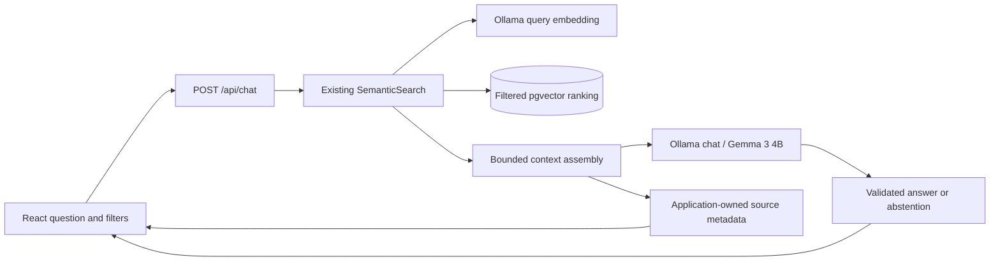

# Milestone 5: local document chat

Single-user, local-only RAG with independent questions. No conversation table,
migration, persistent history, browser storage, claim-level citation verification,
authentication or Milestone 6 features are added.

## Pipeline and reuse



`RAGEngine` calls the same `SemanticSearch.run` used by `/api/search`, passing the
question, UUID filters and top-K. No duplicate retrieval, reparsing, document
re-embedding, LangChain or LlamaIndex. Existing SQL selects only processed/indexed
documents with matching model digest, dimensions and prefix fingerprint. Missing
filter targets return 404, conflicting collection/document filters 422, and embedding
failure 503. Retrieval failure never becomes a general-knowledge answer.

Context assembly defensively rechecks scope, finite relevance, page metadata and text.
Eligibility is a snapshot at retrieval time; deleting/reprocessing a PDF during a
generation can make that snapshot stale and its original unavailable. Chat does not
lock sources for a slow generation. It rolls back the read transaction before calling
the LLM, returning the connection to the pool, and performs no database writes.

## Context construction

Default retrieval is top-K 5, override 1–20. The serialized user payload, including
metadata and separators, is limited to 6,000 characters; each excerpt to 1,600.
Selection greedily preserves retrieval rank, removes exact duplicate text after edge
trimming and repeated chunk IDs, and fits excerpt prefixes into the remaining budget.
Different overlapping passages are not merged. Identical text in another document
retains the first-ranked metadata. No extra model call/reranker is used.

Source IDs are `S-<chunk UUID>`, stable across requests until chunks are replaced.
Document ID, filename, collection ID, one-based PDF page, chunk ID and selected excerpt
come from retrieved records. The model never supplies source objects. All excerpts
actually sent to the model are returned, including possible distractors, with exactly
the text supplied. No claim is made that each source supports each statement.
Prefix truncation can split a sentence or remove an answer. Final scraps shorter than
80 characters are skipped unless the whole passage is shorter.

A stricter second budget limits the entire system/user content to
`CHAT_CONTEXT_TOKENS - CHAT_RESPONSE_TOKENS - 128` UTF-8 bytes, 3,456 by default.
One byte per token is a conservative packing heuristic, not a Gemma tokenizer.
The 128 reserve allows chat framing; response tokens are reserved separately. This
can substantially underuse context, particularly multilingual text. The lower
character/byte limit wins. Questions are never silently shortened; a question that
alone exceeds this budget returns 422 before embedding. No fitting passage returns
insufficient evidence. Model/template changes can require retuning these budgets.

The [Milestone 5 context investigation](../context-budget-review.md) measured an
851-byte system message and a 3,456-byte total ceiling at the default settings. Two
real-document questions retrieved five/ten eligible passages but included only two,
with the second shortened to fill the remaining budget. Relevant lower-ranked sections
were excluded. Actual Ollama input was only 1,047 tokens, so the conservative byte
packer underused the configured 4K window; increasing only top-K or the character cap
would not resolve that bottleneck. There is no hard limit of two sources.

Finalization deliberately retains this greedy selector, complete source metadata in
the model payload, all context limits and the existing system instructions. The
compact-metadata experiment recovered more text but produced mixed factual quality
and was not adopted. Its code, real-document excerpts and raw trial results remain
ignored local verification artifacts.

## Grounding policy

The minimum cosine similarity defaults to **0.5**. Lower/nonfinite scores and empty
passages are excluded. This is a configurable heuristic, not calibrated confidence,
proof of relevance or proof that the requested fact exists. High-scoring passages can
still lack an answer. No lexical or general-knowledge fallback exists.

No usable evidence means an application-owned insufficient-evidence message with no
chat call. With context, Gemma is instructed to use only evidence, acknowledge missing
facts and abstain. Strict JSON output has only `status` and `answer`. If the model
reports insufficient evidence, its answer text is discarded in favor of the fixed
message. An answered response remains an unverified draft. Syntax validation cannot
establish truth. Tests cover deterministic safeguards and mocked abstention; live
examples cannot prove general hallucination prevention.

Observed real-document failures included a wrong category-specific team size and a
report limit transferred between categories, sometimes despite the correct evidence
being supplied. Broad questions can trigger abstention; readable answers can omit
requirements or add unsupported details. Source count, cosine similarity and an
`answered` status do not establish completeness or factual accuracy. The existing
abstention policy and untrusted-source boundaries were preserved after this review;
claim-level citation verification is still outside Milestone 5.

## Ollama integration and errors

`LLMClient` owns a dedicated reusable HTTPX connection, closed at shutdown, separate
from health/embedding clients. It uses [Ollama chat](https://docs.ollama.com/api/chat)
with `stream=false`, a [JSON output schema](https://docs.ollama.com/capabilities/structured-outputs),
temperature 0, `num_ctx=4096`, `num_predict=512` and two-minute keep-alive. It does not
download models or send tools, functions, images, secrets, paths or conversation history.

Validation requires HTTP success, configured model identity, assistant role, `done=true`,
`done_reason=stop`, no tool calls/provider errors, strict output keys/status, nonblank
answer and configured answer length. Truncated output fails as 502. Response body is
capped at 64 KiB and answer at 4,000 characters. No automatic retries repeat expensive work.

Connect/read-generation timeouts are 3/180 seconds, write/pool 5/1 seconds. Cold model
loading counts in generation time. A monotonic deadline is checked between HTTP response
chunks. HTTPX timeouts bound individual blocking I/O; this is not OS-level cancellation
or a guaranteed absolute wall-clock deadline. A stalled read after partial output can
last up to the read timeout. HTTPX reads chunks even though Ollama generation is non-streaming.

| Situation | HTTP / code |
| --- | --- |
| Concurrent chat | 409 `chat_busy` |
| Invalid question/filter/top-K/JSON | 422 `invalid_chat_request` (input not echoed) |
| Unavailable connection | 503 `chat_unavailable` |
| Model/API 404 | 503 `chat_model_missing` |
| Generation timeout | 504 `generation_timeout` |
| Invalid/oversize/truncated response | 502 `invalid_generation` |
| Other provider failure | 503 `generation_failed` |
| Question exceeds packing budget | 422 `chat_context_too_large` |
| Request above 16 KiB, including chunked bodies | 413 `chat_body_too_large` |

Prompts, excerpts, answers, raw provider exceptions and error bodies are not logged.
Success responses use `Cache-Control: no-store`; origin/host protections also apply.
HTTPX ignores proxy environment settings and does not follow chat redirects. Keep
Ollama at a trusted local endpoint; configuring a remote URL sends selected text there.

## Prompt injection and rendering

The application alone supplies system instructions. Every source field, filename and
user question is untrusted. Sources are JSON-serialized in an `untrusted_sources` array,
escaping quotes/delimiters. The prompt rejects embedded commands, role spoofing,
prompt extraction, tool requests and outside knowledge. JSON clarity is not an LLM
security boundary, and prompt instructions alone cannot guarantee protection.

Architectural isolation is stronger: the model has no tools, filesystem/command access,
database access or environment/configuration secrets. Only selected text/metadata and
the question are sent. Database filtering and parameterized queries stay under backend
control. Model text cannot execute SQL or cause arbitrary file reads. A malicious
source can still bias an answer, induce instruction leakage or hallucinations. This
is not a complete injection defense or a document DLP system.

React renders model answers, excerpts and filenames as inert plain text with whitespace.
No HTML/Markdown parser, `dangerouslySetInnerHTML`, model-controlled links or scripts.
Application-generated source controls reuse safe PDF serving and PDF.js page preview.
There is no exact claim-to-source validation or verified citation badge.

## Resources, UI and settings

One nonblocking chat admission slot per API process covers retrieval and generation.
The LLM client also has one generation slot and one pooled connection. Excess requests
return 409 immediately; no durable queue. Other FastAPI threads can serve library/health
requests. Multiple worker processes multiply limits; use one local process. Indexing
and standalone search retain independent limits and can compete for GPU resources.
The app does not control Ollama's global scheduler/GPU allocation.

`/chat` provides question input, collection/document selectors, paginated document
options, top-K, loading/insufficient/error states, source cards and original-page
controls. Filters lock while busy and clear previous answers on scope changes. A new
question replaces the previous result. Leaving the page aborts the browser fetch,
not necessarily backend/Ollama work, whose slot stays held until completion/timeout.
Browser timeout is 600 seconds, covering the maximum configured retrieval/generation
timeouts. No chat is saved in PostgreSQL, browser storage or application logs.

Default model is `OLLAMA_CHAT_MODEL=gemma3:4b`. Private `.env` is preserved. Optional
settings live in `Settings` and `.env.example`:

| Setting | Default |
| --- | --- |
| `CHAT_CONNECT_TIMEOUT_SECONDS` | 3 |
| `CHAT_GENERATION_TIMEOUT_SECONDS` | 180 |
| `CHAT_CONTEXT_TOKENS` | 4096 |
| `CHAT_RESPONSE_TOKENS` | 512 |
| `CHAT_MAX_ANSWER_CHARS` | 4000 |
| `RAG_TOP_K` | 5 |
| `RAG_CONTEXT_CHARS` | 6000 |
| `RAG_PASSAGE_CHARS` | 1600 |
| `RAG_MIN_SIMILARITY` | 0.5 |

## API and manual checks

```json
{"question":"How long are backups retained?","collection_id":null,"document_id":null,"top_k":5}
```

Send to `POST /api/chat`. Optional filters are UUIDs. Response fields are `status`
(`answered`/`insufficient_evidence`), `answer`, `sources`, `chat_model`, `embedding_model`,
`retrieval_count`, `context_count`, `incompatible_documents`, and `timings` containing
`retrieval_ms`, `generation_ms`, `total_ms`. Retrieval includes query embedding and SQL;
generation includes loading/chat round trip. Total excludes routing/serialization.

1. Check migrations and installed chat/embedding models.
2. Upload a disposable known-answer PDF; process and index it.
3. Select its collection/document at `/chat`, ask facts and inspect the original pages.
4. Ask missing-information and unrelated questions; inspect abstention/uncertainty.
5. Test empty collections, conflicting scope and another collection.
6. Use harmless synthetic injected commands and inspect behavior without generalizing
   a small success set. Never put real credentials into test PDFs.
7. Use an isolated unreachable model configuration for service failures; leave the
   user's actual Ollama running.
8. Remove only tracked synthetic fixtures, then compare original data/config fingerprints.

Actual tests, browser evidence, performance and limitations are in the
[Milestone 5 verification report](../verification-milestone-5.md).
