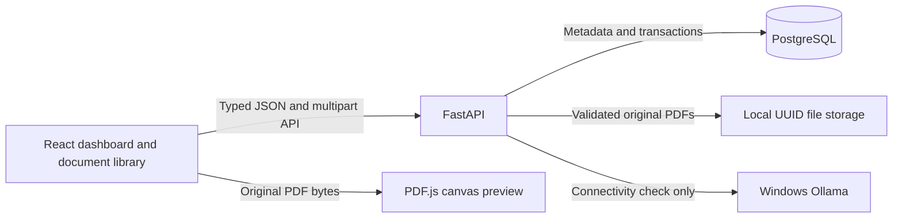
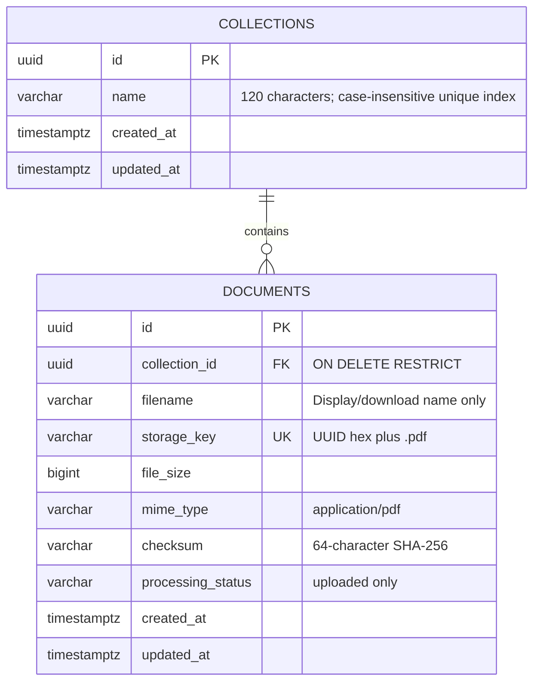

# Milestone 2: local PDF document library

RAGVault is a **single-user, local-only application**. It has no authentication or tenant isolation. Keep the API, frontend, PostgreSQL, and Ollama bound to the local machine; do not expose this milestone publicly.

## Data model

Migration `0001_document_library` adds the two tables. Alembic imports the same model metadata as the application. Startup does not create tables or run migrations. Positive file sizes, checksum length, MIME type, status, unique storage keys, and per-collection checksum uniqueness are enforced in the database. Collection names have a unique lower-case index. Documents also have collection and creation-order indexes.

Timestamps are UTC and PostgreSQL uses timezone-aware columns. Updated timestamps change when names are modified; collection document counts are computed from current rows rather than persisted counters.

## Upload lifecycle

1. Reject unexpected browser write origins and untrusted Host headers. CORS allows only the configured frontend origin. Native clients without Origin remain supported.
2. Bound the entire multipart request, including chunked requests, to `MAX_UPLOAD_BYTES + 64 KiB`. This limits framework spool use; the file itself is separately limited to `MAX_UPLOAD_BYTES`.
3. Verify the collection exists, then copy the spooled file to a unique `.tmp` file in 1 MiB chunks while enforcing its byte limit and computing SHA-256.
4. Treat the client filename as display data only: strip upload path components, reject unsafe/control characters, require `.pdf`, and enforce the name length. Never use it as a storage path. Ignore client MIME claims.
5. Require `%PDF-` at byte zero. A synchronous subprocess runs PyMuPDF against the size-bounded PDF buffer, checking PDF identity, encryption dictionary/password state, repair state, page count, and page tree. The parent waits with `PDF_VALIDATION_TIMEOUT_SECONDS` (default 15), kills a hung child, and returns a safe error. Each parser has its own process because PyMuPDF does not support concurrent thread use. This is immediate request validation, with no background queue. Encrypted, empty, repaired, damaged, and over-limit files are rejected. No text extraction, rendering, chunking, or embeddings run on the backend.
6. Lock the collection row, insert metadata, and flush constraints. A duplicate checksum in this collection returns 409 before the staged PDF is promoted. The same bytes in another collection get their own independent file.
7. Move the staged PDF to its UUID filename on the same filesystem, then commit the database transaction. Any handled failure rolls back the row and cleans up staged/promoted files. Failures to clean up are logged for operator attention.

The collection lock is taken after PDF validation, limiting lock duration. Collection deletion takes the same lock and refuses nonempty collections; the foreign key provides another safeguard against races.

The only stored processing status is `uploaded`: validation and storage succeeded. Rejected uploads return an HTTP error and create no persistent failed row. This status never means text-extracted, embedded, indexed, or RAG-ready. New statuses require a future schema/API change; there is no processing queue.

## Serving and preview

Metadata responses omit internal storage references. The UUID document route resolves the key from the database and checks it against the expected filename format and storage root. Arbitrary paths and symlink file references are rejected. Original bytes are streamed from an already opened file handle with safe inline/download Content-Disposition, fixed PDF MIME, no-store caching, nosniff, and a frame-ancestor policy.

The frontend fetches the original through its typed API client. PDF.js is loaded only when a preview opens and renders one page to a bounded canvas. Character maps, standard fonts, codecs, and the worker are served locally, with no CDN dependency. The app does not create annotation, scripting, or XFA layers. Preview closes cancel rendering and release the worker. The original download remains available for printing, text selection, annotations, and other interactive PDF features. Original-file streaming does not implement HTTP range/resume requests.

The PDF preview is a visual document-management feature. It is not server-side document intelligence or text extraction.

## Deletion and recovery

Collection deletion is allowed only when empty. There is no bulk or cascading collection-delete endpoint.

Document deletion locks the metadata row and moves its file to `.trash/<storage_key>` before committing row deletion. A database failure rolls back the row and restores the file. After commit, the quarantined file is unlinked. If a file is already missing, the stale metadata can still be removed. If Windows denies a file move because another download holds it open, deletion returns 503 with the record intact; retry after the download finishes.

SQL and filesystem transactions are not one atomic transaction. A process crash, ambiguous database commit, disk failure, or failed compensation can require manual recovery. No automatic startup deletion or background reconciliation touches files. With writers stopped, back up PostgreSQL and the entire upload directory together. Compare UUID storage keys and checksums with metadata before restoring quarantined files or removing confirmed orphans. `.tmp` and `.trash` are never served directly. Cleanup/recovery errors are logged without raw exceptions or credentials; they should be investigated before retrying operations repeatedly.

## Storage and deployment

Native default: `<repository>/data/uploads`. Relative `UPLOAD_DIR` settings resolve against the repository root; absolute locations are supported. The data directory is ignored by Git. Temporary, active, and quarantined files share the same root so moves stay on one filesystem. Storage directories must be writable by the backend and controlled by the local operator; protection against an adversarial local administrator is outside this milestone.

The optional Compose backend uses `/app/data/uploads` and a bind mount to `./data/uploads`, so container recreation does not discard originals and native/container modes can reuse the same library. PostgreSQL retains its existing named volume. Do not run multiple writers in native and container modes simultaneously. Alembic remains an explicit command before serving the library.

## Security and limitations

Validation is structural, not antivirus scanning, sanitization, or proof that a PDF is harmless. PDFs remain untrusted. Parser buffers are bounded by file size; page count and canvas dimensions are bounded. The synchronous subprocess isolates parser crashes and enforces a wall-clock deadline, but it is not an OS memory/CPU sandbox and runs with the backend's filesystem privileges. Failed uploads do not acquire a RAG status. Hard crashes can leave files requiring reconciliation. Original storage is not encrypted by this application. There is no authentication, public hosting support, OCR, full-text search, chunking, embeddings, pgvector retrieval, or AI chat.

Backend integration fixtures use isolated SQLite files and temporary upload roots; only fixtures create tables directly. Local verification separately exercises the migrated PostgreSQL database through uniquely named, disposable records, then deletes only those records. Frontend tests cover dialogs, API failure feedback, upload, rename/delete, preview navigation, and renderer cleanup. The actual PDF renderer is also checked in the running browser.

## References

Implementation follows the official [FastAPI upload API](https://fastapi.tiangolo.com/tutorial/request-files/), [PyMuPDF document API](https://pymupdf.readthedocs.io/en/latest/document.html) and [process guidance](https://pymupdf.readthedocs.io/en/latest/recipes-multiprocessing.html), [React Router declarative setup](https://reactrouter.com/start/declarative/installation), and [PDF.js rendering examples](https://mozilla.github.io/pdf.js/examples/).
