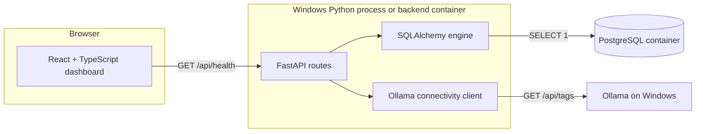

# Milestone 1 architecture

## Application lifetime and boundaries

The application factory receives validated settings and defines a FastAPI lifespan. Startup creates a SQLAlchemy engine and reusable HTTPX client without attempting dependency connections. Shutdown closes the client and disposes the engine. Tests supply explicit settings and override route dependencies, so neither PostgreSQL nor Ollama is required.

The synchronous health route runs in FastAPI's thread pool. Database work belongs to `app/db/session.py`; the Ollama protocol belongs to `app/services/ollama.py`. The route composes their typed results. This small application does not need an asynchronous database layer, repository abstractions, or an AI framework.

SQLAlchemy uses the psycopg 3 driver, a shared declarative base with predictable constraint names, and a request-scoped session provider for future work. Sessions close automatically; future write operations must explicitly commit or roll back. No model tables or `create_all` calls exist. Alembic uses the same settings and metadata as the application, handles URL credentials through SQLAlchemy's URL object, and supports online and offline migration modes. Future model modules must be imported in Alembic's environment before autogeneration.

## Health semantics

| Endpoint / result | Meaning |
| --- | --- |
| `GET /` → 200 | Application liveness; dependencies are not checked |
| `GET /api/health` → 200 | Both PostgreSQL and Ollama are reachable |
| `GET /api/health` → 503 | Application is alive; at least one dependency check failed |

The health response always includes `application`, `database`, and `ollama`. A dependency result contains `status` and, on failure, a safe `detail`. Both checks run even if the first fails. There are no automatic retries, persistent health caches, or startup migrations. Health checks do not expose service URLs, credentials, model lists, or raw exceptions.

Database connection, pool wait, and statement timeouts default to 3 seconds. HTTPX uses 3-second connect/read/write/pool timeouts. These are operation limits, not a strict end-to-end deadline; checks run sequentially. The frontend caps requests at 15 seconds and permits cancellation when unmounted or superseded. Unavailable services yield structured warnings containing the dependency and exception class, while Uvicorn retains its standard access/server logs.

Ollama connectivity is checked with its model-list endpoint, accepting an empty list. The configured model names are reserved values; the client performs no generation, model downloads, or embedding calls.

## Configuration and networking

Pydantic Settings loads the root `.env` with shell variables taking precedence. The password is required and represented as a secret; SQLAlchemy constructs the database URL without manual string interpolation. Only the configured frontend origin is allowed by CORS. This milestone allows GET and its CORS preflight; later API methods should extend the policy when implemented.

Native Windows processes connect to localhost ports 5432 and 11434. The Compose backend connects to `postgres:5432` and to host Ollama through the configurable `OLLAMA_DOCKER_BASE_URL`. The frontend API address must be reachable by the browser, regardless of where frontend files are served. Vite's public settings are embedded during a container build.

Compose starts only PostgreSQL by default and uses a named volume. The optional `app` profile builds the backend and an Nginx-served frontend. PostgreSQL readiness gates the backend, while backend liveness gates the frontend. A temporary Ollama outage does not prevent serving the dashboard. Ports bind to loopback for this local development foundation.

## Frontend behavior

A single dashboard presents actual service health and explicit planned feature sections. Navigation uses section anchors rather than introducing a router for one page. A typed API client validates incoming response shapes, preserves structured 503 health bodies, and rejects malformed responses. A hook owns polling, cancellation, and refresh state. Components do not scatter fetch calls or invent document counts and conversations.

React and Tailwind render entirely from local assets and system fonts. The responsive shell includes semantic landmarks, labeled navigation, a skip link, visible keyboard focus, status text alongside colors, and reduced-motion handling.

## Scope boundary

There is no authentication, document schema, upload endpoint, PDF parser, embeddings, pgvector extension, retriever, RAG pipeline, or AI conversation. Those are future milestones. Empty directories and speculative service abstractions are omitted.

## Implementation references

The foundation follows the official [FastAPI settings](https://fastapi.tiangolo.com/advanced/settings/) and [lifespan](https://fastapi.tiangolo.com/advanced/events/) documentation, [SQLAlchemy engine configuration](https://docs.sqlalchemy.org/en/20/core/engines.html), [Alembic tutorial](https://alembic.sqlalchemy.org/en/latest/tutorial.html), [Tailwind Vite integration](https://tailwindcss.com/docs/installation/using-vite), [Compose environment interpolation](https://docs.docker.com/compose/how-tos/environment-variables/variable-interpolation), and [Ollama model-list API](https://docs.ollama.com/api/tags).
