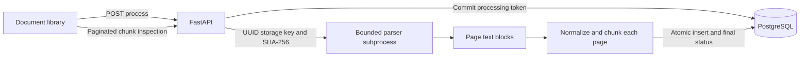

# Milestone 3: page-aware PDF text processing

This records the Milestone 3 processing baseline. Milestone 4 adds the separate
[embedding and semantic-search lifecycle](semantic-search.md), including embedding
invalidation when these chunks are replaced. Its future-feature statements refer to
the original Milestone 3 scope; README and the new architecture describe current features.

RAGVault remains a single-user application bound to the local machine. Text extraction
and chunking are implemented. OCR, embeddings, vector search, retrieval and chat are planned.
Ollama is still used only by health checks. No LangChain, LlamaIndex, queue service or
external model call is introduced.

## Extraction and resource limits

The API looks up the document UUID and resolves the existing internal storage key
through `DocumentStorage.path_for`; clients cannot supply filesystem paths. The child
checks the stored file's size and SHA-256 before parsing, then rechecks PDF identity,
repair/encryption state and page count. File bytes are never modified.

PyMuPDF runs in a separate process, consistent with its documented lack of threading
support. `get_text("blocks", sort=True)` extracts only text blocks; images are excluded.
PDF page indices are converted to one-based page numbers, including gaps caused by
blank/image-only pages. Text is never interpreted as instructions, HTML, SQL or shell code.
The React inspector renders it as escaped plain text.

Existing upload limits (25 MiB, 2,000 pages by default) are insufficient for extraction:
compressed pages may contain very large amounts of text. Extraction adds:

| Setting | Default | Meaning |
| --- | --- | --- |
| `PROCESSING_TIMEOUT_SECONDS` | 60 | Child timeout; configurable from 5 to 180 seconds |
| `MAX_PAGE_TEXT_CHARS` | 100,000 | Raw text characters per page |
| `MAX_EXTRACTED_CHARS` | 1,000,000 | Total raw text characters before normalization |
| `MAX_DOCUMENT_CHUNKS` | 5,000 | Maximum persisted chunks in one attempt |
| `CHUNK_SIZE_CHARS` | 1,200 | Maximum normalized characters in each chunk |
| `CHUNK_OVERLAP_CHARS` | 200 | Target maximum overlap, aligned to word boundaries |

Output text including overlap is capped at twice `MAX_EXTRACTED_CHARS`. Hitting a
limit fails the whole attempt rather than silently dropping pages or storing partial text.
One processing attempt per API process is admitted with a nonblocking semaphore; excess
requests get 409 rather than waiting in a queue. Parser stderr is discarded and stdout
contains only the bounded protocol result. Subprocess timeout kills and waits for the child.
Linux extraction children also have a 1 GiB address-space ceiling. Windows has no hard
memory ceiling in this version: one page's text must be materialized before character
limits can be checked. These limits reduce resource use but are not a hostile-code sandbox.
Upload validation remains its existing, separately bounded subprocess.

## Normalization and chunk boundaries

Whitespace within paragraphs is collapsed and blank-line paragraph boundaries retained.
Text blocks are separated by blank lines. Unicode, punctuation and joiners are retained;
invalid control characters/NULs are removed. The code does not guess dehyphenation,
semantic layout, tables, headings or language. Reading order in complex layouts remains
heuristic; inspect the original PDF when accuracy matters.

The independent `chunking.py` component uses character windows, preferring paragraph,
sentence and word boundaries in the latter half of a window. Overlap aligns forward to
a word boundary, so actual overlap can be smaller than the target. Tokens longer than
the chunk size must be split. Offsets refer to each page's normalized text, not PDF byte
positions or model tokens. Sequence numbers are zero-based and global within a document;
the UI displays them starting from one. Page numbers always start at one.

Chunks never cross page boundaries. This makes citations unambiguous but leaves short
chunks near page ends and loses cross-page context. Duplicate *windows* and empty chunks
are avoided; identical passages genuinely appearing on different pages are retained so
their citations are not discarded. Ordering and chunk text are deterministic for the
same parser version, source bytes and settings. Reprocessing creates fresh row UUIDs
and timestamps; text/page/sequence ordering remains stable.

## Database and lifecycle

Migration `0002_document_processing` preserves all existing documents and collections,
extends the status constraint, adds nullable attempt metadata and creates `document_chunks`.
Existing documents stay `uploaded`; their chunk count is zero.

Chunks store UUID, document UUID, one-based page, zero-based sequence, text, normalized
start/end character offsets and a UTC creation timestamp. `(document_id, chunk_index)`
is unique. A document/page index supports filtering; the unique index supports ordered
document listing. Database constraints reject negative indices, invalid offsets and
blank text. `ON DELETE CASCADE` removes chunks when their document is deleted. ORM
relationships leave this cascade to the database, including unloaded chunk collections.

| Status | Meaning |
| --- | --- |
| `uploaded` | Validated original stored, not extracted |
| `processing` | A committed claim exists; no completed chunks are available |
| `processed` | All chunks and completion metadata committed successfully |
| `no_text` | Extraction succeeded but found no text, including scanned PDFs; OCR unavailable |
| `failed` | Extraction/limits/persistence failed; retry is allowed |

A conditional update claims the document with a new random token and start timestamp.
The same transaction deletes any old extraction and resets counts. Reprocessing deliberately
invalidates earlier text rather than serving stale content after a failed attempt. The
claim transaction commits before parsing, so status is visible and database locks are not
held during extraction. Concurrent requests for the same document are rejected across
API workers as well as within one process.

Completion locks the document and verifies the token, then inserts all chunks and marks
the document `processed`/`no_text` in one transaction. A database failure rolls back all
new chunks; a separate conditional update records a safe failure message if the database
is available. Outages may prevent that update, leaving a recoverable `processing` claim.
Attempts older than the configured timeout plus 60 seconds can be retried after crashes
or API restarts. There is no startup worker or automatic retry. A superseded worker
cannot commit over a newer token. Original PDFs may still be previewed/downloaded while
processing; deletion returns 409 until processing completes or its stale claim is recovered.

## API and UI

| Method/path | Response |
| --- | --- |
| `POST /api/documents/{id}/process` | Synchronous final document response; works for initial processing, retry and reprocessing |
| `GET /api/documents/{id}/processing` | Current document processing metadata; internal token and storage key excluded |
| `GET /api/documents/{id}/chunks` | Ordered page of chunks; default 20, maximum 100, nonnegative offset; optional positive `page_number` filter |

Existing document list/detail responses include status, page/chunk counts, timestamps,
safe error and settings used for successful chunking. Chunk listing requires a completed
extraction (409 otherwise). Unknown IDs return 404; malformed UUIDs/limits return 422.
Busy/active attempts return 409. Parser failures return 422 with a fixed message; general
database/storage errors use the existing safe handlers. No native exceptions, paths,
source text or credentials appear in error messages or logs.

The library offers process/retry/reprocess actions, a busy indicator, status polling for
persisted processing rows, and a paginated text inspector showing original PDF page numbers.
An expired-processing retry may still return 409 while the original claim is active.
If a browser request is interrupted, refresh the status before retrying. The API finishes
synchronously; closing a browser is not cancellation. Client processing timeout is
240 seconds to accommodate the maximum parser limit and database cleanup.

## Future vectors and work queues

Chunk UUIDs, deterministic sequence/page metadata and offsets provide stable *source
references within one extraction*. Future embedding records can refer to chunk UUIDs
and should cascade/invalidate when reprocessing replaces chunks. This migration stores
no embeddings, vector columns, model names or premature vector indexes. Chunk citations
are preparatory metadata, not an implemented AI citation or chat feature.

Long jobs still occupy an API thread. A later durable job queue could own the same claim,
token and atomic-completion contract, add heartbeats/cancellation and bound resources
across all workers. It is deliberately outside Milestone 3.

## Verification

Automated tests use temporary SQLite databases and temporary files. Live verification
creates only a uniquely named collection and synthetic PDF, checks PostgreSQL persistence,
reprocessing and deletion cascades, then removes only those fixtures. Existing row values,
upload bytes and `.env` are fingerprinted and compared. See [the verification report](../verification-milestone-3.md).

References: [PyMuPDF process safety](https://pymupdf.readthedocs.io/en/latest/recipes-multiprocessing.html)
and [text extraction/reading-order trade-offs](https://pymupdf.readthedocs.io/en/latest/recipes-text.html).
