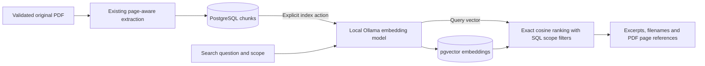

# Milestone 4: local semantic passage search

RAGVault now embeds stored chunks with local Ollama and ranks passages with PostgreSQL
pgvector. It returns original text, filenames and one-based PDF pages. No generated
answers, chat, conversation history, OCR, LangChain or LlamaIndex are introduced.



## Database image and upgrade runbook

The pre-upgrade runtime was PostgreSQL **17.11**, Alpine **3.24.3**, with PGDATA major
**17**. Switching that existing volume to a Debian-based image would also switch libc
and potentially collation behavior. Instead `database/Dockerfile` builds pgvector
**0.8.7** in a builder stage and copies only the extension library/SQL files into the
same pinned official PostgreSQL 17 Alpine base. Build tools never enter the runtime.
The PostgreSQL and musl binaries were compared byte-for-byte between the old and new
images before the old volume was attached; both matched. No major-version, libc,
data-directory or named-volume change was performed.

For an existing installation, check `PG_VERSION`, `pg_config --version`, OS/libc and
candidate compatibility **before** replacement. Do not use this recipe blindly with
another PostgreSQL major, architecture or libc family. Stop and plan that migration
separately if these checks differ. A private `pg_dump` and fingerprints of original
rows, uploads and `.env` were taken before this installation's replacement.

Build the PostgreSQL candidate, verify it, then replace only the database container:

```powershell
Set-Location 'C:\Projects\ragvault'
docker compose exec -T postgres pg_config --version
docker compose build postgres
# Compare the candidate runtime with the existing server before using existing PGDATA.
docker compose up -d --no-deps --wait postgres
Set-Location backend
.\.venv\Scripts\python.exe -m alembic upgrade head
.\.venv\Scripts\python.exe -m alembic check
```

The `ragvault_postgres_data` volume and `127.0.0.1` binding are retained. No volume
deletion/reset command is needed. Migration `0003_semantic_search` enables the extension
and adds storage/lifecycle columns. It never runs at application startup. Its role must
be able to create the extension. Downgrade deliberately leaves the shared extension in
place, while removing this milestone's derived embeddings only when explicitly invoked.
CI uses a fresh pgvector PostgreSQL 17 service, never this user's volume; its different
image base does not change the compatibility strategy for existing installations.

## Embedding service and identity

`EmbeddingClient` is injected independently of health checks. It calls `/api/tags` to
resolve the configured model's digest, then `/api/embed` with arrays of text and
`truncate: false`. It does not pull models, invoke a chat model or execute source text.
Actual vectors establish the dimension; production schema/code never assumes 768.
The installed `nomic-embed-text` response was verified as **768-dimensional** in this
environment. Model names are canonicalized with the default `:latest` tag.

Every vector is checked for batch count, consistent dimensions, finite numeric values,
float32 range, configured dimensional limit and nonzero norm. Vectors are normalized
before storage/querying. Document inputs default to `search_document: ` and questions
to `search_query: `, appropriate for this model. Both prefixes can be configured for
other models. Empty prefixes are supported; alternatives require evaluation/reindexing.

A fingerprint covers model name, actual digest, verified dimension, both prefixes and
normalization version. It is stored on documents and embedding rows. A model alias
that changes digest, a dimension change or changed prefixes therefore cannot silently
mix old and new vector spaces. Digest checks before and after each operation discard
results if the selected model changes mid-operation. No vector/text payloads or native
provider error bodies are logged or forwarded in errors.

## Storage, indexing and invalidation

`chunk_embeddings` has one row per chunk: `chunk_id` primary key and cascade foreign
key, dimensionless `vector`, verified dimension, fingerprint and UTC creation time.
The SQLAlchemy pgvector type supports alternative dimensions without a schema rewrite.
A B-tree fingerprint/dimension index narrows compatible rows. JSON is a unit-test-only
SQLite storage variant; there is no production Python/text-similarity search fallback.

Document processing status remains separate. Index status is `not_indexed`, `indexing`,
`indexed` or `failed`; metadata includes safe errors, attempt token/start time, completion
time, model/digest/dimension, fingerprint and indexed count. `uploaded`/`no_text`/failed
extractions cannot be indexed. Indexing reads existing chunks and never reparses the PDF.

A conditional database update claims an attempt. That transaction clears old vectors
and metadata and commits `indexing` before any network calls. Old indexes are deliberately
unavailable during reindexing and after failures. A single indexer slot per API process
rejects excess work with 409. Network work runs outside database transactions in batches.
Completion locks the document, verifies the attempt token and exact ordered source chunk
IDs, then commits **all** vectors and final metadata atomically. Commit failures roll
back all new vectors and record `failed` when the database is reachable. Database outages
can leave a recoverable lease; retry after the index budget plus 60 seconds of grace.

Reprocessing clears the indexing claim/status and deletes old chunks in the same
processing transaction. Foreign-key cascades remove their vectors. An in-flight indexer
cannot publish against replaced chunks or a superseding token. Document deletion also
cascades chunk/vector cleanup. Active processing/indexing blocks deletion until finished
or an expired claim has been recovered. Renaming a document requires no reindex: search
joins the current document metadata.

## Limits and configuration

| Setting | Default | Bounds/purpose |
| --- | --- | --- |
| `OLLAMA_EMBEDDING_MODEL` | `nomic-embed-text` | Configured local model; must already be installed |
| `EMBEDDING_TIMEOUT_SECONDS` | 60 | Per-request timeout, 2–180 seconds; search operation budget |
| `INDEXING_TIMEOUT_SECONDS` | 180 | Indexing budget, 10–600 seconds |
| `EMBEDDING_BATCH_SIZE` | 16 | 1–32 chunks per provider request |
| `MAX_INDEX_CHUNKS` | 2,000 | 1–5,000 chunks in a document |
| `MAX_INDEX_VECTOR_VALUES` | 2,000,000 | Total document vectors × dimensions |
| `MAX_EMBEDDING_DIMENSIONS` | 4,096 | Maximum admitted response dimension; configurable to 16,000 |
| `EMBEDDING_DOCUMENT_PREFIX` | `search_document: ` | Quoted in `.env.example` to preserve its trailing space |
| `EMBEDDING_QUERY_PREFIX` | `search_query: ` | A change invalidates compatibility with previous indexes |
| `SEARCH_TOP_K` | 5 | Server default; request override 1–20 |

Questions are limited to 2,000 characters. Provider responses are streamed with a 16 MiB
cap; deadline checks occur between response chunks and embedding batches. HTTP timeouts
bound individual network phases; this is not hard process cancellation or a durable queue.
Two searches per API process are admitted. Database queries retain the application's
statement timeout. Indexing holds bounded source/vector lists in memory; large documents
may require lower dimensions, different limits or later background infrastructure.

## Exact search and server-side scope

The query is embedded with the current identity and searched using pgvector cosine
distance (`<=>`). SQL joins embeddings → current chunks → documents. It filters for
processed and fully indexed documents, matching fingerprints/dimensions, and the requested
collection/document **before returning ranked results**. Conflicting document/collection
filters return 422; nonexistent UUIDs return 404, malformed inputs 422. Scope is enforced
server-side and never replaced by similarity thresholds. This is still a single-user app,
not an authentication/tenant authorization system.

Exact ranking has deterministic tie breakers and a top-K cap. A guarded distance expression
avoids evaluating incompatible dimensions. Stale/incomplete indexes never participate.
The response counts incompatible indexed documents **within the requested scope** so
the UI can explain the need to reindex. With no compatible passages, results are empty.
Ollama failure is a safe 503, rather than invented/fallback results.

Results include document/collection/chunk IDs, current filename, page, full chunk excerpt,
cosine distance and similarity (`1 - distance`). Similarity is **not a probability or
answer confidence**. Nearest passages may still be irrelevant; there is no calibrated
relevance threshold. The original PDF can be opened at its cited page through PDF.js.

No HNSW/IVFFlat index is added. The live benchmark contained four chunks in three
synthetic PDFs, far too small to justify approximate indexes or claim broad retrieval
quality. Measure a representative corpus before changing the search strategy.

## API and frontend

| Endpoint | Behavior |
| --- | --- |
| `POST /api/documents/{id}/index` | Synchronous index/retry/reindex; typed document metadata |
| `GET /api/documents/{id}/indexing` | Current stored indexing metadata; no token/path |
| `POST /api/search` | `{query, top_k?, collection_id?, document_id?}` → ranked source passages, model/dimension/timing/compatibility metadata |

The library explains separate processing and indexing states, supports retries/reindexing,
and polls active states. `/search` has a question form, scoped document/collection filters,
top-K, loading/errors, empty results, incompatible-model notices, original excerpts and
page references. Filter options are paginated in batches of 100. Source text is rendered
as React text, never HTML/instructions. There is no AI-chat UI or generated answer.

## Tests and future RAG integration

Default tests mock Ollama. Explicit `postgres` tests create qualified tables in unique,
disposable schemas, with bounded connection/statement timeouts and mocked topic vectors.
They exercise real pgvector ranking, dimension coexistence, scope, invalidation and
cleanup. Set `RAGVAULT_TEST_POSTGRES=1` after migrating a test-accessible server; its role
needs schema-creation privileges. Public/user tables and uploads are never test targets.
CI runs these explicitly after migrations. The separate live verification uses only
generated fixtures and real local Ollama, then removes those fixtures by recorded UUID.

Future RAG can consume these chunk/page references, but answer generation, prompts,
conversation persistence and evaluation beyond this small retrieval test are outside
Milestone 4. See [verification results and the file inventory](../verification-milestone-4.md).

Primary references: [pgvector](https://github.com/pgvector/pgvector),
[SQLAlchemy integration](https://github.com/pgvector/pgvector-python#sqlalchemy),
[Ollama embedding endpoint](https://docs.ollama.com/api/embed).
