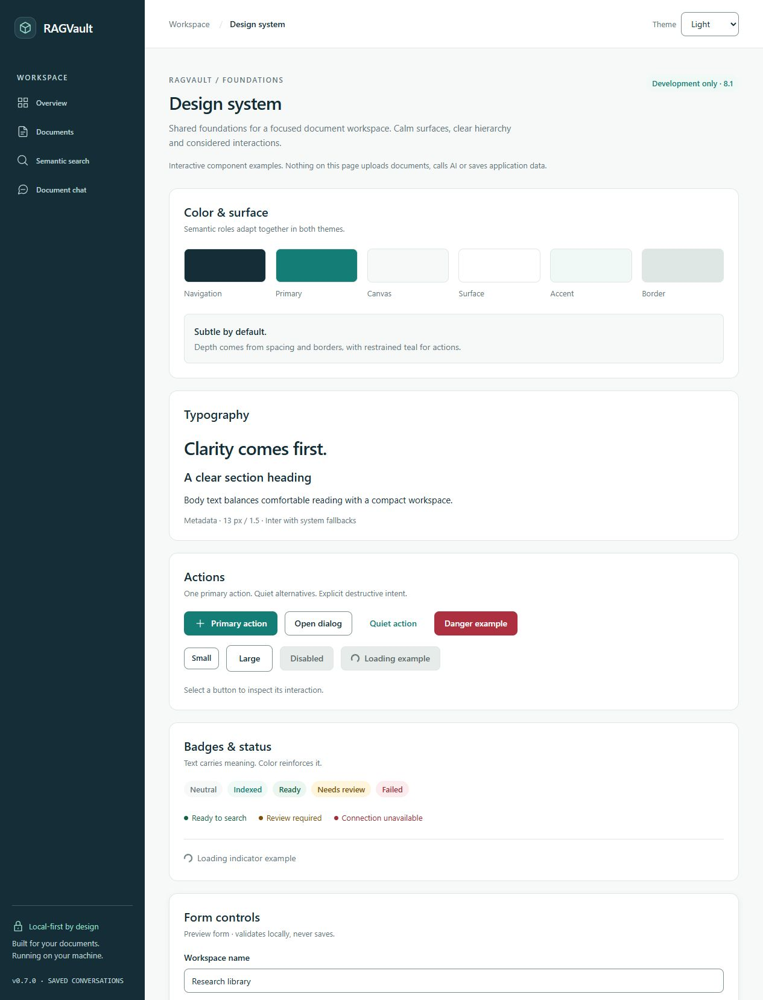
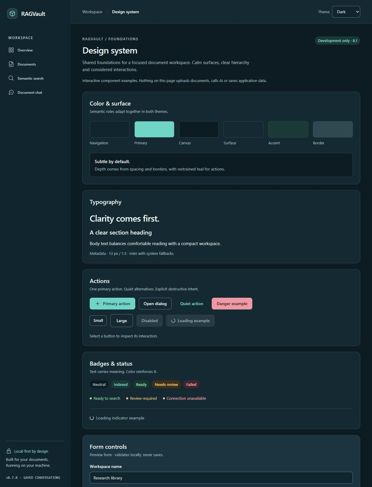

# RAGVault design system

Stage 8.1 establishes shared styling, controls and themes. Stage 8.2 adds the shared
navigation and dashboard redesign. Stage 8.3 extends it to the document library and
upload/management controls. Stage 8.4 extends the shared styles to saved and unsaved chat,
conversation history and compact citation presentation. Search and PDF reader contents retain their existing
structure and behavior. See [Stage 8.1 verification](verification-milestone-8-1.md),
[Stage 8.2 verification](verification-milestone-8-2.md) and
[Stage 8.3 verification and inventory](verification-milestone-8-3.md) and
[Stage 8.4 verification and inventory](verification-milestone-8-4.md).

## Direction

Modern Professional: light-first, deep navy navigation, restrained teal actions, neutral
surfaces, comfortable spacing and clear typography. Borders establish grouping; shadow
is reserved for elevated surfaces. No gradient, remote font service, global state library,
Storybook, new dependency or animation framework is required.

## Tokens and Tailwind 4

`frontend/src/styles.css` defines `--ds-*` values on `:root` and dark overrides on
`:root[data-theme='dark']`. Tailwind 4 `@theme inline` maps these values into semantic
utilities. Components use roles, not repeated palette literals.

| Role / utilities | Light | Dark |
| --- | --- | --- |
| `canvas` — page background | `#F7F9F8` | `#0D1B22` |
| `surface` — cards/panels | `#FFFFFF` | `#152932` |
| `elevated` — raised cards/dialogs | `#FFFFFF` | `#1C3440` |
| `field` — input background | `#FFFFFF` | `#11252E` |
| `ink` — primary text | `#142D36` | `#E8F1F0` |
| `muted` — secondary text | `#64757B` | `#ABC0C4` |
| `line` — decorative separators | `#DFE7E5` | `#304951` |
| `control-border` — identifying input/button boundary | `#7D918F` | `#637F87` |
| `primary` / `on-primary` — filled action | `#147D75` / white | `#71D5C6` / `#102A30` |
| `primary-hover` | `#10685F` | `#8BE2D5` |
| `accent` / `accent-soft` — links and tint | `#147D75` / `#F0F9F6` | `#80DCCF` / `#1B3937` |
| `nav` / `nav-ink` | `#142D36` / `#F3F8F7` | `#10252E` / `#F3F8F7` |
| `nav-muted` | `#BED0D2` | `#BED0D2` |
| `nav-hover` / `nav-selected` | `#203E47` / `#294A53` | same |
| `focus` / navigation focus | teal / `#75DBC8` | `#71D5C6` / `#75DBC8` |
| `success` / `success-soft` | `#166343` / `#EAF6EF` | `#9CE0B3` / `#18382F` |
| `warning` / `warning-soft` | `#805009` / `#FFF4DC` | `#F0CF83` / `#3C301C` |
| `danger` / `danger-soft` | `#A22E38` / `#FCECEE` | `#F5B2B8` / `#41262E` |
| `disabled` / `disabled-ink` | `#E7ECEB` / `#596969` | `#263B44` / `#99ADB1` |

Separate danger-action/hover/foreground, status borders, navigation accent/line, overlay
and shadow roles are also centralized in the stylesheet. Do not substitute `line` for
`control-border` on form controls: decorative borders intentionally have softer contrast.

Examples: `bg-surface text-ink border-line`, `text-muted`, `bg-primary text-on-primary`,
`text-danger`, `border-control-border`, `shadow-card`, `rounded-control`.

Compatibility helpers `.primary-button`, `.secondary-button`, `.text-input`,
`.error-message`, `.collection-button`, `.nav-item`, `.eyebrow` and `.planned-badge` remain.
`forest` aliases the surface accent; `mint` aliases the navigation accent. Filled
navigation/action callers have been migrated to explicit `nav` / `primary` roles so
these aliases do not produce unreadable dark-theme text. Literal white is retained for
PDF paper.

## Typography, spacing and radius

The font stack begins with **Inter**, followed by system UI fonts including Segoe UI.
Inter is used if installed; it is not bundled or downloaded. The application remains
fully usable offline with system fonts.

| Use | Utility / size | Line height / weight |
| --- | --- | --- |
| Page title | `text-page`, 30 px | 1.2 / 600, tight tracking |
| Section title | `text-section`, 20 px | 1.4 / 600 |
| Body | `text-body`, 15 px | 1.6 / 400 |
| Compact body | `text-sm`, 14 px | context-specific readable spacing |
| Form label | `.form-label`, 14 px | 1.5 / 500 |
| Metadata | `text-meta`, 13 px | 1.5 / 400–500 |

Use the existing 4 px Tailwind spacing scale: 8 px within compact groups, 12–16 px
between controls, 20–24 px card padding/gaps and 28–40 px between page sections.
`rounded-control` is 8 px; `rounded-card` is 14 px; existing dialogs retain 16 px.
Badges are pill-shaped. Small/medium/large shared buttons have minimum heights of
36/40/44 px. Standard fields have a 40 px minimum height and textareas remain resizable.
Do not override native file, PDF, pagination or specialized conversation controls just
to use a generic wrapper. Legacy page typography is migrated in later page stages.

## Shared React components

Components live in `frontend/src/components/ui/` and forward native props, event handlers
and React 19 refs. There is no form/state framework or broad component configuration layer.

| Component | API / behavior |
| --- | --- |
| `Button` | `variant`: primary/secondary/ghost/danger; `size`: sm/md/lg; `loading`; native `disabled`; defaults to `type="button"`, explicitly choose submit in forms |
| `Input` | Native text/input props, shared field styling; specialized existing controls stay specialized |
| `Textarea` | Native props, three default rows, vertical resizing |
| `Card` | Native div props; optional `elevated`; consumers provide semantic headings/section labels |
| `Badge` | `tone`: neutral/accent/success/warning/danger; visible text communicates meaning |
| `StatusIndicator` | Tone, optional `loading`, visible text and a decorative dot/spinner; live announcements are opt-in native props |
| `LoadingIndicator` | Visible `label`, polite status semantics and decorative spinner |
| `EmptyState` | Required title/description, optional icon and a working action node |
| `FormField` | One native-compatible control child; label, optional hint/error; preserves supplied IDs/descriptions and associates generated IDs/validation state |

```tsx
<FormField label="Collection name" hint="Keep related documents together." error={error}>
  <Input value={name} onChange={(event) => setName(event.target.value)} required />
</FormField>
<Button type="submit" loading={saving}>Save collection</Button>
```

`StatusBadge` reuses Badge/StatusIndicator while retaining its existing service states.
Native `Dialog` still handles modality, Escape and busy cancellation. It explicitly
focuses the first enabled form control (or a close button) and restores trigger focus
when unmounted. Its elevated surface and overlay now use semantic roles.

## Theme lifecycle

- Choices: Light, Dark, System. **No stored preference means Light**, even on a dark OS.
- The only persisted value is `localStorage['ragvault.theme']`, containing the chosen
  mode rather than a resolved System color. No documents, history or credentials are stored.
- `public/theme-init.js` is a small, blocking, same-origin script in the document head,
  before the application module/CSS paint. It validates the stored mode and sets
  `data-theme` and native `color-scheme`. It requires no remote service.
- `ThemeProvider` uses React state/context and `useSyncExternalStore` for live OS changes.
  Only System mode follows the OS. A storage event synchronizes choices across tabs;
  clearing storage resets to Light. Blocked storage falls back safely to in-memory use.
- The bootstrap and provider deliberately have a small shared contract (key/modes/default);
  tests execute the actual bootstrap script and provider behavior to keep them aligned.
- A labeled native Theme select is integrated into the workspace header. It stays
  available on mobile without opening navigation. Tests/components outside a ThemeProvider do not show
  a nonfunctional selector; production always mounts the provider at the root.

## Accessibility decisions

Contrast regression tests use underlying sRGB relative luminance values, without rounding
before assertions. They require normal-text pairs to reach 4.5:1, following
[WCAG 2.2 contrast guidance](https://www.w3.org/WAI/WCAG22/Understanding/contrast-minimum.html),
and identifying controls/focus/selected indicators to reach 3:1, following
[non-text contrast guidance](https://www.w3.org/WAI/WCAG22/Understanding/non-text-contrast.html).

The tested text minimum is 4.542:1 in Light and 5.005:1 in Dark. Tested non-text minima
are 3.143:1 and 3.524:1 respectively. Status text, disabled labels, hover actions,
navigation text and field/focus boundaries are included. Active navigation also has
an inset accent marker in addition to color and `aria-current`.

Focus rings are visible, offset 3 px and 2 px wide. Labels/hints/errors are programmatically
associated. Buttons retain names while busy; disabled/busy buttons cannot submit twice.
Status information never relies on color alone. Native keyboard behavior is preserved.
Reduced-motion CSS removes smooth scrolling and limits animation/transition duration and
animation iteration; no new page motion is added beyond a loading spinner and color changes.

These checks do not certify the entire application as WCAG conformant. Some legacy pages
still have dense layout, small metadata and specialized control spacing. Full assistive
technology, forced-colors, every zoom level and real-device testing remain future work.
PDF paper/content is intentionally not recolored or treated as application theme content.

## Development preview

Run `npm run dev` inside `frontend`, then open
[the component preview](http://localhost:5173/dev/design-system).
Use the Theme select, action examples, local validation form and dialog. Clear the form
and choose Validate preview to inspect error styling. No preview action calls the backend
or pretends to upload, generate, save or delete application records.

The route is guarded by `import.meta.env.DEV`; Vite removes the lazy preview import from
the production build. It is absent from product navigation. In production, the unknown
preview URL follows the normal redirect to the dashboard. No Storybook server is needed.




## Rules for later stages

Keep roles centralized; add semantic roles when needed rather than literal palette classes.
Use the shared controls or compatible legacy helpers, and retain accessible names, native
props, loading states and refs. Recheck both themes, status colors and keyboard focus after
each migration. Keep PDF/citation text plain and preserve all source/scope protections.

Stage 8.3 preserves the document processing and text-inspection contracts. Document technical metadata and rename/
delete controls use an inline native details disclosure, not an overflow menu or popover.
Recovery controls remain visible outside it. Stage 8.4 adds a desktop conversation panel,
a native mobile history dialog, scoped creation controls, an anchored composer and clear
user/assistant grouping. Long scope names expand on demand. Full message and source text
wraps; timestamps expose the full date accessibly. Compact mobile button labels retain
their complete accessible names.

Accepted claims keep their original wording and numbered PDF controls. A single Sources
disclosure per answer groups identical source/page/quote/check metadata, without merging
different quotes or renumbering references. Partial, withheld and historical-source
warnings remain explicit; detailed checks and withheld statements expand separately.
Original excerpts and model output remain plain text. No retrieval, model, validation,
scope or persistence contracts change.
Do not infer new data, API or model behavior from a visual foundation change.


## Stage 8.5: search and shared PDF reader

Search uses shared controls and semantic surfaces for the query, real collection/document
filters, result count and plain original passages. Ordered cards identify their document,
collection and original page. Raw cosine similarity is secondary metadata, explicitly
explained as embedding similarity rather than factual confidence or answer correctness.
Filter failures block submission until recovery; loading, empty, request failure and
incompatible-index states retain honest recovery guidance.

The native Dialog has an opt-in reader size; other dialogs keep their existing layout.
The reader offers direct page entry, previous/next, session-only 50–200% visual zoom,
fit width, separate load/render retries and an original download. Controls wrap on phones,
retain full accessible names, and stay sticky during short-window dialog scrolling.
The heading is limited to two visual lines with full accessible text/native title; a
full-width File details disclosure exposes the complete filename on touch devices.

PDF paper stays white in both themes. Zoom magnifies a bounded bitmap rather than claiming
full-resolution or selectable text. Keep one page/canvas, the local PDF.js worker/assets,
page cleanup and cancellation before canvas reuse. Pan inside the named focusable PDF
viewport; reserve scrollbar space to prevent resize/render feedback loops. Search and
citation actions retain exact document IDs/pages; stale or unavailable historical sources
remain disabled. Highlighting, text layers, OCR and annotations are deferred. See the
[Stage 8.5 verification](verification-milestone-8-5.md) for measurements and accessibility limits.
