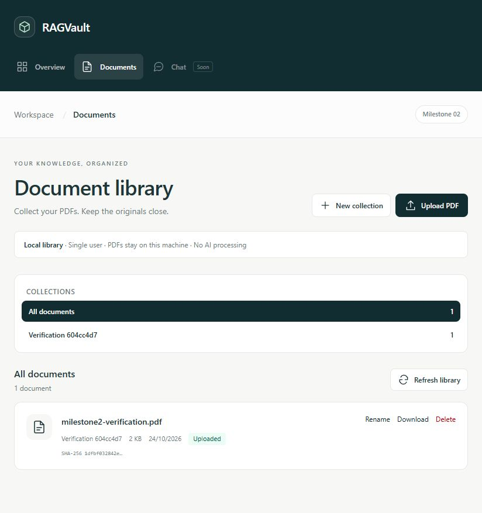
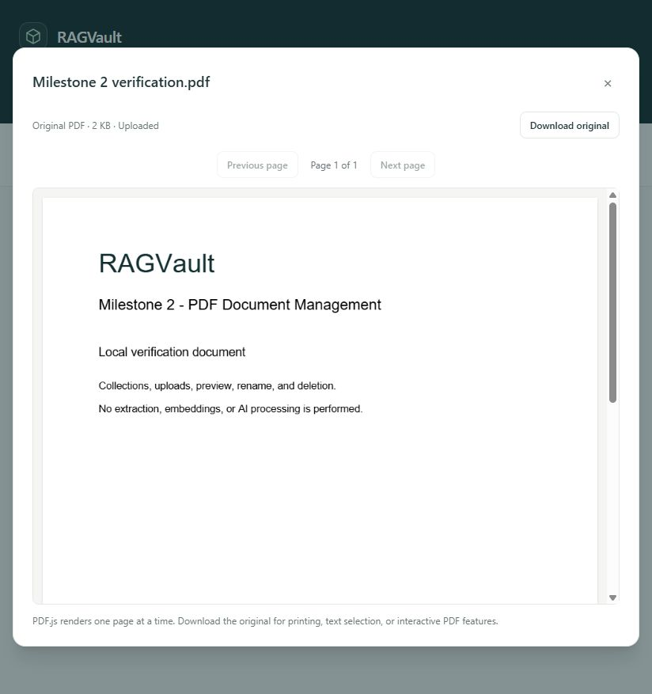

# Milestone 2 verification report

Verified on **24 October 2026 (Asia/Singapore)** against foundation commit `f61cf25a2703076a9b17018c65ad6d492c69eb89`.

**Milestone 2 is implemented and locally verified. No Milestone 3 features, commit, or push were performed.** Existing local configuration, PostgreSQL volume, and user data were preserved. Native development servers remain available at `http://localhost:5173` and `http://localhost:8000`.

## Actual results

| Verification | Observed result |
| --- | --- |
| Backend dependency installation | Passed; added PyMuPDF and python-multipart |
| Frontend dependency installation | Passed; React Router, PDF.js, and interaction-test dependencies installed; npm reported 0 audit vulnerabilities |
| Alembic `upgrade head` | Passed against local PostgreSQL |
| Alembic `current` | `0001_document_library (head)` |
| Alembic `check` | `No new upgrade operations detected.` |
| Schema inspection | `collections`, `documents`, and `alembic_version` present |
| Authenticated SQLAlchemy connection | Passed; `SELECT 1` returned `1`; PostgreSQL 17.11 |
| Live collection creation | HTTP 201 for a uniquely named verification collection |
| Live PDF upload | HTTP 201; Uploaded status; SHA-256 matched the original |
| PostgreSQL persistence | Uploaded row read through a separate SQLAlchemy session |
| Original-file serving/download | Returned byte-identical PDF; inline/attachment dispositions verified |
| Duplicate upload | HTTP 409, without another document record |
| Nonempty collection deletion | HTTP 409; collection and PDF preserved |
| Browser library | API-created document visible in the actual React library |
| Browser PDF preview | Original page visibly rendered with PDF.js; screenshot saved |
| Browser rename | Document and collection names changed and persisted |
| Browser upload | Generated PDF selected through the file chooser; Uploading/validating indicator visible; successful library entry observed |
| Browser deletion | Generated documents removed after confirmation; empty state observed |
| Browser collection deletion | Nonempty deletion displayed an error; empty verification collection deletion succeeded |
| Responsive layout | Mobile (390 px requested) and desktop (1365 px) checks showed no horizontal document overflow; temporary viewport overrides reset |
| Live cleanup | No verification collection or active/staged/quarantined PDF remained after cleanup |
| Backend tests | **70 passed**, 1 non-blocking upstream warning |
| Ruff lint | All checks passed |
| Ruff formatting | 34 files already formatted |
| Python dependencies | No broken requirements found |
| Frontend tests | **16 passed**, 3 test files |
| ESLint | Passed |
| Prettier | All matched files conform |
| TypeScript | Passed |
| Vite production build | Passed; 107 modules transformed, lazy PDF renderer/worker assets produced |
| Compose configuration | Passed with the existing app profile |
| Docker image builds | Backend and frontend passed; backend rebuilt after final storage changes |
| Backend container smoke test | Health/library routes, PostgreSQL, host Ollama, and mounted storage write passed |
| Final backend container upload | Parser subprocess, actual PDF upload, byte-identical serving, health, and verification-record cleanup passed |
| Frontend container smoke test | Nginx config valid; `/documents` and a local PDF.js character map returned HTTP 200 |
| Foundation health | HTTP 200 with FastAPI, PostgreSQL, and Ollama connected |
| CORS | Configured origin allowed; untrusted preflight returned 400 |
| Git/secret review | 88 source candidates reviewed; no configured-secret, generated-file, or credential-token findings; nothing staged |
| Local configuration | Root `.env` fingerprint unchanged; existing Docker volume preserved |
| Documentation links / whitespace | Local Markdown links and `git diff --check` passed |

The suite uses isolated SQLite databases and temporary upload roots. It tests collection/document CRUD, pagination/filtering, invalid extension/signature, corrupted and repaired PDFs, size limits including chunked requests, encrypted PDFs with and without opening passwords, page limits, missing collections, duplicate content, timestamps, persistence across sessions, traversal/name validation, failed-commit cleanup, failed-storage rollback, deletion restoration, missing files, browser write origins, and Host validation. Existing health/configuration/lifecycle tests continue to pass.

Frontend tests exercise create, upload, duplicate feedback, rename, deletion confirmation, nonempty collection rejection, empty/network states, preview/download, PDF page navigation, parser-error fallback, and worker cleanup. The PDF.js unit tests mock the parser/render worker; actual PDF rendering is separately verified in the browser.

## Focused problems found and fixed

- **Malformed PDF cleanup on Windows:** opening an invalid PDF by path could retain a native file handle. Validation now opens a size-bounded memory buffer, and rejected-upload cleanup tests pass.
- **Native PDF preview unavailable in the embedded browser:** the original iframe stayed blank. The preview now lazily loads PDF.js and renders bounded pages with local fonts/maps/codecs and a download fallback. The verification page was visibly rendered.
- **Frontend test/type mismatches:** corrected Testing Library queries to match accessible names and supported options; all tests and TypeScript checks pass.
- **Origin protection:** CORS alone does not prevent cross-site form writes. Explicit write-Origin checks and local Host validation were added and tested.
- **File/database compensation:** tests verify promoted-file cleanup after failed upload commits, metadata rollback after storage errors, and file restoration after failed deletion commits. Quarantine filenames preserve their storage keys for operator recovery.
- **Native parser concurrency:** final review identified PyMuPDF's unsupported concurrent-thread use. Validation now runs in a synchronous subprocess with a configurable deadline; timeout and crash tests verify staged-file cleanup and safe errors. No background processing queue was added.

The existing Starlette warning remains: `Using httpx with starlette.testclient is deprecated; install httpx2 instead.` It is not suppressed and does not fail tests. No unrelated dependency migration was introduced.

## Evidence

The screenshots capture disposable verification records. Those records and their stored PDFs were subsequently deleted; the final live library returned to its prior empty state. Only this run's generated verification documents/collection were modified or removed. Local fixture PDFs, scripts, and logs remain in ignored `.artifacts`.

## Architecture decisions

- PostgreSQL stores constrained UUID metadata; filesystem storage holds original PDF bytes under server-generated keys.
- Duplicate detection is SHA-256 within a collection. Another collection can contain its own independent copy.
- Nonempty collections cannot be deleted; there is no implicit bulk document deletion.
- Uploads use bounded multipart intake, chunked storage, structural PyMuPDF validation, database constraints, and compensating cleanup.
- Deletion quarantines the file before metadata commit, restores on rollback, and removes quarantine after success.
- `uploaded` is the only persisted status. Rejected uploads return errors and create no failed row; no indexed/embedded/RAG-ready status exists.
- Browser preview uses a lazy local PDF.js worker and one canvas page at a time, without annotation/scripting/XFA layers.
- Synchronous parser subprocesses avoid unsupported native-library thread use and enforce a configurable validation deadline, without introducing a background queue.
- Origin and Host checks support the explicitly single-user, local-only boundary; authentication remains unimplemented.

See [the architecture document](architecture/document-library.md) and [README](../README.md) for endpoint schemas, limits, configuration, Windows commands, security assumptions, and recovery behavior.

## Limits and checks not performed

- Full combined Compose application mode was not started on published ports because native dev servers are using them. Both images and separate container smoke checks passed.
- GitHub Actions has not been run remotely, and no commit or push was created.
- The actual browser exercised file selection; drag/drop is implemented but was not manually exercised. Large-library UI pagination, every PDF font/codec variant, and very large real documents were not manually tested.
- Size/page boundaries and failures were verified with small isolated limits/fixtures. There was no sustained load/concurrent PostgreSQL stress test or forced process/power-loss test.
- Filesystem and SQL operations cannot be made one atomic transaction. Hard crashes, ambiguous commits, or failed cleanup/recovery can require operator reconciliation. Structural validation is not antivirus or sanitization. The parser subprocess has a wall-clock deadline but no OS memory/CPU sandbox or reduced filesystem privileges.
- Preview renders visual pages; interactive forms, annotations, printing, and text selection use the downloaded original. Range/resume streaming is not implemented.

These limitations are documented rather than represented as completed features. There are no remaining blocking failures in the tested Milestone 2 local workflow.

## Milestone 2 verification checklist

- [x] Additive Alembic migration applied and schema matches SQLAlchemy metadata.
- [x] Collection and document APIs implemented with safe validation/errors.
- [x] Bounded, validated PDF uploads and per-collection duplicate policy verified.
- [x] UUID file storage, compensation, and safe collection deletion behavior verified.
- [x] Original preview/download, library upload, rename, and deletion verified live.
- [x] Isolated backend and frontend tests pass with lint, formatting, types, and build.
- [x] Docker images build and storage/serving smoke tests pass.
- [x] Health indicators preserved and services connected.
- [x] README, architecture, security assumptions, and limitations documented.
- [x] Verification records cleaned up; existing configuration/data preserved.
- [x] No commit, push, or Milestone 3 implementation.

## Complete changed-file inventory

### Modified

- `.env.example`
- `.github/workflows/ci.yml`
- `.gitignore`
- `README.md`
- `backend/Dockerfile`
- `backend/alembic/env.py`
- `backend/app/core/config.py`
- `backend/app/main.py`
- `backend/pyproject.toml`
- `backend/tests/conftest.py`
- `backend/tests/test_config.py`
- `docker-compose.yml`
- `docs/architecture/foundation.md`
- `frontend/.dockerignore`
- `frontend/.prettierignore`
- `frontend/eslint.config.js`
- `frontend/package-lock.json`
- `frontend/package.json`
- `frontend/src/components/AppShell.tsx`
- `frontend/src/components/Icon.tsx`
- `frontend/src/lib/api.ts`
- `frontend/src/main.tsx`
- `frontend/src/pages/DashboardPage.tsx`
- `frontend/src/styles.css`
- `frontend/tsconfig.node.json`

### Added

- `backend/alembic/versions/0001_document_library.py`
- `backend/app/api/library.py`
- `backend/app/core/errors.py`
- `backend/app/core/origin.py`
- `backend/app/core/upload_limit.py`
- `backend/app/models/__init__.py`
- `backend/app/models/library.py`
- `backend/app/schemas/library.py`
- `backend/app/services/library.py`
- `backend/app/services/pdf_validation.py`
- `backend/app/services/storage.py`
- `backend/tests/test_library.py`
- `docs/architecture/document-library.md`
- `docs/screenshots/document-library.png`
- `docs/screenshots/pdf-preview.png`
- `docs/verification-milestone-2.md`
- `frontend/scripts/copy-pdf-assets.mjs`
- `frontend/src/components/Dialog.tsx`
- `frontend/src/features/documents/LibraryDialogs.tsx`
- `frontend/src/features/documents/PdfPreview.test.tsx`
- `frontend/src/features/documents/PdfPreview.tsx`
- `frontend/src/hooks/useLibrary.ts`
- `frontend/src/lib/format.ts`
- `frontend/src/pages/DocumentsPage.test.tsx`
- `frontend/src/pages/DocumentsPage.tsx`
- `frontend/src/test/setup.ts`
- `frontend/src/types/library.ts`
- `frontend/vitest.config.ts`

### Removed

- `backend/alembic/versions/README.md`

The removed Alembic README described an empty revision directory; the actual migration now replaces it. No existing local configuration or user data file was removed.
