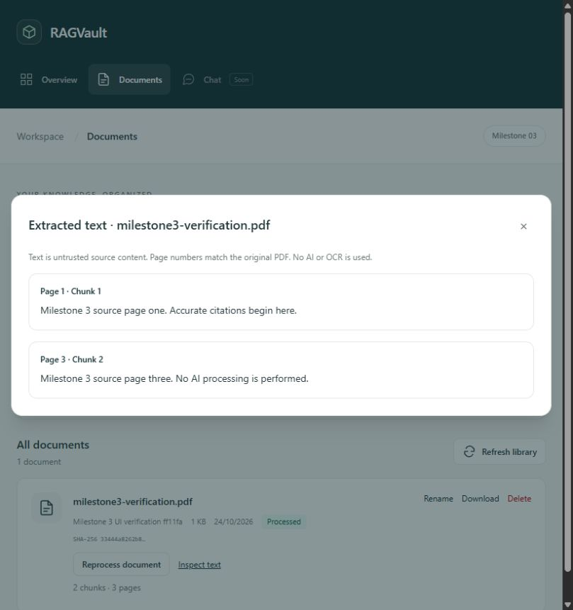

# Milestone 3 verification

Verified locally on 24 October 2026 against the existing native Windows app and PostgreSQL,
plus the Linux Docker images. This report records Milestone 3's pre-publication local
verification. Remote publication and CI results are recorded separately in
[GitHub Actions](https://github.com/Amrincode/ragvault/actions); local success alone
does not establish remote CI success. The implementation baseline was commit
`854180f798d4d347234d063c58d9dd2d899081f5`.

## Actual automated results

| Check | Result |
| --- | --- |
| Full backend suite with inherited CI `POSTGRES_PASSWORD` preset | **119 passed**, 1 existing upstream warning |
| Backend Ruff lint | Passed |
| Backend Ruff formatting | Passed; 40 Python files |
| Python dependency consistency (`pip check`) | Passed |
| Frontend Vitest | **24 passed**, 4 test files |
| Frontend ESLint | Passed |
| Frontend Prettier check | Passed |
| TypeScript | Passed (`tsc -b`, also included in production build) |
| Vite production build including local PDF.js assets | Passed |
| Compose configuration | Passed with `config --quiet`; resolved secrets not printed |
| Docker backend and frontend image builds | Passed, final 0.3.0 sources |
| Linux container extraction subprocess | Passed under the 1 GiB address-space limit |
| Alembic upgrade/current on native PostgreSQL | Passed; `0002_document_processing (head)` |
| Native Alembic schema check | Passed; no new upgrade operations detected |
| Container Alembic schema check | Passed; no new upgrade operations detected |
| Privacy/secret/generated-file candidate scan | Passed; no findings |
| Git whitespace check | Passed |

The existing Starlette TestClient/HTTPX deprecation warning remains non-blocking.
No dependencies were added for this milestone. Release metadata is now 0.3.0.

## Coverage and design decisions

The new backend cases cover deterministic chunk coverage and ordering, paragraph/Unicode
normalization, overlap, word boundaries, long tokens, empty/short pages, invalid settings,
actual multipage extraction, page numbering, blank and image-only PDFs, timeout/start/crash
and malformed child results, size/page/text/chunk limits, checksum replacement detection,
missing originals, safe failure messages, database persistence and atomic commit failure,
retry/reprocessing without duplicates, active/expired/superseded claims, deletion cascades,
invalid UUIDs and pagination. A source-text fixture containing instructions remains plain
stored text and causes no instructions to be executed.

Frontend additions cover process and retry interactions, busy/duplicate-click prevention,
processing recovery controls, no-text feedback, source page labels, plain-text rendering
of HTML-like content, pagination, loading failures and library refresh after processing.
All earlier Milestone 1/2 tests remain included.

The implementation uses an explicitly triggered synchronous subprocess with per-process
admission control. Page-local character chunks favor citation accuracy over cross-page
context. A committed attempt token exposes progress and guards atomic chunk replacement;
stale claims can be retried after timeout plus grace. Original PDFs are immutable. No
queue, model calls, OCR, embeddings, vector columns or chat were added. See
[the processing architecture](architecture/pdf-processing.md) for the complete limits,
transaction sequence, API and future pgvector plan.

## Live verification and preservation checklist

- [x] Apply the additive migration while retaining original tables and row values.
- [x] Verify PostgreSQL schema consistency from both native and container environments.
- [x] Upload a newly generated three-page PDF in a uniquely named verification collection.
- [x] Extract known source text on pages 1 and 3; preserve blank page 2 in page counting.
- [x] Confirm chunk text matches the original source and persists in PostgreSQL.
- [x] Process twice: two chunks after each attempt, no duplicate rows.
- [x] Confirm the original PDF bytes are unchanged after processing.
- [x] Delete only the verification document and confirm its chunks cascade to zero rows.
- [x] Remove only the verification collection, preserving existing rows and files.
- [x] Compare original row values, existing upload fingerprints and `.env` before/after.
- [x] Use the browser at `http://localhost:5173/documents` to process a separate synthetic PDF.
- [x] Observe the busy indicator, final status/counts, and page-aware chunk inspector.
- [x] Remove that browser fixture and restore the normal library view.
- [x] Build both images and execute a three-page extraction fixture in Linux `/tmp`.
- [x] Preserve the existing PostgreSQL Docker volume; do not stop/reset its service.
- [x] Keep `.env`, PDFs, database data, temporary fixtures and builds out of Git candidates.
- [x] Complete local review before the separately approved commit and publication.

Automated suites use temporary SQLite databases and upload directories. Live verification
uses only newly created synthetic fixtures and cleans them up by their recorded UUIDs;
it never processes, renames or deletes existing user documents.

## Limitations and remaining concerns

No unresolved implementation or verification failures remain. Extraction is heuristic,
does not OCR scanned pages, and cannot guarantee reading order for every PDF layout.
Character windows are not model token limits. A long job occupies an API thread; limits
and a single parser slot per API process bound the initial implementation, not a durable
cross-worker job queue. Windows has no hard parser memory ceiling; transient page text
must be materialized before size checks. Linux extraction uses an address-space ceiling.
Parser subprocesses are not a filesystem/privilege security sandbox. Reprocessing
invalidates previous chunks before replacing them, so failures intentionally leave no
old extraction to inspect. A database outage may leave a stale processing claim needing
an explicit retry. The app remains single-user/local-only without authentication.

Milestone 4 is outside this implementation and verification report.

## Complete changed-file inventory

The list below includes all intended tracked modifications and new source/documentation
files. Generated artifacts and private verification helpers are excluded.

| Change | File |
| --- | --- |
| Modified | `.env.example` |
| Modified | `README.md` |
| Modified | `backend/app/api/library.py` |
| Modified | `backend/app/core/config.py` |
| Modified | `backend/app/main.py` |
| Modified | `backend/app/models/__init__.py` |
| Modified | `backend/app/models/library.py` |
| Modified | `backend/app/schemas/library.py` |
| Modified | `backend/app/services/library.py` |
| Modified | `backend/pyproject.toml` |
| Modified | `docs/architecture/document-library.md` |
| Modified | `frontend/package-lock.json` |
| Modified | `frontend/package.json` |
| Modified | `frontend/src/components/AppShell.tsx` |
| Modified | `frontend/src/hooks/useLibrary.ts` |
| Modified | `frontend/src/lib/api.ts` |
| Modified | `frontend/src/pages/DashboardPage.tsx` |
| Modified | `frontend/src/pages/DocumentsPage.test.tsx` |
| Modified | `frontend/src/pages/DocumentsPage.tsx` |
| Modified | `frontend/src/types/library.ts` |
| Created | `backend/alembic/versions/0002_document_processing.py` |
| Created | `backend/app/services/chunking.py` |
| Created | `backend/app/services/pdf_extraction.py` |
| Created | `backend/app/services/processing.py` |
| Created | `backend/tests/test_chunking.py` |
| Created | `backend/tests/test_processing.py` |
| Created | `docs/architecture/pdf-processing.md` |
| Created | `docs/screenshots/text-chunks.png` |
| Created | `docs/verification-milestone-3.md` |
| Created | `frontend/src/features/documents/ProcessingActions.test.tsx` |
| Created | `frontend/src/features/documents/ProcessingActions.tsx` |
