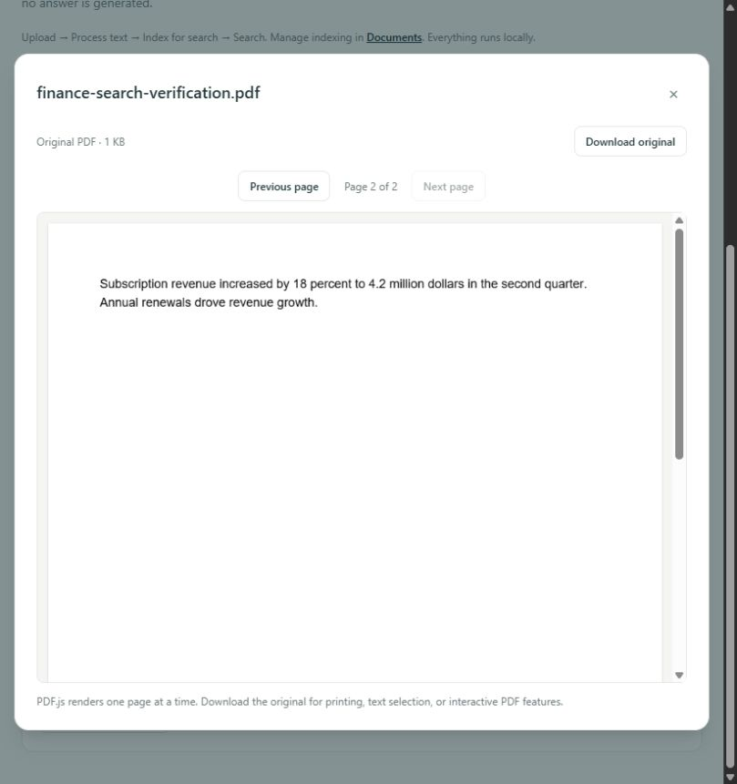

# Milestone 4 verification

Verified locally on 25 October 2026. This report records Milestone 4's pre-publication
local verification. The implementation baseline was Milestone 3 commit
`315710c8d3d56d9c363016aa0b075b230594834a`. Publication and remote CI results are
recorded separately in [GitHub Actions](https://github.com/Amrincode/ragvault/actions);
local success alone does not establish remote CI success. The workflow includes explicit
PostgreSQL vector integration tests. Milestone 5 is outside this report.

## Actual automated and runtime results

| Check | Result |
| --- | --- |
| Complete backend suite, including explicit PostgreSQL vector tests | **167 passed**, 1 existing upstream warning |
| Mocked/unit backend coverage within that run | 163 passed; no real Ollama required |
| Isolated PostgreSQL/pgvector coverage within that run | 4 passed, embeddings mocked |
| Frontend suite | **37 passed**, 6 files |
| Ruff lint and formatting | Passed; 50 Python files formatted |
| ESLint and Prettier checks | Passed |
| Python dependency consistency | Passed; pgvector integration installed |
| TypeScript and Vite production build | Passed |
| Compose configuration | Passed without printing resolved environment secrets |
| PostgreSQL, backend and frontend image builds | Passed |
| Container → PostgreSQL/pgvector distance query | Passed |
| Container → Windows Ollama embedding request | Passed; actual dimension 768 |
| Native migration/current/schema check | Passed; `0003_semantic_search (head)` |
| Container Alembic schema check | Passed; no new upgrade operations detected |
| Native health and `/search` availability | HTTP 200 |
| Browser index → scoped search → original PDF page | Passed |
| Candidate privacy/secret/generated-file review | Passed |

The existing Starlette TestClient/HTTPX deprecation warning remains non-blocking. The
default test run skips the four explicitly enabled PostgreSQL cases unless
`RAGVAULT_TEST_POSTGRES=1`; the complete result above used that flag and executed all four.
No automated test calls a real embedding model. CI's first test step uses mocks and its
later PostgreSQL step explicitly enables vector integration after migration.

New coverage validates provider batches, dimensions, malformed/nonfinite/zero vectors,
timeouts and connection failures, model identity/fingerprints, retry/reindex and duplicate
prevention, atomic persistence failure, active/stale claims, concurrent source replacement,
no-text rejection, resource limits, SQL parameterization, invalid requests and scope.
Real pgvector tests cover ranking, page metadata, collection/document boundaries, model
digest changes, mixed model dimensions, reprocessing invalidation and deletion cascades.
Frontend cases cover indexing/retry, filters and option pagination, loading/errors/empty
results, compatibility notices, safe text rendering and opening the cited original page.
All earlier Milestone 1–3 tests remain included and pass.

During development, a new claim regression caught a naive/aware datetime comparison in
ORM in-memory synchronization; claims now execute their conditional comparison in the
database. Test database connections also gained explicit timeouts and schema-qualified
table creation. Those issues were resolved before the successful complete run.

## Database compatibility and preservation

Before changing the running image, the existing server was verified as PostgreSQL
**17.11**, PGDATA major **17**, Alpine **3.24.3**. A candidate pgvector **0.8.7** image
was built from the same pinned PostgreSQL Alpine runtime. Its PostgreSQL and musl
binaries matched the original byte-for-byte. Only pgvector extension files were copied
from the build stage into the unchanged runtime base.

A private ignored `pg_dump` backup was created before replacement. The existing named
volume was retained, and the PostgreSQL cluster system identifier remained unchanged.
Original collection/document/chunk row values, uploaded file bytes and `.env` were
fingerprinted and compared after migrations, tests and live fixture cleanup; all matched.
The migration adds nullable/defaulted indexing metadata and derived embedding storage.
It does not reprocess or index any existing user document.

Automated PostgreSQL tests use qualified tables in unique `ragvault_test_…` schemas,
temporary uploads, mocked vectors and bounded connections/statements. Only their own
schemas are removed. Live checks used newly generated PDFs in uniquely named collections;
cleanup used only recorded fixture UUIDs. All such verification documents/collections
were removed; no user records or uploads were deleted or renamed.

## Live retrieval evidence

The configured local `nomic-embed-text` model returned **768-dimensional** vectors.
Dimensions were established from actual responses and then validated in every batch;
production vector storage is dimensionless and does not hardcode 768. The local model
digest and both prefixes are incorporated in compatibility fingerprints.

The dataset contained **three synthetic PDFs, four chunks, two collections**:

| Indexing sample | Chunks | Client wall time |
| --- | ---: | ---: |
| finance-verification.pdf | 2 | 11,281.13 ms |
| backup-verification.pdf | 1 | 194.11 ms |
| nature-verification.pdf | 1 | 244.08 ms |

| Question | Actual top result | PDF page | Cosine similarity | Client wall time |
| --- | --- | ---: | ---: | ---: |
| How much did subscription revenue increase? | finance-verification.pdf | 2 | 0.8589 | 2,536.88 ms |
| How are database backups protected and how long are they kept? | backup-verification.pdf | 1 | 0.8680 | 175.39 ms |
| How do forests remove carbon dioxide from the air? | nature-verification.pdf | 1 | 0.7984 | 2,593.97 ms |

All **3/3 expected document/page pairs ranked first**. Excerpts contained the known
revenue, encrypted-backup/retention and photosynthesis passages. Times include provider
and API/database work; they are observations, not throughput or cold-start guarantees.
No approximate index was introduced. This tiny sample is not evidence of excellent
general retrieval quality or performance on a representative corpus.

Collection filtering excluded higher-scoring out-of-scope finance passages when Nature
was selected. Document filtering returned only the selected PDF. Conflicting document
and collection scope was rejected with 422. Reindexing preserved the correct vector
count, reprocessing removed the former vectors and made scoped search empty until
reindexing, and deleting fixtures cascaded their chunk/vector rows to zero.

Browser verification used another synthetic finance PDF. The library transitioned from
Not indexed → Indexing → Indexed, displayed the real model and 768 dimensions, and the
question with both filters selected ranked page 2 first. **Open original** displayed
the corresponding PDF.js page 2 and its matching revenue text.

## Milestone 4 checklist

- [x] Check PostgreSQL major/runtime compatibility before attaching the existing volume.
- [x] Create an ignored private backup; preserve cluster identity, records, uploads and `.env`.
- [x] Enable pgvector with an explicit Alembic migration; no startup schema creation.
- [x] Verify actual model dimensions; validate identity, dimensions and vectors.
- [x] Index existing chunks in bounded batches without re-extracting PDFs.
- [x] Provide retry/reindex with atomic replacement and stale-source invalidation.
- [x] Enforce document/collection filters in parameterized server-side vector queries.
- [x] Return original excerpts, document names, pages and distance/similarity scores.
- [x] Implement search/indexing UI, errors/empty states and original-page navigation.
- [x] Run all previous/new tests, quality checks, production and Docker builds.
- [x] Verify native and container schema consistency and real Ollama connectivity.
- [x] Measure and report a small, known-passage retrieval sample honestly.
- [x] Review credentials, personal paths, uploads and generated/private artifacts.
- [x] Complete local review before the separately approved commit and publication.
- [x] Keep chat, generated answers and Milestone 5 outside this work.

## Limits and remaining issues

No unresolved implementation/verification failures remain. Exact cosine ranking may
return irrelevant nearest passages; similarity is not confidence and there is no
calibrated cutoff or broad corpus evaluation. Indexing/search are synchronous, occupy
API threads, use per-process admission limits and bounded provider/batch work, and have
no durable queue. Model/prefix changes deliberately require reindexing; old indexes
are excluded. A database outage can leave a lease requiring explicit stale-attempt retry.
Earlier extraction limitations, including no OCR and the Windows transient-memory caveat,
remain. The app is single-user/local-only without authentication.

See [architecture, limits and API decisions](architecture/semantic-search.md). Commit,
push and remote CI follow explicit publication approval.

## Complete changed-file inventory

Only intended source, migration, test, configuration, documentation and synthetic
screenshots are included below. Private backups, fixture PDFs, helper scripts, test
databases, `.env`, caches, builds and dependency directories remain ignored.

| Change | File |
| --- | --- |
| Modified | `.env.example` |
| Modified | `.github/workflows/ci.yml` |
| Modified | `README.md` |
| Modified | `backend/app/core/config.py` |
| Modified | `backend/app/main.py` |
| Modified | `backend/app/models/__init__.py` |
| Modified | `backend/app/models/library.py` |
| Modified | `backend/app/schemas/library.py` |
| Modified | `backend/app/services/library.py` |
| Modified | `backend/app/services/processing.py` |
| Modified | `backend/pyproject.toml` |
| Modified | `docker-compose.yml` |
| Modified | `docs/architecture/pdf-processing.md` |
| Modified | `frontend/package-lock.json` |
| Modified | `frontend/package.json` |
| Modified | `frontend/src/components/AppShell.tsx` |
| Modified | `frontend/src/components/Icon.tsx` |
| Modified | `frontend/src/features/documents/LibraryDialogs.tsx` |
| Modified | `frontend/src/features/documents/PdfPreview.test.tsx` |
| Modified | `frontend/src/features/documents/PdfPreview.tsx` |
| Modified | `frontend/src/features/documents/ProcessingActions.tsx` |
| Modified | `frontend/src/hooks/useLibrary.ts` |
| Modified | `frontend/src/lib/api.ts` |
| Modified | `frontend/src/main.tsx` |
| Modified | `frontend/src/pages/DashboardPage.tsx` |
| Modified | `frontend/src/pages/DocumentsPage.tsx` |
| Modified | `frontend/src/types/library.ts` |
| Created | `backend/alembic/versions/0003_semantic_search.py` |
| Created | `backend/app/api/search.py` |
| Created | `backend/app/schemas/search.py` |
| Created | `backend/app/services/embeddings.py` |
| Created | `backend/app/services/indexing.py` |
| Created | `backend/app/services/search.py` |
| Created | `backend/tests/test_embeddings.py` |
| Created | `backend/tests/test_indexing.py` |
| Created | `backend/tests/test_search.py` |
| Created | `backend/tests/test_vector_postgres.py` |
| Created | `database/Dockerfile` |
| Created | `docs/architecture/semantic-search.md` |
| Created | `docs/screenshots/search-source-page.png` |
| Created | `docs/screenshots/semantic-search.png` |
| Created | `docs/verification-milestone-4.md` |
| Created | `frontend/src/features/documents/IndexingActions.test.tsx` |
| Created | `frontend/src/features/documents/IndexingActions.tsx` |
| Created | `frontend/src/pages/SearchPage.test.tsx` |
| Created | `frontend/src/pages/SearchPage.tsx` |
| Created | `frontend/src/types/search.ts` |
