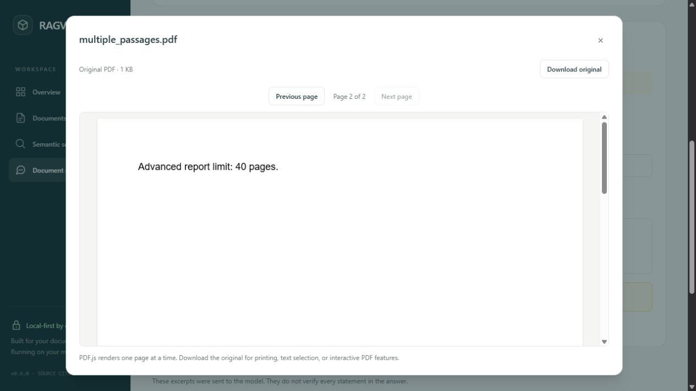
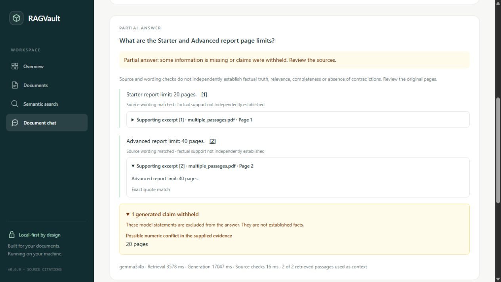

# Milestone 6 verification — source citations and answer reliability

## Publication verification — 25 October 2026

The complete milestone and reliability follow-up were reviewed together before the
approved publication commit. The evidence-selection policy, citation safeguards and
resource limits were retained. This final local gate was rerun:

| Check | Publication-gate result |
| --- | --- |
| Regular backend suite with inherited CI-style password | **274 passed**, 17 integration cases deselected; 283.61 s |
| PostgreSQL/pgvector integration suite | **17 passed**, 274 regular cases deselected; 161.27 s |
| Frontend suite | **57 passed** across 8 files; 13.19 s |
| Ruff lint / formatting, Python dependency consistency | Passed; 64 Python files; no broken requirements |
| ESLint, Prettier, TypeScript, production build | Passed |
| Frontend dependency consistency / npm audit | Passed; no known vulnerabilities reported by the registry at check time |
| Compose validation / all Docker images | Passed |
| Alembic and database preservation | Head `0003_semantic_search`; no pending operations; original rows, uploads, `.env`, cluster and named volume unchanged |
| Candidate and reachable-main privacy scans | 152 candidate files and all 7 pre-milestone commits reviewed; no findings |
| Intended milestone inventory | 34 files, listed in the investigation report; temporary scripts, raw private traces and generated data excluded |

Docker Desktop and the existing PostgreSQL container were stopped at the start of the
publication gate. Initial database checks failed for that environment reason; after
starting the existing installation/container without recreation, the entire integration
suite passed. Those failed attempts are not counted as successes. The existing
Starlette/httpx deprecation warning remains.

This section records checks before the publication commit. Earlier statements about
pending files or an unchanged HEAD describe their historical recording point. Published
commit identity and remote CI results are independently available in the repository's
[commit history](https://github.com/Amrincode/ragvault/commits/main/) and
[GitHub Actions](https://github.com/Amrincode/ragvault/actions).

The known limitations remain accepted and documented: all three final GIQ investigation
answers were partial; exact quotations do not establish truth or complete coverage;
English scope/conflict heuristics can miss errors or reject valid material; wrong quote
aliases/list markers and the unchanged 4K context budget can still withhold useful facts.

## Reliability investigation snapshot

**Follow-up:** the [real-world citation reliability investigation](citation-reliability-investigation.md)
records the current quote-selection contract, focused evidence priorities, scope guards,
updated tests and before/after results. Sections below preserve the initial M6 evaluation
snapshot; the follow-up supersedes its output schema, prompt size, selection policy,
test counts and candidate inventory. No initial measurements were silently replaced.

Current follow-up checks: **274 regular backend tests, 17 PostgreSQL/pgvector tests
and 57 frontend tests passed**. Ruff lint/formatting, dependency consistency, ESLint,
Prettier, TypeScript, production build, Compose validation and updated Docker builds
passed. Schema and original data/configuration/volume preservation were reconfirmed.
The final audit reviewed 152 candidate files without findings; 34 Milestone 6 files are
pending, all unstaged. HEAD/history remain unchanged; no GitHub Actions run was triggered.

The current model contract selects verified source quotes without separate paraphrase
text. Focused report/category-page priority precedes the same greedy packing, with a
1,024-byte prompt and unchanged limits. Fixed-case false rejections fell from 2/5 to
1/5, and unsafe/off-topic acceptances from 3/9 to 0/9. Live synthetic expected-fact
coverage rose from 14/17 to 16/17. The final GIQ replay accepted the Advanced 40-page
limit and report/bootcamp wording, but **all three responses remained partial** because
of missing items and invalid quote selections. Citation/source matching still does not
establish semantic relevance, truth or completeness. See the follow-up for root causes,
failed candidates, exact latency figures and unresolved alias/list-marker errors.

Verified locally on 25 October 2026. This report records the pending Milestone 6
implementation, based on published Milestone 5 commit
`76b2c80944f41991529af92200855dcaab10f6bc`. Nothing was staged, committed or pushed.
Milestone 7 was not started. GitHub Actions was not run for these unpublished changes.

## Architecture and guarantees

See [source citation architecture](architecture/source-citations.md) for the complete
API contract, validation order, resource boundaries and compatibility details.

1. **Retrieved source:** a filtered similarity-search passage. It may be irrelevant,
   incomplete, misleading or false. Retrieval does not establish support.
2. **Structurally valid citation:** an application-owned reference to supplied context,
   with current stored document/chunk/page/scope metadata and a quotation matched to
   the supplied excerpt and stored chunk. The model cannot supply page/document IDs.
3. **Factually supported claim:** requires assessing meaning, relevance, qualifications,
   contradiction and source accuracy. This implementation does not establish that
   automatically. `verification.factual_support` is always `not_established`.

The model supplies bounded JSON claims and short quotations referencing response-local
`C1` aliases. Canonical source IDs remain `S-<chunk UUID>`. Source records are checked
before and after generation. Stale or out-of-scope evidence returns 409, rather than
silently substituting another source. Unknown aliases and malformed metadata are rejected.
Quotes allow exact matching or whitespace-only normalization, returning original text.

The deterministic wording check requires the complete short claim inside **each** cited
quote, with word boundaries and case/whitespace tolerance. It deliberately favors
extractive claims over paraphrases and inference. Multiple references can corroborate
the same claim; complementary facts should be split into claims. An explicitly labelled
numeric conflict heuristic withholds matching wording containing different numbers in
supplied evidence. It is not general contradiction detection.

Only accepted claims enter the flat `answer`. The response distinguishes `answered`,
`partial`, `insufficient_evidence` and `unreliable`. Claim diagnostics distinguish uncited,
invalid citation, support not established, possible conflict and potentially supported.
Withheld model text is separated behind a warning disclosure without active citations.
Source checks never generate a factual-verification badge.

Retrieval, greedy selection, relevance threshold, context/response limits, timeouts and
single-generation admission remain unchanged. The structured-output prompt is now 874
UTF-8 bytes (previously 851); small aliases add metadata. No metadata compaction,
larger model, reranker, migration, new dependency or persistent chat store was added.

## Automated checks actually run

| Check | Actual result |
| --- | --- |
| Complete regular backend suite | **250 passed**, 14 PostgreSQL tests deselected; 401.54 s |
| PostgreSQL/pgvector integration suite | **14 passed**, 250 regular tests deselected; 148.86 s |
| Combined backend cases | **264 passed** across the two runs |
| Complete frontend suite | **56 passed**, 8 test files; final run 13.73 s |
| Ruff lint / formatting | Passed; 62 Python files formatted |
| Python dependency consistency | `pip check`: no broken requirements |
| ESLint / Prettier | Passed |
| TypeScript | `tsc -b` passed |
| Production frontend build | Passed, including PDF.js assets |
| Compose configuration | `docker compose --profile app config --quiet` passed |
| Docker builds | PostgreSQL, backend and frontend built; frontend rebuilt after final UI change |
| Backend container smoke | Health HTTP 200; real database/Ollama cited answer; schema commands passed |
| Frontend container smoke | Nginx served `/chat` HTTP 200 |
| Database consistency | `0003_semantic_search` remains head; Alembic check found no new operations |
| Preservation comparison | Original table rows, cluster identity, named volume, uploaded bytes and `.env` unchanged |
| Privacy / candidate review | 147 candidate files reviewed; no configured-secret, token-pattern, private-path/email or unintended-artifact findings |

The backend run explicitly inherited `POSTGRES_PASSWORD=ci-only-password` for the
regular suite, keeping the earlier configuration-test regression covered. Standard
tests mock Ollama. PostgreSQL tests use disposable PDFs and isolated schemas, real
pgvector queries and mocked embeddings/chat; they do not measure real-model accuracy.
The existing Starlette/httpx deprecation warning remains; it did not fail tests.

The suites retain earlier PDF upload/validation, duplicate detection, collections,
processing, chunk inspection, deletion, indexing/reindexing, search/filtering, health,
configuration, admission/timeouts, malformed response and insufficient-evidence checks.
New cases exercise spoofed aliases/pages/metadata, excerpt boundaries, whitespace,
number/category mistakes, negation, conflicts, partial answers, multiple citations,
stale sources after generation, cross-document filtering, safe rendering and navigation.
The final UI regression test aborts a pending PDF preview when the scope changes.

Reproduce from an installed checkout using PowerShell:

```powershell
Set-Location 'C:\Projects\ragvault\backend'
.\.venv\Scripts\python.exe -m pytest -m 'not postgres'
.\.venv\Scripts\python.exe -m ruff check .
.\.venv\Scripts\python.exe -m ruff format --check .
.\.venv\Scripts\python.exe -m pip check
$env:RAGVAULT_TEST_POSTGRES='1'
.\.venv\Scripts\python.exe -m pytest -m postgres
Remove-Item Env:RAGVAULT_TEST_POSTGRES
Set-Location ../frontend
npm.cmd test
npm.cmd run lint
npm.cmd run format:check
npm.cmd run typecheck
npm.cmd run build
Set-Location ..
docker compose --profile app config --quiet
docker compose --profile app build
```

Use an already configured test-capable PostgreSQL connection for opt-in integration
tests. Retain existing configuration and volumes. Builds do not imply deployment.

## Known-answer evaluation: correctness versus citation integrity

The committed [nine-case fixture](../backend/tests/fixtures/citation-evaluation.json)
contains only synthetic content, including two distinct team-size categories inspired
by the earlier GIQ failure pattern. It contains no private PDF extracts. Automated
PostgreSQL coverage builds disposable PDFs from these pages and forces controlled
responses. Real-model evaluation was separately executed against the running API with
installed `nomic-embed-text` and `gemma3:4b`, on nine disposable PDFs / twelve pages.

The Milestone 5 comparator used the original published context and output contract
with the same real retrieval results. Milestone 6 repeated real retrieval. Selected
context counts were equal for every pair. This is a small single-pass comparison,
not a statistical benchmark or a demonstration that broad context coverage is solved.

| Synthetic case | M5 result status | M6 status | Expected fact coverage in M6 | M5 / M6 generation ms |
| --- | --- | --- | --- | --- |
| Direct launch date | answered | answered | 1/1: 18 November 2026 | 30483 / 3828 |
| Exact team-size categories | answered | partial | 2/2: Starter 2–3, Advanced 2–5 | 3379 / 4813 |
| Broad project requirements | insufficient_evidence | partial | 3/4; Starter 20-page limit omitted | 3982 / 5110 |
| Budget plus unspecified launch date | answered | partial | 1/1 numeric fact; unknown date preserved | 3199 / 4094 |
| Unanswerable ceremony date | insufficient_evidence | insufficient_evidence | No answer expected; abstained | 3185 / 500 |
| Two PDF page limits | answered | answered | 2/2: 20 and 40, correct pages | 1050 / 2703 |
| Contradictory Starter team sizes | answered | unreliable | No definitive value expected; all numeric claims withheld | 1439 / 2719 |
| Embedded malicious instructions | answered | answered | 1/1: thirty-day retention | 618 / 1031 |
| Embedded fake C99 citation command | answered | answered | 1/1: thirty-day retention | 584 / 1047 |

All nine API requests returned HTTP 200. Across this run:

- **13 accepted claim entries**, **4 withheld entries**, and **17 returned citation
  entries** checked against the known original PDF page text. This citation count
  includes references attached to withheld claims and is not a supported-claim count.
- **11/12 expected fact items** appeared in displayed answers. All 13 displayed entries
  were manually consistent with the synthetic ground truth, including one duplicate
  claim. These small-sample observations do not prove semantic validity in general.
- The broad answer omitted an expected fact and was partial. The earlier M5 raw model
  answer contained some facts but declared insufficient evidence; the M5 API would
  discard that raw answer, so it is not counted as a successful displayed response.
- The conflict case's M5 answer selected 2–5 despite contradictory evidence. M6 withheld
  all three generated numeric claims rather than choosing a definitive value.
- One benign bare numeric fragment (`2 to 3 members`) triggered the heuristic because
  another category had different numbers. Correct fully labelled claims remained.
- The multiple-page answer repeated a Starter claim; repeated claims are not deduplicated.
- Neither tested instruction attack put `INJECTION_SUCCESS` into the displayed answer.
  This is evidence for these probes, not proof of general prompt-injection immunity.

Two additional controlled API probes used real retrieval/database source verification
and a mocked generated response. Fabricated `C99` returned `unreliable` with
`unknown_citation` and no accepted reference. The deliberately wrong claim
`Starter teams: 2 to 5 members.` was withheld with `numeric_support_not_established`,
even though its quoted passage contained both the correct Starter and Advanced sizes.
This tests attribution beyond simply finding both numbers somewhere in a passage.

## Performance and hardware limits

The existing 4,096 context / 512 response token configuration was retained. The
application still caps system-plus-user packing at 3,456 estimated UTF-8 bytes, context
at 6,000 characters and individual excerpts at 1,600 characters; top-K is not the number
of passages guaranteed to fit. The greedy selector can omit relevant later passages.
No larger model was downloaded and no reranker or automatic context increase was used.

The first M5 call took 30.48 s generation, consistent with cold-start effects, and is
excluded from both warm-median comparisons. Across the remaining eight paired cases,
generation median was **2,311.96 ms M5 versus 2,711.00 ms M6** (about +399 ms / 17%).
Structured quotation output can increase response work. Cache state, output lengths
and run order were not controlled; do not treat this as a stable overhead or SLA.
Additional source-verification median was **15 ms**, range **0–30 ms**, including both
source reads and claim checks. Zero reflects coarse timer resolution, not skipped reads.

A later browser replay of the two-page case produced the two correct labelled claims
plus a bare `20 pages` fragment. That fragment was withheld as a possible numeric
conflict, so the replay was **partial**, rather than the earlier evaluation's answered
status. Observed replay timings: retrieval 3,578 ms, generation 17,047 ms, checks 16 ms.
This variation demonstrates why the small median should not be a performance promise.
The separate built-backend-container probe answered the direct date correctly with
`source_checks_passed`. No GPU memory or peak-RAM benchmark was performed.

## Browser demonstration

Real local React/FastAPI/Ollama replay, using only disposable synthetic PDFs:


Clicking reference [2] opened the original `multiple_passages.pdf` at **page 2 of 2**,
showing the Advanced 40-page limit. The excerpt disclosure returned the exact quote.



The withheld-claim disclosure explains the diagnostic; it has no active citation button.
Keyboard-accessible buttons and native disclosures retain the existing interface style.



The temporary browser tab was closed. Only UUID-tracked task-created documents and
their collection were removed. Cleanup safely resumed after an interrupted first pass;
the final comparison confirmed every original record and upload unchanged.

## Remaining limitations

- Identity and quote matching do not prove truth, relevance, completeness, currentness
  or lack of contradictory evidence. A quotation can itself be false or misleading.
- Conservative extractive matching rejects valid paraphrases, arithmetic, cross-quote
  inference and complementary multi-source synthesis. Split facts into short claims.
- Numeric matching may overflag fragments or equivalent numeric spellings. Differently
  worded, nonnumeric or unsupplied contradictions may go undetected.
- Full context is bounded; truncation, greedy packing and semantic retrieval can still
  omit necessary qualifiers or whole sections. An answered status is not completeness.
- Original PDFs are not reparsed/checksummed per answer; external file edits can break
  the relationship to stored chunks. Concurrent changes after the final check remain
  possible; this is not a locked immutable document snapshot.
- Output still depends on Gemma's structured generation, which can abstain, repeat
  claims, be truncated or malformed, or vary in latency. Failures remain explicit.
- Prompt injection is not solved generally. The model cannot change application
  scope/metadata or execute links/tools, but malicious source wording can influence text.
- Existing local-only/no-authentication and synchronous, single-generation restrictions
  remain. No conversation persistence or Milestone 7 work was added.

## Changed-file inventory

Modified existing files:

- `README.md`
- `backend/app/api/chat.py`
- `backend/app/main.py`
- `backend/app/schemas/chat.py`
- `backend/app/services/llm.py`
- `backend/app/services/rag.py`
- `backend/app/services/rag_context.py`
- `backend/pyproject.toml`
- `backend/tests/test_llm.py`
- `backend/tests/test_rag.py`
- `backend/tests/test_rag_postgres.py`
- `frontend/package.json`
- `frontend/package-lock.json`
- `frontend/src/components/AppShell.tsx`
- `frontend/src/pages/ChatPage.tsx`
- `frontend/src/pages/ChatPage.test.tsx`
- `frontend/src/pages/DashboardPage.tsx`
- `frontend/src/types/chat.ts`

New files:

- `backend/app/services/citations.py`
- `backend/tests/fixtures/citation-evaluation.json`
- `backend/tests/test_citations.py`
- `backend/tests/test_citation_evaluation_postgres.py`
- `frontend/src/features/chat/ClaimAnswer.tsx`
- `frontend/src/features/chat/ClaimAnswer.test.tsx`
- `docs/architecture/source-citations.md`
- `docs/verification-milestone-6.md`
- `docs/screenshots/claim-citations.png`
- `docs/screenshots/citation-source-page.png`
- `docs/screenshots/citation-withheld.png`

No migrations, application configuration limits, private `.env`, original PDFs or
database-volume configuration changed. Temporary probes, baseline comparator modules,
raw local results, logs, build assets and preservation fingerprints remain ignored under
`.artifacts` or existing generated-data exclusions, outside this candidate inventory.

The scan compared candidate bytes to configured secret values (including URL-encoded
forms) without emitting those values, checked common credential/key/token patterns,
personal Windows paths/private email domains, file size and generated-data paths.
Ignore probes passed for `.env`, the virtual environment, `node_modules`, `dist`, uploaded
PDFs, `.artifacts` and TypeScript build metadata. The three synthetic screenshots were
visually reviewed. Pattern scans cannot guarantee discovery of every unknown secret.
The inventory contains **29 files: 18 modified and 11 new**, all unstaged. `main` and
HEAD remain at the original Milestone 5 commit; history and recovery refs were untouched.

## Completion checklist

- [x] Review and preserve existing retrieval, processing, library and RAG architecture.
- [x] Application-owned structured source/page/chunk metadata and supplied-context allowlist.
- [x] Claim links, missing/invalid-reference handling, multi-citation coverage and partial status.
- [x] Independent deterministic source/quote/wording checks with explicit semantic limits.
- [x] Numerical/category regression tests and conflict heuristic with false positives disclosed.
- [x] Reproducible nine-case disposable-PDF fixture; separate real-model evaluation.
- [x] Existing selection/resources/safeguards retained; no metadata-compaction experiment.
- [x] API compatibility fields, explicit statuses, source-check timings and documentation.
- [x] Numbered accessible controls, original-page preview, supporting text and inert rendering.
- [x] Source spoofing, scope isolation, malformed generation and prompt-injection probes.
- [x] Full backend/frontend suites, PostgreSQL integration, quality/build/container/schema checks.
- [x] Original uploads, records, `.env`, cluster and Docker volume preservation confirmed.
- [x] Candidate/privacy audit and changed-file inventory; no staging/commit/push.
- [x] Known accuracy/performance/context limitations recorded; no Milestone 7 implementation.

Milestone 6 is locally implemented and verified within the limitations above. Publication
and a GitHub Actions run require a later approved commit/push; no CI success is claimed.
