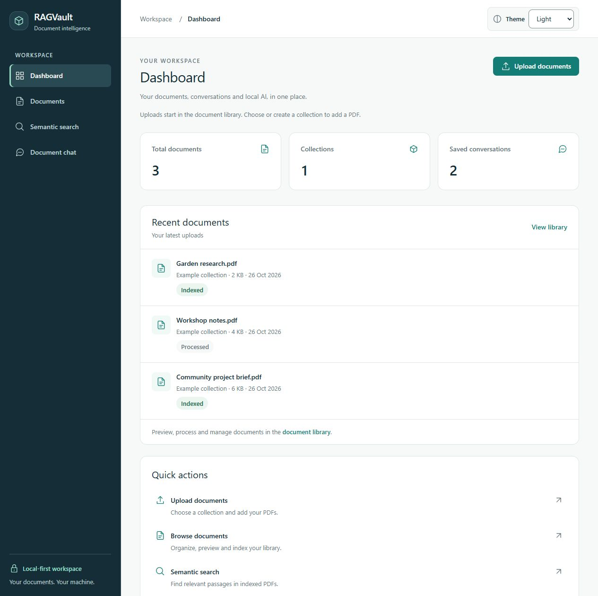
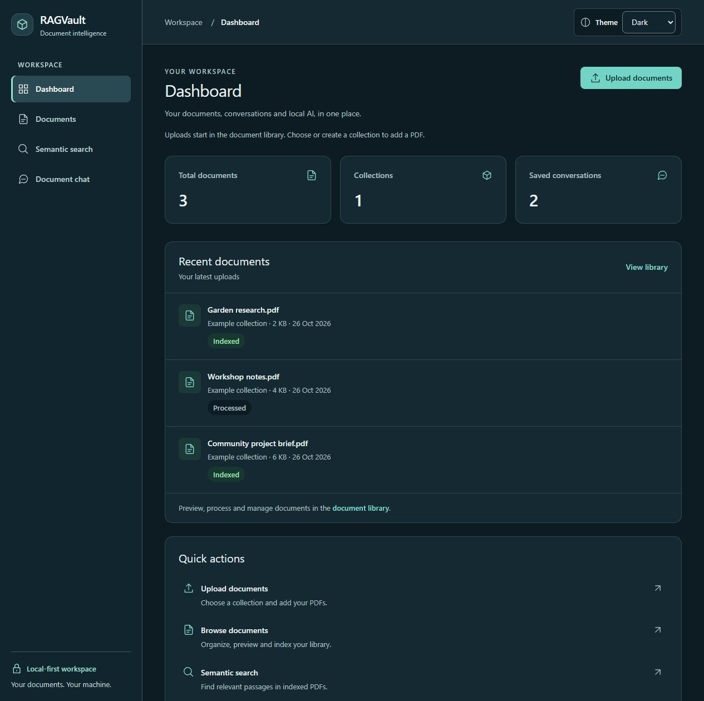
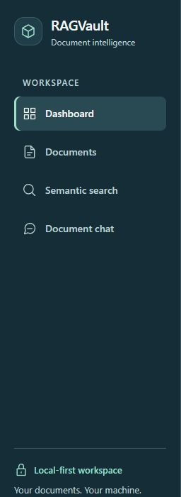
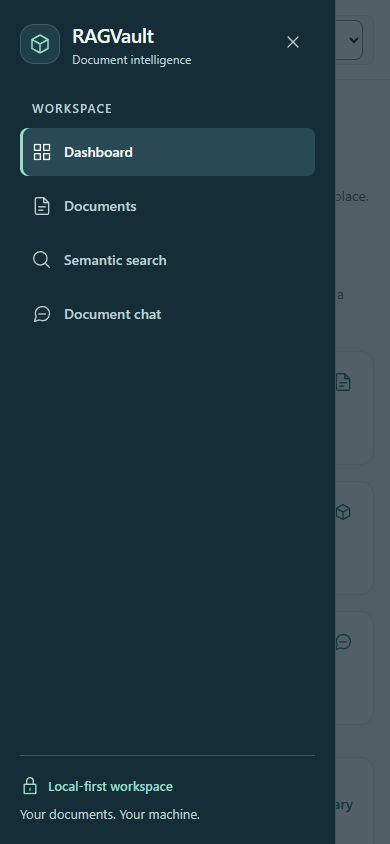
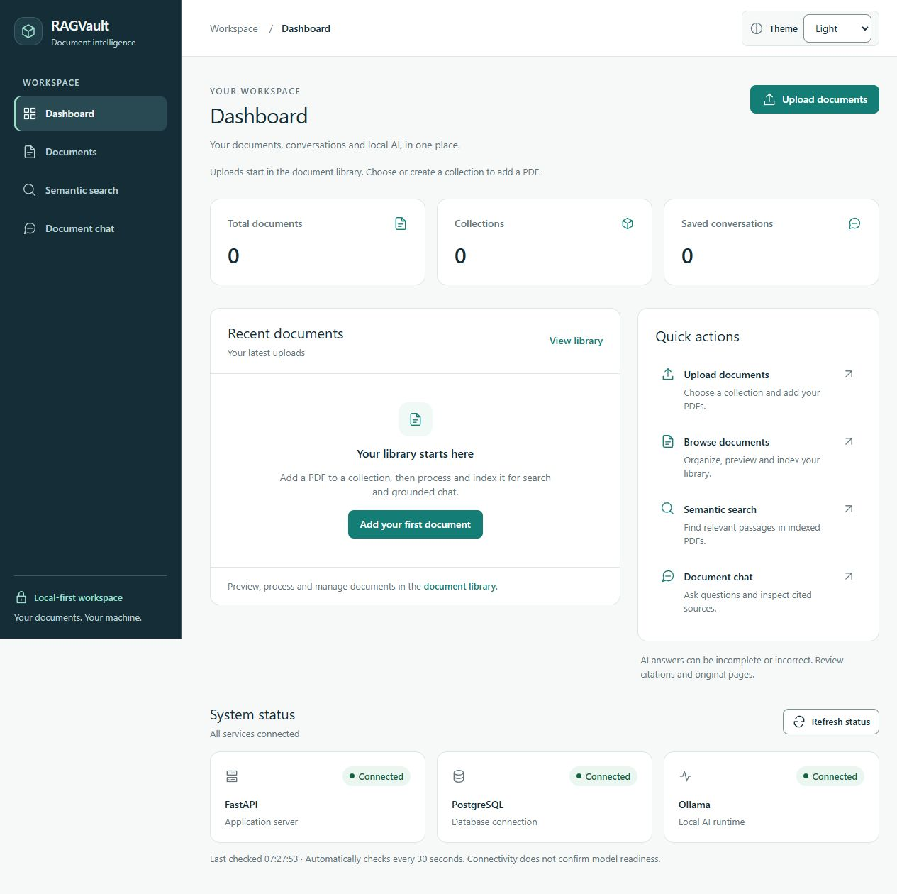

# Stage 8.2 verification — navigation and dashboard

Implemented and verified locally on 26 October 2026, based on
`174a5b87d091d42ca1b2356a093f35cfed8daedb`. The initial implementation checkpoint
preceded publication approval; the approved final review is recorded below.
Stage 8.3 has not started.

## UI changes and scope

The shared shell now uses a deep navy desktop sidebar with consistent existing SVG
icons, larger navigation targets, restrained teal active indicators and `aria-current`.
Branding and workspace hierarchy replace developer version/milestone labels. Existing
route destinations remain `/`, `/documents`, `/search` and `/chat`.

Below 1024 px, an accessible menu toggle opens a native modal drawer. Close, Escape,
outside click or route selection dismiss it. Initial Close focus, explicit boundary
Tab/Shift+Tab wrapping, native background inertness, body scroll locking and trigger
restoration are retained. Crossing to desktop closes the drawer and releases scrolling.
The existing skip link targets a programmatically focusable main. Router-level focus
handling focuses a destination after its DOM commits, rather than racing route changes.
The native, labeled Light/Dark/System selector remains available in the header at all
sizes. The header is in normal flow; it does not overlay the composer or PDF viewer.

The dashboard provides a workspace heading, a document-upload entry link, three real
summary totals, up to five recent uploads with useful metadata and document states,
working quick links, and independently checked system status. Shared Card, Button,
Badge, EmptyState and LoadingIndicator components use the established semantic tokens.
No gradients, charts, new dependencies or layout animations were introduced.

Documents, Search, Chat, PDF contents, RAG behavior, citations, model settings, backend
APIs, dependency files and migrations were not changed. Theme preference infrastructure
is unchanged; only its selector presentation was updated.

## Real data sources and performance

| Display | Existing source and meaning |
| --- | --- |
| Total documents | `GET /api/documents?limit=20&offset=0`, unfiltered `total`, not the returned page length |
| Collections | `GET /api/collections`, length of the complete unpaginated collection response |
| Saved conversations | `GET /api/conversations?limit=20&offset=0`, response `total`, including empty saved conversations |
| Recent documents | First five of the document page; backend orders by `created_at DESC, id DESC`. Shows upload date, size, collection when available, and individual processing/indexing state |
| System status | Existing `GET /api/health` via `useHealth`; initial/manual check and 30-second interval. Valid degraded health means the API is reachable; an unobserved dependency is shown as Not checked |

Workspace data needs three parallel requests, with no per-document requests, library
pagination walk or polling. Each resource settles independently, with a 15-second
dashboard timeout and unmount cancellation. Retry reloads those three resources;
health refresh is separate. Failed totals say Unavailable, not zero. A healthy service
check does not imply that library requests succeeded or that AI models are ready.

An accurate workspace-wide **indexed document count is deferred**: the existing API
does not supply it. Counting indexed documents from one page would be misleading.
No backend endpoint was added to fill a summary card.

Upload links lead to the existing library, where users choose/create a collection and
upload; they do not claim to open an upload modal directly. Recent-document management
links lead to that library because an existing document detail/deep-link route is not
available. No fake per-document detail links were added.

## Actual checks run

| Check | Result |
| --- | --- |
| Complete frontend suite | **192 passed in 17 files**; includes the previous 174 tests and 18 new navigation/dashboard cases |
| ESLint | Passed |
| Prettier | Passed |
| TypeScript | Passed (`tsc -b`) |
| Production build | Passed; no new runtime dependencies; dev component preview remains excluded |
| Dashboard states | Accurate totals rather than page lengths, loading, real zeros/empty, unavailable backend, partial resource failures, independent health, degraded dependencies, retry, 20-item page capped to five, long filenames and aborted/late requests passed |
| Navigation tests | Four active routes, unchanged links, skip link, keyboard activation, close/Escape, focus boundaries/restoration, new-route focus, breakpoint closure, scroll cleanup and themes passed |
| Theme browser checks | Light and Dark inspected; Dark/System persisted on reload; System resolved to host Dark; original Light preference restored |
| Responsive browser checks | 320, 390, 768 and 1280 px; no horizontal overflow in checked dashboard views, including long filenames at 320 px |
| Mobile integration | Existing library, search, saved chat and synthetic PDF/citation rendering worked at 390 px; drawer route focus reached the new main; composer sent a contextual follow-up |
| Live health | `/api/health` HTTP 200; FastAPI, PostgreSQL and Ollama connected |
| Live disposable PDF | Upload, byte-identical download, extraction and real embedding/indexing passed |
| Live filtered search | API and browser returned the owned synthetic passage only; browser cosine similarity 0.832, retrieval 2296 ms |
| Live saved chat | Gemma returned the pruning requirement, one accepted claim and an available citation; duplicate request replay reused the original turn |
| Live generation timing | Initial synthetic answer: retrieval 125 ms, generation 9985 ms, total 10110 ms |
| Live follow-up | Enter showed pending feedback, then returned the same grounded requirement with an available citation; four saved messages survived reload; citation opened PDF page 1 |
| Preservation | Owned fixtures removed; original six table digests, `.env`, uploads, PostgreSQL cluster identity and Docker mounts match their baseline |

The initial targeted test run had one incorrect expected status label (Unknown versus
the existing Not checked label), which was corrected. Visual review caught duplicate
card padding. Native focus testing exposed a browser-chrome boundary step, addressed
with explicit drawer boundary wrapping. Live route navigation exposed a premature
focus attempt, addressed by the router-level effect and a distinct-page regression test.
All reported final tests were run after these corrections.

The backend was available for these live checks. This was a focused synthetic smoke
test, not a rerun of the full backend/PostgreSQL automated suites or an answer-quality
evaluation. The unchanged backend still emits its existing Starlette/httpx test-client
deprecation warning in verification helpers. No new GitHub Actions run was triggered
at that initial checkpoint.

## Approved publication review — 26 October 2026

The final review found no need to change the working application implementation.
Navigation and dashboard still use the Stage 8.1 tokens, shared components and theme
provider. Routes, API clients, backend behavior, dependencies and migrations are preserved.
Three workspace requests use genuine existing responses; there is no synthetic product
data or assumed healthy state in the production implementation.

| Check rerun for publication | Actual result |
| --- | --- |
| Complete frontend suite | 192 passed in 17 files |
| Frontend ESLint / Prettier / TypeScript / production build | Passed |
| Regular backend suite | 314 passed; the 21 opt-in PostgreSQL cases skipped in this invocation |
| Separate PostgreSQL/pgvector suite | All 21 passed in disposable test schemas; 314 regular cases deselected |
| Backend Ruff lint / formatting / `pip check` | Passed; 72 Python files already formatted; no broken requirements |
| Existing schema | `0004_conversations (head)`; Alembic found no new upgrade operations |
| Compose / retained PostgreSQL container | Compose configuration valid; existing container healthy |
| Browser themes | Dark and System choices persisted through reload; System resolved to Dark on this host; original Light restored |
| Mobile drawer and routes | Close focus, boundary Tab/Shift+Tab wrapping, Escape trigger restoration, body scroll cleanup and destination-main focus passed at 390 px |
| Live PDF/search/chat | Owned synthetic PDF upload, original-byte download, extraction, real indexing, filtered retrieval, saved answer with an available citation, and duplicate-turn replay passed |
| Initial real generation | Retrieval 125 ms, generation 10312 ms, verification 16 ms, total 10453 ms; one accepted claim |
| Cleanup/preservation | Owned fixture records removed; current original six table digests, configuration, upload hashes, cluster and mounts unchanged |

The live browser also rechecked library PDF rendering, document-filtered search and
saved-answer citation navigation inside the mobile shell. These are focused synthetic
integration checks, not a broad answer-quality evaluation. Existing accuracy and
accessibility limitations below remain applicable.

Deleting the owned synthetic PDF temporarily returned HTTP 503 during cleanup; normal
retries succeeded. No original file was deleted and no backend deletion behavior was
changed. This transient cleanup limitation remains disclosed rather than being hidden
by a code change outside this UI stage.

Publication preservation is compared with the **current** local workspace state, rather
than assuming the earlier implementation checkpoint is still current. Normal PDF
reprocessing can invalidate an existing vector index; publication does not reindex user
documents or replace their data. Use the existing Index for search action when needed.

Only the documented source, tests, documentation and five synthetic screenshots are
included. Disposable PDFs, API fixtures, scripts, raw browser/verification artifacts,
local configuration and database files remain excluded. The exact staged blobs and
reachable main history are scanned before publication. The approved push uses only
`main` to `origin/main`, without force or tag following. CI results are checked for that
exact commit after pushing; see [workflow runs](https://github.com/Amrincode/ragvault/actions/workflows/ci.yml).

## Accessibility findings and limits

Checked meaningful headings, semantic regions/lists, real link destinations, visible
status wording, labeled controls, accessible icon-button names, focus visibility, native
modal background behavior, keyboard drawer boundaries, Escape, route focus, skip link
and no hidden body-scroll lock after dismissal. Navigation controls use 44–48 px targets.
Existing 68 semantic contrast assertions passed in both themes, including navigation
text/selected indicators and control/focus boundaries. No palette values were changed.
The existing reduced-motion rule was reviewed; the new shell/drawer adds no animated
opening/closing transition. A real OS reduced-motion toggle was not exercised.

This is not a complete WCAG certification. Screen-reader, forced-colors, every zoom
level, physical mobile keyboards and a broad browser/device matrix remain untested.
Existing page-specific density and answer-quality limitations remain. The synthetic
garden fixture demonstrates integration only; it does not establish broad RAG accuracy.

## Privacy-safe visual evidence

These screenshots show the actual frontend against a **separate temporary synthetic
API fixture**, not the user's library or a real service-health measurement. Names,
counts and health states in these images are illustrative fixture responses. Real
integration was checked independently as described above. No original PDF names,
private collection names, conversation content, credentials or filesystem paths appear.
Fixture scripts and raw logs remain ignored in `.artifacts`; preview servers were stopped.

## Changed-file inventory

Modified:

- `README.md`
- `docs/design-system.md`
- `frontend/src/components/AppShell.tsx`
- `frontend/src/components/Icon.tsx`
- `frontend/src/main.tsx`
- `frontend/src/pages/DashboardPage.tsx`
- `frontend/src/styles.css`
- `frontend/src/theme/ThemeSelector.tsx`

Created:

- `docs/verification-milestone-8-2.md`
- `docs/screenshots/dashboard-light.png`
- `docs/screenshots/dashboard-dark.png`
- `docs/screenshots/dashboard-empty.png`
- `docs/screenshots/navigation-desktop.png`
- `docs/screenshots/navigation-mobile.png`
- `frontend/src/components/AppShell.test.tsx`
- `frontend/src/components/RouteFocus.tsx`
- `frontend/src/hooks/useDashboard.ts`
- `frontend/src/pages/DashboardPage.test.tsx`

Only the listed 18 files belong to Stage 8.2. Privacy checks cover candidate source/docs
and built assets for configured secrets, personal emails/Windows paths and token/key
patterns; generated/data paths and temporary verification scripts are excluded. Git
history is preserved. Publication is limited to this inventory after explicit approval;
temporary verification artifacts remain ignored.
