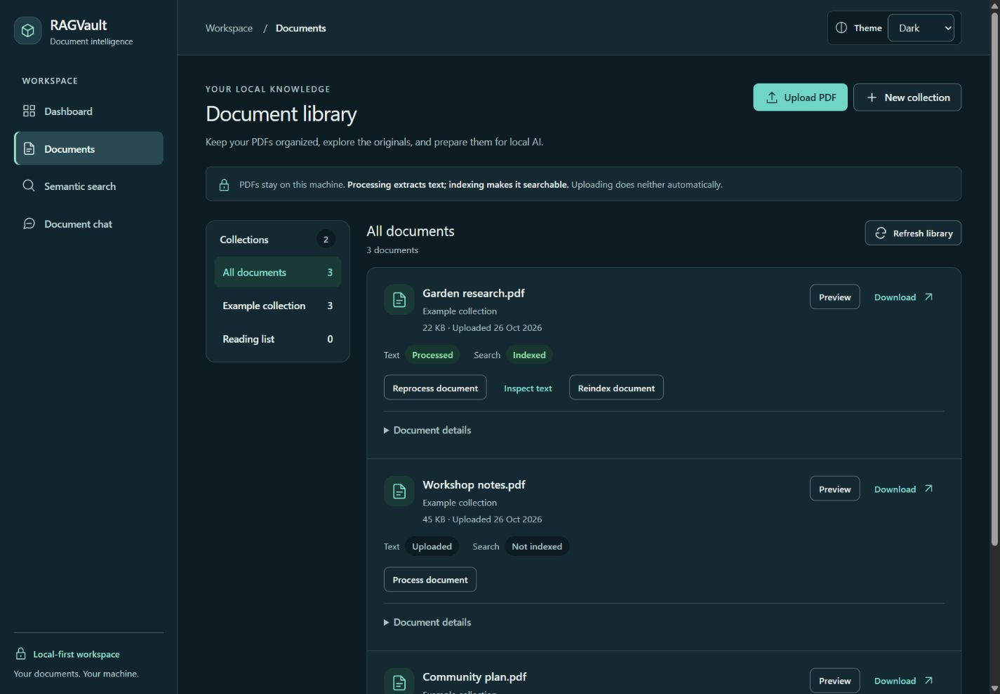
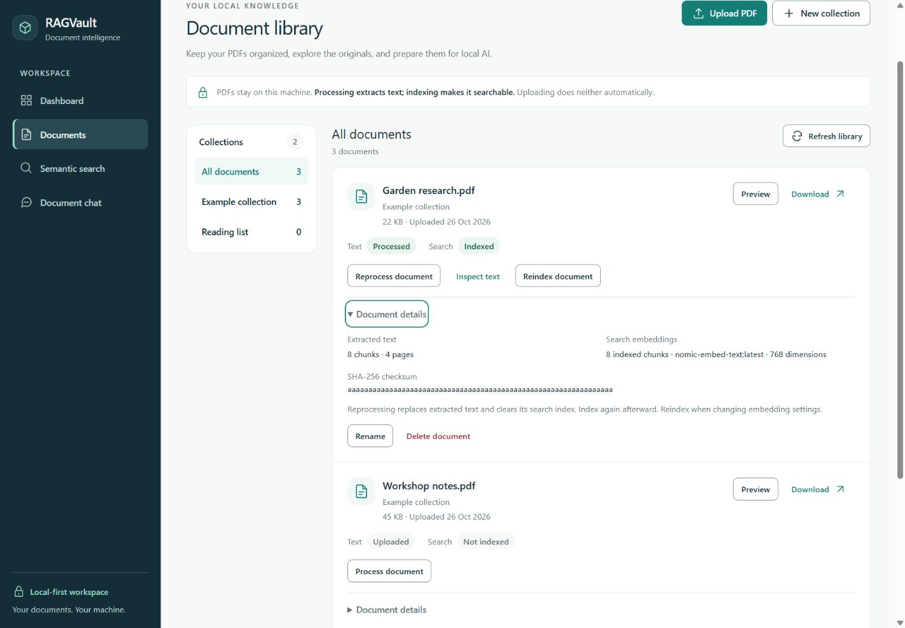
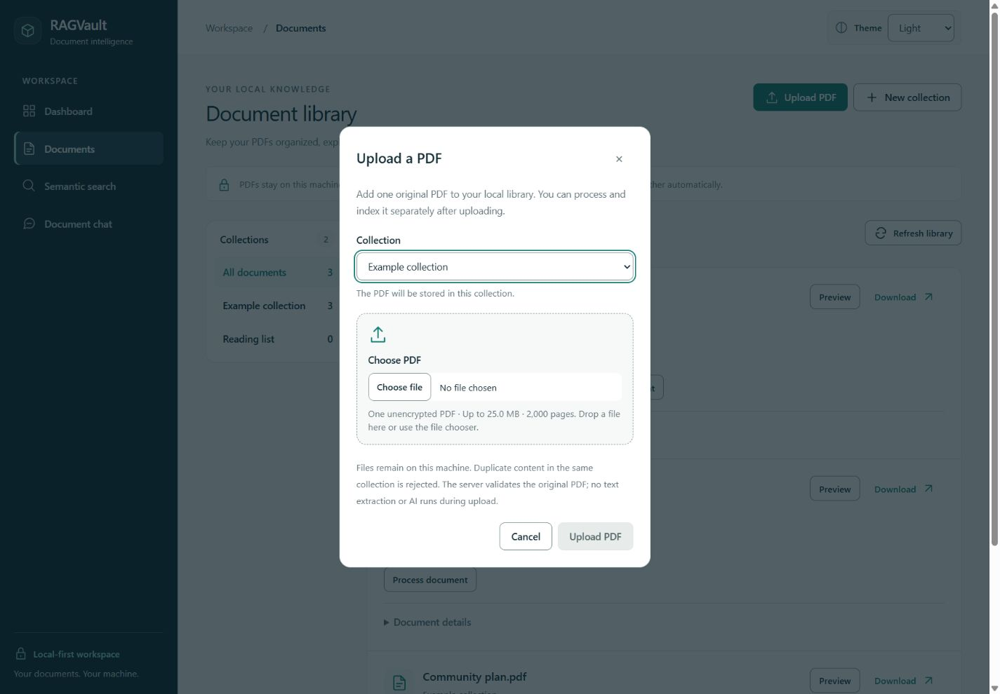
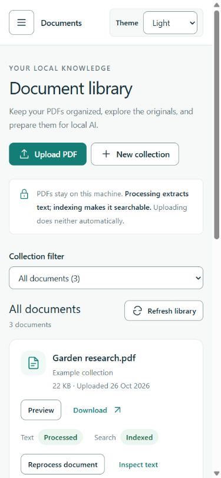
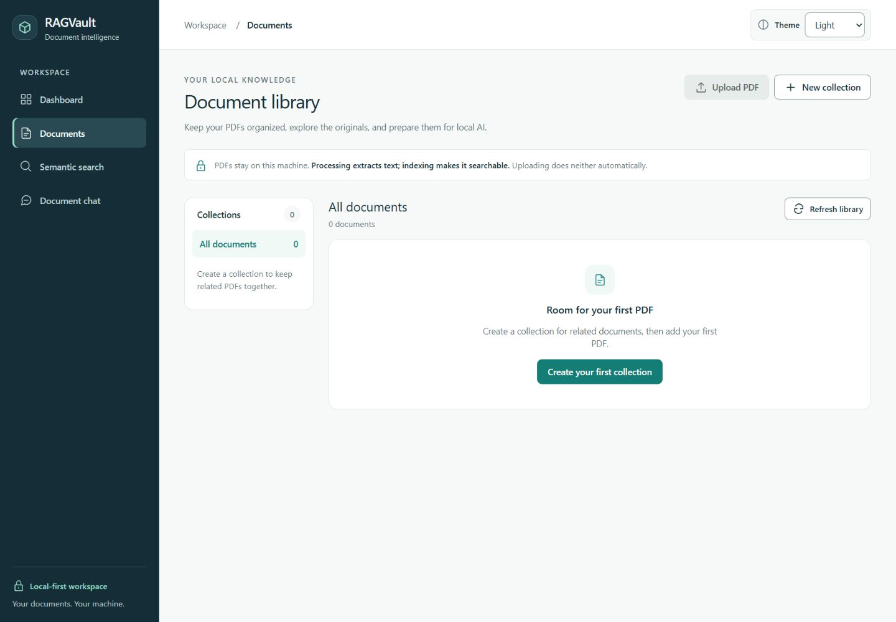

# Stage 8.3 verification — professional document library

Implemented locally on 26 October 2026, based on
`13be06cbb72d4dfa1fc1cef135b51f4ce954730b`. The initial implementation checkpoint
preceded publication approval; the approved final review is recorded below.
Stage 8.4 has not started.

## Implementation and scope

The document library uses the Stage 8.1 semantic tokens, typography and shared Card,
Button, Badge, FormField, Input, EmptyState and LoadingIndicator components inside the
unchanged Stage 8.2 navigation shell. The header makes Upload PDF the primary action
and New collection secondary. A concise explanation distinguishes extraction from
indexing and states that uploading performs neither automatically.

Collections appear in a sidebar at 1280 px and above, with a labeled native selector
below that breakpoint. Selection, counts, rename, empty-collection deletion and server
collection filtering are preserved. Non-empty collection deletion is disabled with an
explanation; backend rejection is still surfaced if the collection changes meanwhile.

Each document prioritizes its complete filename, collection, byte size, upload date,
Preview and Download. Filenames wrap instead of losing text to truncation. Separate
Text and Search badges display actual processing and indexing fields. Processed text
does not imply a completed index. Processing, indexing and failure-recovery buttons
remain visible, along with text inspection when supported and safe error feedback.

An inline native **Document details** disclosure holds chunk/page counts, embedding
metadata, the full checksum, reprocessing guidance, Rename and confirmed Delete.
It is not an overflow menu/popover and adds no menu keyboard model or outside-click
behavior. Native disclosure keyboard/focus behavior is retained. Full PDF preview,
download, extraction, reprocessing, indexing and text inspection use existing API clients.
Deleting a row/collection moves focus to the persistent list heading; other dialogs
restore their trigger. Destructive confirmation and failure/retry feedback are retained.

The upload dialog shows the selected filename and size, destination, actual configured
byte/page restrictions and unencrypted-PDF policy. It keeps file selection and drag/drop,
requires one PDF, and retains backend validation. Busy feedback reflects the actual
pending request; no progress percentage is fabricated. Upload success is announced in
the library and says that processing and indexing are separate steps. Failures leave
the dialog open for retry; duplicate submission and cancellation are blocked while busy.

## Data and state handling

The existing endpoints, contracts, types, page size and ordering are unchanged:

- Collections and counts: complete `GET /api/collections` response.
- Document count, ordering and page: `GET /api/documents?limit=20&offset=...`, with the
  existing optional collection filter. Counts come from the server; the all-collections
  sidebar count sums the existing collection counts.
- Upload restrictions: existing `GET /api/library/config`.
- Metadata, statuses and actions: existing document/processing/indexing/chunk endpoints.

`useLibrary` now distinguishes initial loading, a successful empty response, and failure.
An initial failure does not present an empty library or an invented zero count. A failed
refresh can keep the same view's last loaded data with an explicit warning. Changing a
collection/page immediately hides the previous view's documents, aborts old requests and
ignores late responses. Polling remains limited to documents actually processing/indexing;
it pauses during a pending refresh or error to avoid overlapping polling requests.

No client-side filename filter, library-wide filename search, unsupported sorting,
cross-collection document movement or new aggregate API was added. No background processing,
OCR or automatic indexing was added. At the implementation checkpoint, the existing
uploaded user PDF was unindexed; its state was preserved during those checks.

Backend source/contracts, schemas/migrations, `.env`, dependency files, Ollama settings,
RAG generation/retrieval, citations, saved conversations, Search, Dashboard, application
navigation and the PDF renderer were not changed.

## Actual tests and quality checks

| Check | Result |
| --- | --- |
| Complete frontend suite | **216 passed in 19 files**; the previous 192 tests plus 24 new cases |
| Focused document suites | 43 passed across list, processing, indexing, upload and document-row tests |
| ESLint | Passed |
| Prettier | Passed |
| TypeScript | Passed (`tsc -b`) |
| Production build | Passed; no new dependencies |
| Existing semantic contrast tests | 68 assertions passed; palette values unchanged |

Coverage includes list metadata and full names; each processing/indexing state;
visible failed-action recovery; no automatic processing/indexing; collection selection;
upload type/size/multiple-file validation, server errors, pending state and success;
preview/download; rename and confirmed document deletion; empty-collection restrictions
and backend rejection; initial failure versus empty, stale refresh and retry; pagination
and collection/page reset; hidden technical metadata and focus after deletion. Existing
Search, Chat, citation, PDF rendering, navigation and theme tests remain in the full suite.

Initial checks caught a generated JSX delimiter, test expectations for the old exposed
rename/delete controls, and a test-query option unsupported by Testing Library's types.
These were corrected. Browser review caught cramped mobile filenames; primary actions
now move below the filename area on small screens. Final checks include that correction.

The complete backend and PostgreSQL automated suites were **not rerun at the initial
implementation checkpoint**. No backend test pass or CI run was claimed then. The
approved publication review below subsequently ran both suites. Initial live verification
used the real existing services and owned synthetic PDFs only.

## Approved publication review — 26 October 2026

Review against the published design system found no need to change application code.
Only this verification report was updated during finalization. Shared semantic tokens,
native controls/disclosures, explicit processing/indexing states, recovery controls,
server pagination and the existing preview integration remain intact.

Docker Desktop, FastAPI and Vite were stopped at the start of this review. The installed
Desktop app, existing PostgreSQL container and unchanged development servers were started.
No container/volume recreation, database migration upgrade/downgrade or configuration
edit was needed. A new private baseline recorded current original files, public records,
processing/indexing states, cluster/mount identity and Git refs before synthetic work.

| Check rerun for publication | Actual result |
| --- | --- |
| Complete frontend suite | 216 passed in 19 files |
| ESLint / Prettier / TypeScript / production build | Passed |
| Regular backend suite | 314 passed; 21 opt-in PostgreSQL tests skipped in this invocation |
| Separate PostgreSQL/pgvector suite | All 21 passed in isolated disposable schemas; 314 regular cases deselected |
| Backend Ruff lint / formatting / `pip check` | Passed; 72 Python files already formatted; no broken requirements |
| Retained database revision / metadata | `0004_conversations (head)`; no new upgrade operations detected |
| Compose / existing PostgreSQL | Configuration valid; existing container healthy |
| Library themes | Light checked; Dark and System choices persisted on reload; System resolved to host Dark; original Light choice restored |
| Narrow layout / metadata | Long synthetic filename wrapped at 320 px without horizontal overflow; full 64-character checksum used `break-all`; collection selection worked at 390 px |
| Keyboard/dialogs | Enter expanded native details; rename input received initial focus; Escape restored its Rename trigger; upload dialog focused its destination field and dismissed with Escape |
| Fresh live API workflow | Owned synthetic upload, byte-identical original download, checksum-preserving rename, explicit text processing, explicit indexing, filtered search and saved grounded chat passed |
| State distinction | Uploaded / Not indexed, then Processed / Not indexed, then Indexed were explicitly asserted |
| Initial synthetic chat | One accepted claim and available citation; retrieval 125 ms, generation 10657 ms, verification 15 ms, total 10797 ms; duplicate request reused the saved turn |
| Browser compatibility | Library preview, mobile route navigation, dashboard real totals/connected health, filtered semantic search, saved chat and citation PDF rendering passed |
| Fresh deletion checks | Three immediate API download/delete probes returned 200/204; the remaining indexed synthetic document returned 204 on its first deletion after browser preview/citation use |
| Cleanup/preservation | Only owned synthetic records removed; current original six-table digests, `.env`/upload/backend hashes, processing/indexing states, cluster and mounts unchanged |

The browser's filtered search returned the owned passage only (cosine similarity 0.832,
observed retrieval 4672 ms). A short automation wait expired before the response arrived;
the completed result was subsequently inspected successfully, with no application error.
Renaming the owned source correctly marked its older saved citation stale. A fresh
contextual answer then used the renamed source with an available citation; opening it
rendered the original PDF page. Citation validation was never bypassed or weakened.

Current workspace state may differ from the earlier implementation snapshot after normal
user activity. Publication preserves the current baseline, including any existing indexed
state, rather than restoring the earlier unindexed snapshot. No original document action
was invoked. The four new synthetic deletion flows needed no retry; the earlier HTTP 503
did not reproduce here. These checks cannot prove that a transient storage failure will
never recur. No backend behavior was changed.

The existing Starlette/httpx test-client deprecation warning and Vitest environment
performance advisory are non-failing. The remaining accessibility and answer-quality
limits still apply; synthetic smoke checks are not a broad RAG accuracy evaluation.
Only the 18 documented source/test/documentation/sanitized-image files are published.
Staged blobs and reachable main history are scanned before committing. The approved push
uses only `main` to `origin/main`, without force or tag following. GitHub Actions is checked
against that exact pushed commit; see [workflow runs](https://github.com/Amrincode/ragvault/actions/workflows/ci.yml).

## Real local integration and deletion check — implementation checkpoint

Docker Desktop and FastAPI were initially stopped. The installed Desktop app, existing
PostgreSQL container and unchanged API were started without recreating containers,
deleting volumes, upgrading/downgrading migrations or editing local configuration.
The running PostgreSQL cluster/mount identity was recorded before fixture creation.

The real browser uploaded an owned two-page synthetic PDF to an owned collection and
verified selected-file metadata, genuine busy feedback, success, explicit text processing,
the intermediate **Processed / Not indexed** state, explicit indexing, **Indexed** state,
extracted-text page numbers, PDF.js original preview and keyboard-opened document details.
The synthetic document was renamed through its dialog; the original download was checked
byte-for-byte against the generated file and the backend checksum, with PDF/attachment
headers. Metadata reported two pages and two indexed chunks.

Document deletion was confirmed through the real UI after preview/download and succeeded
on its first attempt. The now-empty owned collection was renamed and deleted through
its confirmation dialog; focus returned to the list heading. Three additional synthetic
download/delete probes each returned **HTTP 200 for download and HTTP 204 for deletion**.
The earlier temporary HTTP 503 was **not reproduced in these four deletion flows**.
This does not prove it cannot recur; no unrelated backend/storage change was made.

All owned documents/collection were removed. The original six public table digests,
original upload and `.env` hashes, tracked backend files, cluster identifier and Docker
mounts match the pre-implementation baseline. The original user PDF was never processed,
reindexed, renamed, downloaded for this test or deleted. Its unindexed state was preserved
at that checkpoint.
The existing Starlette/httpx test-client deprecation warning remains in snapshot helpers.

## Accessibility and responsive observations

- Checked Light and settled Dark colors and System persistence after reload (System
  resolved to Dark on this host); restored Light afterward. Existing shared theme and
  semantic-contrast assertions passed, with no new literal status palette.
- Checked 320, 390, 768 and 1440 px layouts. No horizontal overflow in the inspected
  library views, including a long filename at 320 px. Mobile uses the native collection
  selector and stacks filename/actions. Collection and document names remain available.
- Native details opened/closed with Enter; metadata is hidden until expanded. Primary
  actions have filename-specific accessible names. There is no custom action menu.
- Name/upload dialogs focus their first enabled field. Escape dismissed the idle upload
  dialog and restored Upload PDF focus. Busy controls are genuinely disabled. The native
  modal prevents background interaction; destructive dialogs keep explicit confirmation.
- Headings, regions, counts, visible status wording, polite busy/success feedback,
  associated labels/hints/errors, and post-deletion list focus were checked. The Stage 8.2
  skip link and navigation remain unchanged.
- Existing reduced-motion CSS was reviewed. No new motion or opening animation was
  added. A real OS reduced-motion toggle was not exercised.

This is not a complete WCAG audit. Screen readers, forced-colors, every zoom level,
physical mobile keyboards and a broad browser/device matrix remain untested. Native file
picker appearance varies by OS. One automated file-chooser interaction returned unusually
slowly; selection/upload completed successfully, and no backend upload timeout was observed.

## Sanitized screenshot inventory

Images are the real frontend rendered against a **separate temporary synthetic API
fixture**. Names, counts, statuses, checksums and embedding metadata in those images are
illustrative; they do not disclose the private workspace or prove live backend results.
Real integration was verified separately above. The upload screenshot shows its idle
state; selected-file metadata was checked in the real browser upload. JPEG files were
captured without image editing. Temporary fixture servers were stopped; the real app
services remain available. Browser viewport overrides were reset.

| File | View |
| --- | --- |
| `screenshots/library-light.jpg` | Desktop document library, Light |
| `screenshots/library-dark.jpg` | Desktop document library, Dark |
| `screenshots/library-details.jpg` | Expanded technical metadata and management actions |
| `screenshots/library-upload.jpg` | Labeled upload dialog, restrictions and destination |
| `screenshots/library-mobile.jpg` | Library at 390 px |
| `screenshots/library-empty.jpg` | Empty library with a working creation action |

## Privacy, files and Git

Privacy checks cover tracked/unignored candidates and generated production assets for
configured secrets, token/private-key patterns, personal emails and Windows user-folder
paths. Generated/data paths, disposable PDFs, fixture servers and verification logs/scripts
are excluded. Only the six synthetic screenshots above are intended documentation assets.
No original PDF contents or private collection/conversation data appear in them.
The final scan covered **213 candidate files**, matched the exact **18-file** inventory,
and found **zero** configured-secret, token/key, private-email or personal-path matches.
Production assets contained no configured-secret matches or development-preview content.

Changed-file inventory (18 files):

Modified:

- `README.md`
- `docs/design-system.md`
- `frontend/src/features/documents/IndexingActions.tsx`
- `frontend/src/features/documents/LibraryDialogs.tsx`
- `frontend/src/features/documents/ProcessingActions.tsx`
- `frontend/src/hooks/useLibrary.ts`
- `frontend/src/pages/DocumentsPage.test.tsx`
- `frontend/src/pages/DocumentsPage.tsx`

Created:

- `docs/verification-milestone-8-3.md`
- `docs/screenshots/library-light.jpg`
- `docs/screenshots/library-dark.jpg`
- `docs/screenshots/library-details.jpg`
- `docs/screenshots/library-upload.jpg`
- `docs/screenshots/library-mobile.jpg`
- `docs/screenshots/library-empty.jpg`
- `frontend/src/features/documents/DocumentRow.tsx`
- `frontend/src/features/documents/DocumentRow.test.tsx`
- `frontend/src/features/documents/UploadDialog.test.tsx`

At the initial checkpoint all changes remained unstaged. Approved publication is limited
to the inventory above; Git history is preserved and temporary artifacts stay excluded. Preview at
[the document library](http://localhost:5173/documents).
