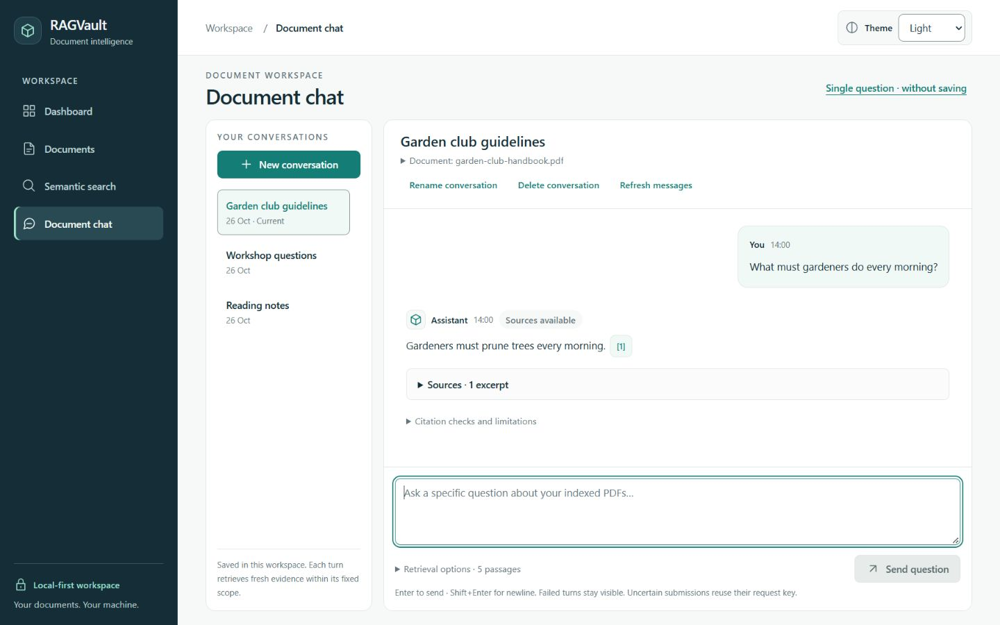
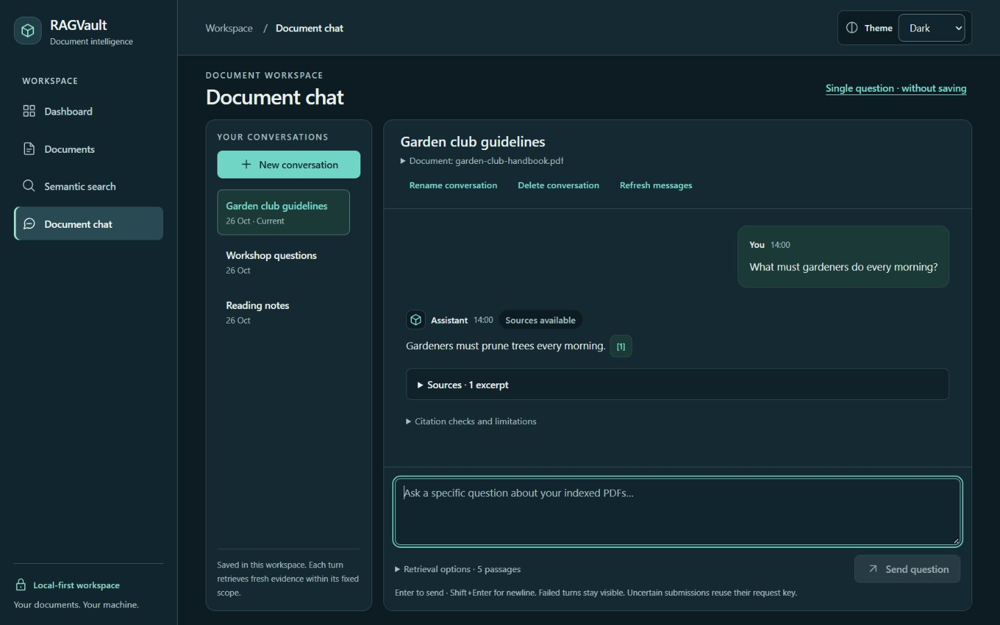
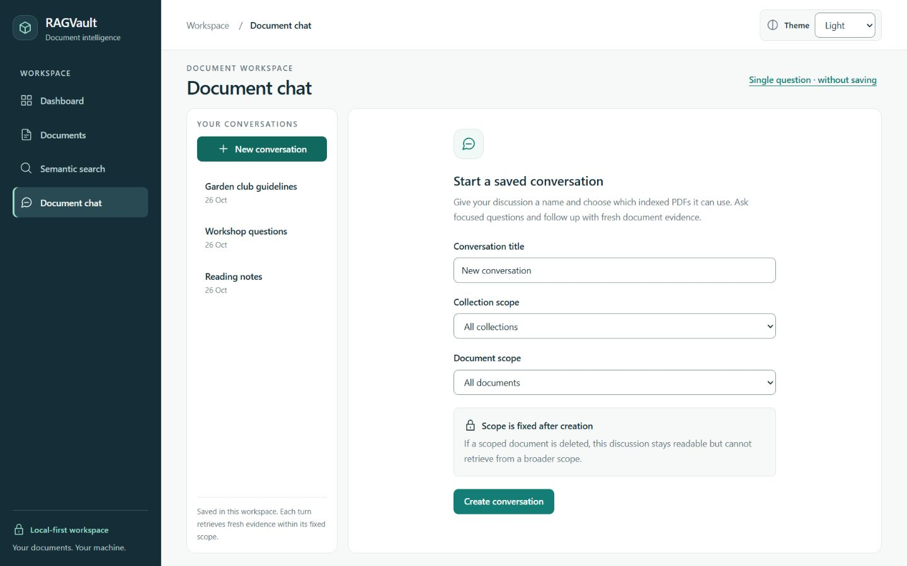
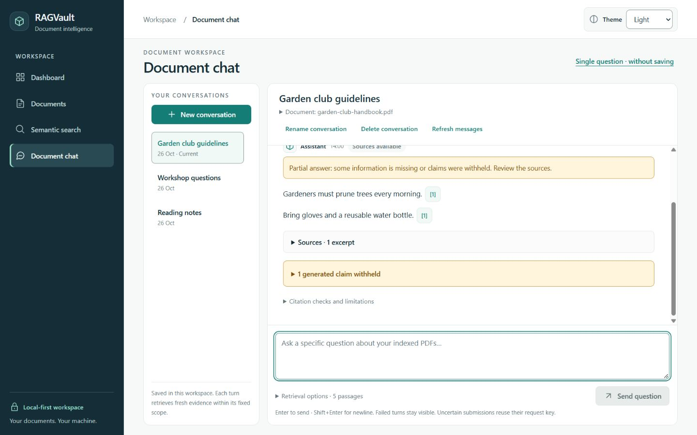
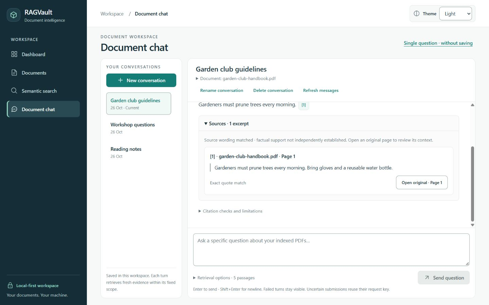
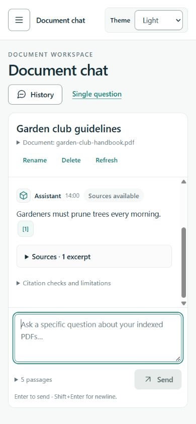
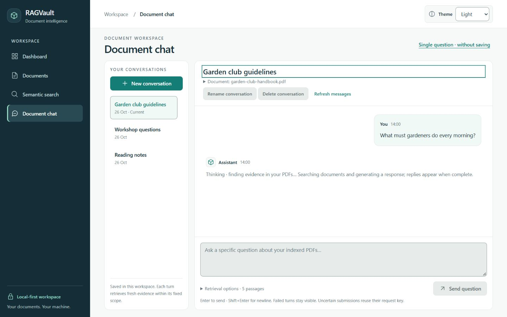

# Stage 8.4 verification — AI chat and conversations

Implemented and checked locally on 26 October 2026, based on
`c405593fb978932437ff578a92263a5e65204191`. The initial implementation checkpoint
preceded publication approval; the approved final review is recorded below.
Stage 8.5 has not started.

## Design and implementation

Saved and single-question chat now use the published semantic colors, typography,
shared controls and Light/Dark/System theme lifecycle. No dependencies or palette
values were added. Navigation, Dashboard, Documents, Search and the PDF renderer
retain their existing implementations.

- Desktop uses a restrained conversation-history panel beside the message workspace.
  Narrow screens expose history in a separate native modal dialog. Active discussions,
  titles, dates, genuine empty/loading/error states and existing pagination remain.
- Named conversation creation keeps the collection and document selectors, server
  pagination and fixed-scope explanation. Missing scope data blocks creation.
- The selected conversation has a readable heading, accessible rename/delete/refresh
  controls and expandable scope details. Long headings display up to two lines; their
  complete title and scope remain available in the disclosure and accessible text.
  This prevents long filenames from consuming the narrow message viewport.
- User messages have a subtle tinted grouping; assistant messages have a role marker
  and comfortable plain-text typography. Short timestamps expose their full local date
  through an accessible label and native title. Full message/quote text wraps.
- The composer sits below the independently scrollable messages. Mobile labels are
  compact while accessible names remain complete. Enter submits; Shift+Enter inserts
  a newline; IME composition does not submit. Default top-K remains 5, with native
  integer validation from 1 to 20 inside Retrieval options.
- Unsent questions survive switching saved conversations in the mounted workspace.
  This is an in-memory draft cache, not new browser storage or server persistence.
  Drafts do not survive reloading or leaving this workspace.
- Pending feedback describes searching and generating with replies appearing when
  complete. No token streaming, simulated percentages or invented phase telemetry
  was added. Failed turns, uncertain submissions and scope unavailability remain
  distinct, with their existing recovery actions.

## Citations and uncertainty

Accepted claims retain their exact application-provided text and numbered inline PDF
controls. A single expandable **Sources** section per answer replaces repeated excerpt
panels inside individual claims. Visual cards are grouped only when source ID, document,
collection, chunk, filename, page, original excerpt and match method are identical.
Every claim keeps its own original number and callback, including aliases to the same
card. Different quotes, pages or exact/normalized metadata remain separate. Grouping
does not cross messages or renumber references.

Original quotes, filename/page and exact versus whitespace-normalized match information
remain readable, with existing original-page navigation. They are not described as
independently verified facts. Partial-answer warnings stay explicit. Fully withheld and
insufficient-evidence responses have distinct labels. Withheld statements/reasons and
detailed citation checks use separate native disclosures. Source-excerpt fallback still
says **not an answer**, and warns that excerpts may be incomplete or irrelevant.

Historical stale/unavailable/invalid sources retain visible warnings and disabled
navigation; availability does not imply renewed factual verification. All model output,
filenames and excerpts remain React text. No HTML/Markdown parser was introduced.

## Preserved behavior and contracts

The existing API clients/types, immutable scopes, bounded follow-up handling, message
positions and merge ordering, older-message pagination, five-second pending polling,
request UUIDs and duplicate replay are retained. Uncertain submissions can still check
the same request key while the server reports generation in progress. Failed-question
retry explicitly prepares a new turn.

Message completion follows the bottom only while the reader is near the latest message.
Manual reading positions, older-message prepend compensation and Jump to latest remain.
Changing discussions remounts the transcript and focuses its heading. Dialogs restore
their triggers. The existing PDF preview opens the checked application-provided page.

`/chat?mode=single` uses the compatible composer and citation presentation but remains
stateless. Scope controls still clear obsolete results/previews; requests retain the
existing `POST /api/chat` contract. Unchecked retrieved-context excerpts remain a
separate expandable section, distinct from accepted claim citations.

Backend RAG/retrieval/generation, validation and numerical safeguards, Ollama settings,
embedding configuration, schema/migrations and database behavior were not changed.

## Initial implementation checks

This table records the implementation checkpoint. Both backend suites were subsequently
run during the approved publication review below.

| Check | Result |
| --- | --- |
| Complete frontend suite | **236 passed in 20 files**; 20 added cases over the 216-test baseline |
| ESLint | Passed |
| Prettier | Passed |
| TypeScript | Passed (`tsc -b`) |
| Production build | Passed; no new dependencies |
| Backend/PostgreSQL automated suites | Not rerun in this frontend-only stage; real-service smoke checks below were executed |
| GitHub Actions | Not triggered at the initial implementation checkpoint |

New cases cover source-card identity and distinct quote/match metadata, preserved
reference numbers/callbacks, disabled historical navigation, fully withheld answers,
per-conversation drafts, mobile history/focus/Escape/selection, list pagination/retry,
unavailable scopes, long scope details, rename-dialog restoration, keyboard/IME/multiline
composition, top-K limits and recovery during server generation. Existing submission,
scroll/prepend/Jump to latest, failed-turn retry, citation/PDF, fallback, theme,
single-question, library, dashboard and search tests remain in the complete suite.

Initial checks caught a Windows text-encoding issue and outdated excerpt-panel test
expectations; both were corrected. Lint identified draft-cache ref access, replaced by
React state. Responsive review found composer wrapping and long-scope crowding; compact
mobile labels and expandable scope details corrected those problems. The final full
run includes these corrections and the recovery regression case.

## Approved publication review — 26 October 2026

Review against the Modern Professional design system required no application-code
changes. Finalization updates this report only. Shared semantic controls, theme handling,
plain-text rendering, source identity and number mapping, fixed scopes, request-key
recovery and scroll/pagination logic remain intact. No backend or configuration edits,
service recovery, volume recreation or database upgrade/downgrade were needed.

A fresh private baseline captured current original records, indexing states, uploads,
configuration, backend files, database cluster/mounts and Git refs before synthetic writes.
Publication preserves this current state rather than restoring an earlier snapshot.

| Check rerun for publication | Actual result |
| --- | --- |
| Complete frontend suite | 236 passed in 20 files |
| ESLint / Prettier / TypeScript / production build | Passed |
| Regular backend suite | 314 passed; 21 opt-in PostgreSQL cases skipped in this invocation |
| Separate PostgreSQL/pgvector suite | All 21 passed in disposable isolated schemas; 314 regular cases deselected |
| Backend Ruff lint / format / Python dependency check | Passed; 72 files already formatted; no broken requirements |
| Database revision / schema consistency | `0004_conversations (head)`; no new upgrade operations detected |
| Docker Compose / builds | Configuration valid; all three images built successfully; existing PostgreSQL stayed healthy |
| Themes | Light checked; Dark and System persisted after reload; System resolved to host Dark; original Light restored |
| Live conversation management | Created an owned collection/document-scoped discussion through the UI, selected, renamed and confirmed deletion; server scope IDs and deletion checked |
| Saved answer / follow-up / duplicate key | Real Gemma answers had accepted claims and available citations; replay reused the saved turn |
| Live PDF navigation | Saved and unsaved citations rendered the synthetic original at page 1; Escape restored the single-question citation trigger |
| Historical sources | Renaming only the owned PDF marked both saved answers stale; refreshed UI displayed warnings and disabled citation controls |
| Mobile / focus / scroll | 390 px layout had no horizontal overflow; history focused Close and restored its trigger on Escape; rename restored its trigger; manual scroll position stayed at 0 after refresh; Jump to latest worked |
| Unsaved mode | Focused synthetic single question answered with a checked citation; saved conversation remained at four messages |
| Cleanup / preservation | All task-owned records/uploads removed; current original six-table digests, files, backend, indexing states, cluster and Docker mounts preserved |

The initial synthetic answer took retrieval **125 ms**, generation **9235 ms**, source
checks **15 ms**, total **9375 ms**. The real UI follow-up took retrieval **2187 ms**,
generation **3578 ms**, source checks **16 ms**, total **5781 ms**. Single-question UI
reported retrieval **2188 ms**, generation **8906 ms**, source checks **16 ms**. Pending
feedback was visible before completion. These are individual smoke observations, not
accuracy or latency benchmarks. Only owned synthetic PDFs were used for generation.

The full frontend suite rechecked history/message pagination, delayed completion and
prepend scroll preservation, retry and idempotency behavior, deduplication, partial and
fully withheld answers, evidence fallback, historical sources and unsaved requests.
These fixture-based cases do not claim that live Gemma produced every answer state.

The browser CSSOM contained the inherited reduced-motion rules: root scrolling becomes
automatic, animation/transition duration becomes 0.01 ms and animation iterations become
one. The message pane's computed scroll behavior was `auto`. The host reported reduced
motion **off**; no OS preference or browser media emulation was changed. The physical
reduced-motion, screen-reader, software-keyboard and device-matrix limitations below remain.

The seven sanitized screenshots were retained; disposable scripts, raw proof images,
PDFs and logs remain ignored. Publication is limited to the exact 19-file inventory.
The normal fast-forward push includes only `main`; exact-commit GitHub Actions results
are reported with the publication handoff. The existing workflow checks backend tests,
fresh migrations, schema drift, PostgreSQL/pgvector, frontend checks and all Docker builds.

## Real-service smoke checks — initial implementation checkpoint

Used the existing PostgreSQL container, FastAPI, Vite and Ollama services. Only a new
task-owned collection, synthetic one-page PDF and conversation were mutated.

- Health reported database and Ollama connected.
- Synthetic upload/download byte equality, checksum-preserving rename, explicit
  processing, explicit indexing and filtered real semantic search passed. Uploaded /
  Not indexed, Processed / Not indexed and Indexed remained distinct states.
- Real Gemma generation answered the synthetic pruning question with one accepted
  claim and an available citation. Initial timings: retrieval **109 ms**, generation
  **9234 ms**, source checks **32 ms**, total **9375 ms**.
- Replaying the exact request UUID returned the same saved assistant message without
  a duplicate turn. The real browser opened its original PDF page 1; Escape returned
  focus to the citation marker.
- A contextual follow-up submitted with Enter showed immediate pending feedback and
  answered with the same supported pruning requirement. Timings: retrieval **2188 ms**,
  generation **8906 ms**, total **11094 ms**. The composer regained focus afterward.
- Renaming only the synthetic document and discussion succeeded. The two historical
  answers correctly became **stale** after their source filename changed.
- A real single-question request restricted to that synthetic collection/document
  answered with the expected claim and numbered source. Observed UI timings: retrieval
  **5687 ms**, generation **8875 ms**, source checks **0 ms**. It created no saved turn.
- All owned records/uploads were deleted afterward. Original six-table digests,
  original upload/configuration hashes, database cluster and Docker mounts match the
  pre-task snapshot. Tracked backend files remain byte-identical.

These are focused smoke observations, not a retrieval-accuracy or latency benchmark.
No original user PDF, conversation or historical message was modified for verification.

## Accessibility and responsive observations

Checked desktop at 1440 px, tablet at 768 px, mobile at 390 px and narrow 320 px layouts.
The inspected narrow layouts had no horizontal document overflow. Long synthetic scope
names remain available through their native disclosure; source filenames/quotes wrap.
Messages and history have separate purposeful scroll regions; small/short windows can
also need normal page scrolling. The composer remains below the transcript.

Light was inspected; Dark and System choices persisted after reload (System resolved
to host Dark). Light was restored. The shared theme/semantic-contrast tests passed.
Native history, scope, source and verification disclosures support keyboard access.
The mobile dialog focused Close, Escape closed it and restored History. Rename and
source-preview focus restoration passed. Native modality prevents application background
interaction; browser chrome remains reachable through normal browser keyboard behavior.
Keyboard scrolling exposed Jump to latest, which returned to the bottom. Scroll behavior
on delayed completion and prepending older messages was covered by the automated tests.

Inherited reduced-motion CSS removes smooth scrolling and reduces animation/transition
duration. No new animation was added; an OS reduced-motion toggle was **not** exercised.
This is not a complete WCAG audit: screen readers, forced colors, every zoom level,
physical phone keyboards/software keyboards and a broad browser/device matrix remain
untested. Native dialogs, selection controls and file/PDF behavior vary by platform.

## Sanitized screenshots

Screenshots render the real frontend against a **separate temporary synthetic API**.
Their conversation names, partial answer, pending state, citations and timestamps are
illustrative fixtures, not live model outputs or evidence of answer accuracy. No private
PDF data, real conversation titles, prompts or filesystem paths appear. Images are raw
browser JPEG captures without image editing. Temporary servers/tabs are closed after
verification; normal application services remain available.

| Screenshot | View |
| --- | --- |
| `screenshots/chat-light.jpg` | Light conversation |
| `screenshots/chat-dark.jpg` | Dark conversation |
| `screenshots/chat-new.jpg` | Title and immutable scope creation |
| `screenshots/chat-partial.jpg` | Partial answer, inline references and withheld disclosure |
| `screenshots/chat-sources.jpg` | Original excerpt, page and match metadata |
| `screenshots/chat-mobile.jpg` | 390 px conversation and composer |
| `screenshots/chat-pending.jpg` | Honest pending message state |

## Known limits and privacy

Existing 4K model context / serialized evidence limits, greedy passage selection,
extractive wording checks, numerical/relevance false rejections and model answer-quality
limits remain unchanged. Retrieved passages need not all fit the model context. Sources
and matching text do not prove factual truth, complete relevance or completeness.
No whole-document summarization, model switching, retrieval tuning or streaming was added.
Drafts are session-local and are lost on a reload or leaving the chat workspace.
The existing Starlette/httpx test-helper deprecation and Vitest environment performance
advisory are non-failing observations; neither changes these test results.

Privacy checks cover tracked/unignored files and production assets for configured secret
values, key/token patterns, personal emails and Windows user-folder paths. Disposable
PDFs, original uploads, fixture servers, temporary verification scripts/logs and generated
output stay under ignored paths. Only the seven synthetic screenshots are intended image
assets. At the initial checkpoint no files were staged and the base history was unchanged.
Approved publication is restricted to the inventory below and preserves existing history.
The final scan covered **225 candidate files** and the exact **19-file** change inventory,
with **zero** configured-secret, token/key, private-email or personal-path findings.
Production assets contained no configured secrets, fixture API address or development
component-preview content. Preservation checks passed after owned-fixture cleanup.

Changed-file inventory (19 files):

Modified:

- `README.md`
- `docs/design-system.md`
- `frontend/src/features/chat/ClaimAnswer.tsx`
- `frontend/src/features/chat/ClaimAnswer.test.tsx`
- `frontend/src/features/chat/ConversationChat.tsx`
- `frontend/src/features/chat/ConversationChat.test.tsx`
- `frontend/src/pages/SingleQuestionChat.tsx`

Created:

- `docs/verification-milestone-8-4.md`
- `frontend/src/features/chat/ChatComposer.tsx`
- `frontend/src/features/chat/ChatComposer.test.tsx`
- `frontend/src/features/chat/ChatMessage.tsx`
- `frontend/src/features/chat/ConversationHistory.tsx`
- `docs/screenshots/chat-light.jpg`
- `docs/screenshots/chat-dark.jpg`
- `docs/screenshots/chat-new.jpg`
- `docs/screenshots/chat-partial.jpg`
- `docs/screenshots/chat-sources.jpg`
- `docs/screenshots/chat-mobile.jpg`
- `docs/screenshots/chat-pending.jpg`

Preview: run the existing backend and frontend development servers, then open
[saved chat](http://localhost:5173/chat) or
[single-question mode](http://localhost:5173/chat?mode=single).
