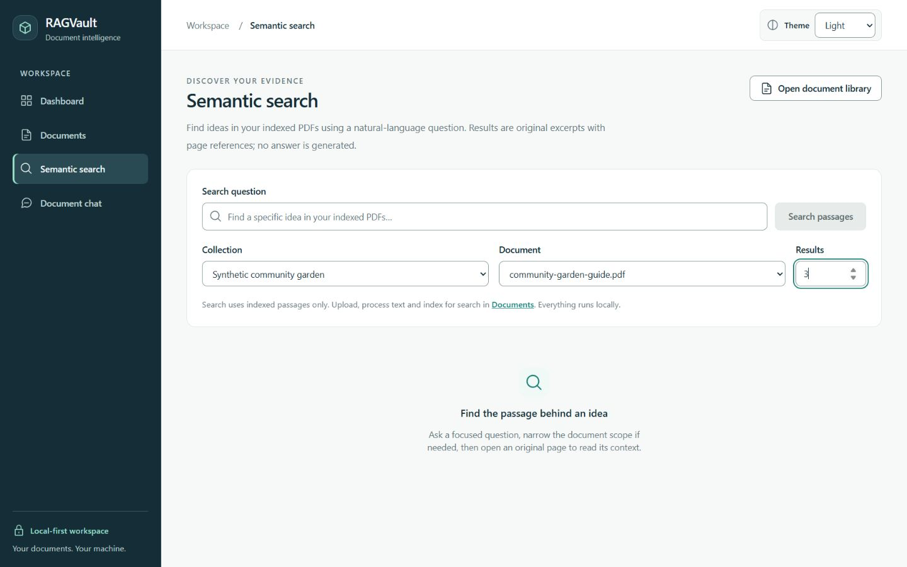
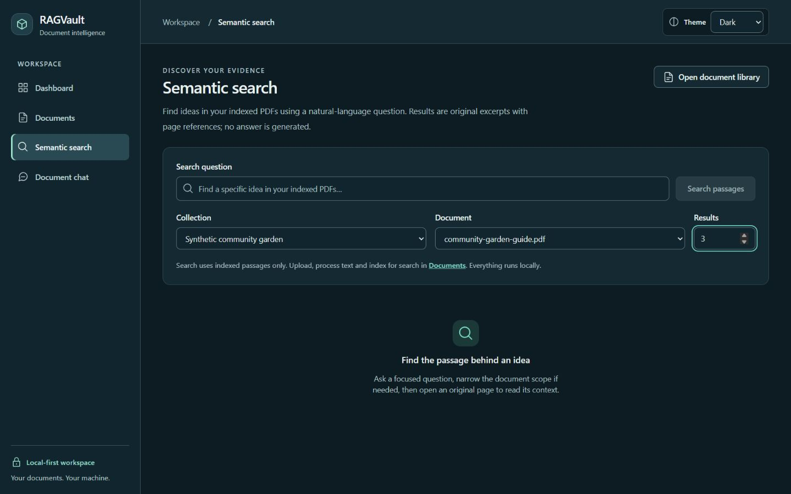
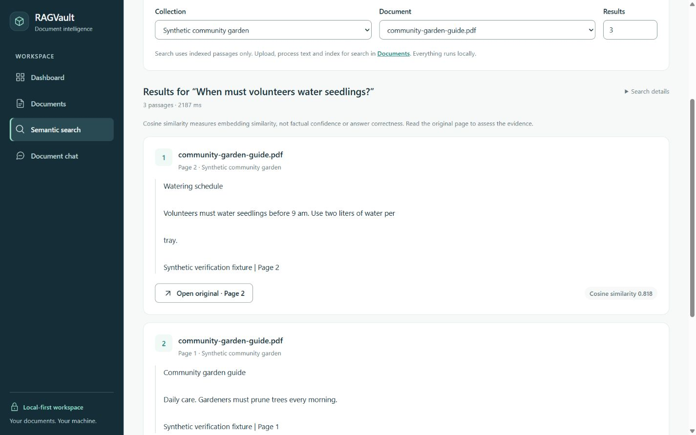
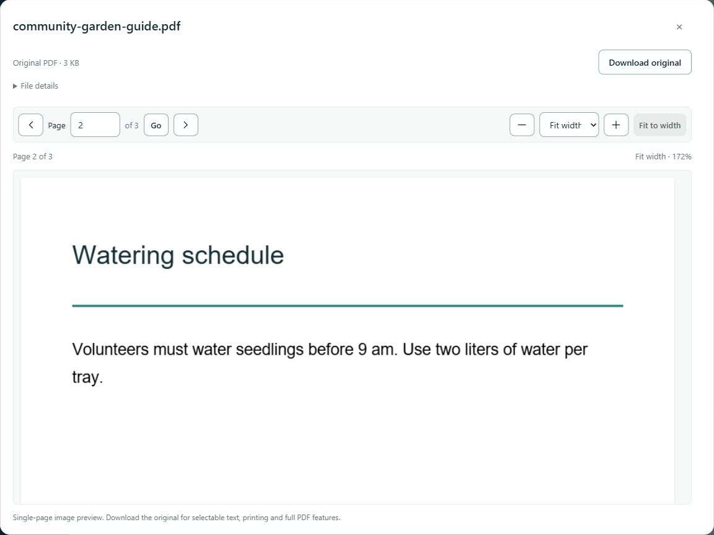
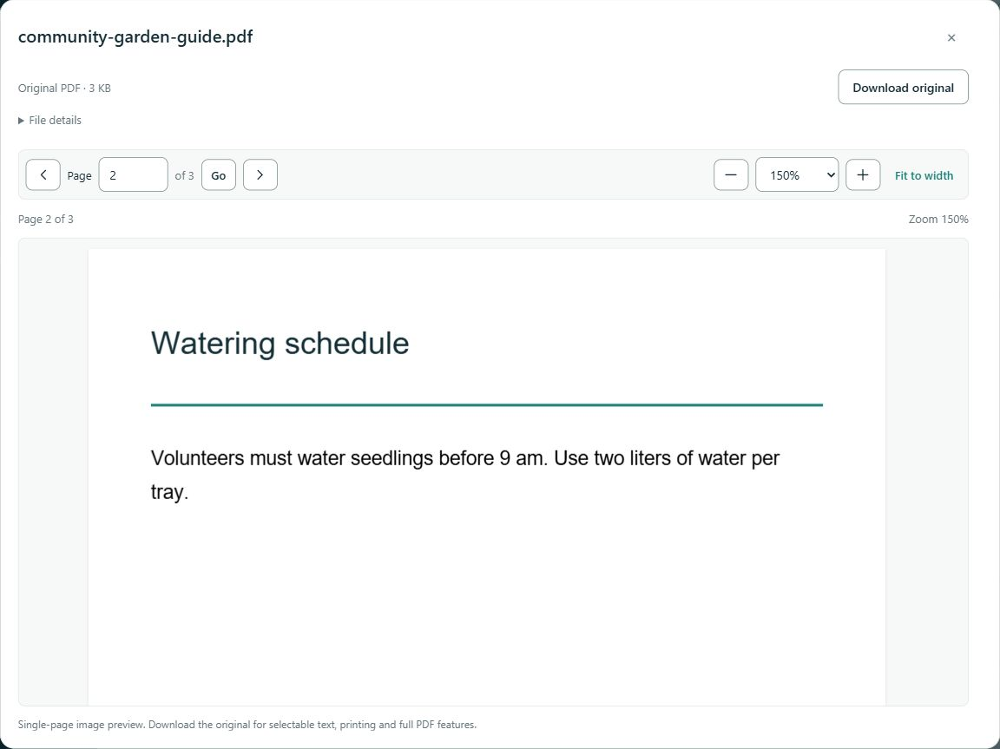
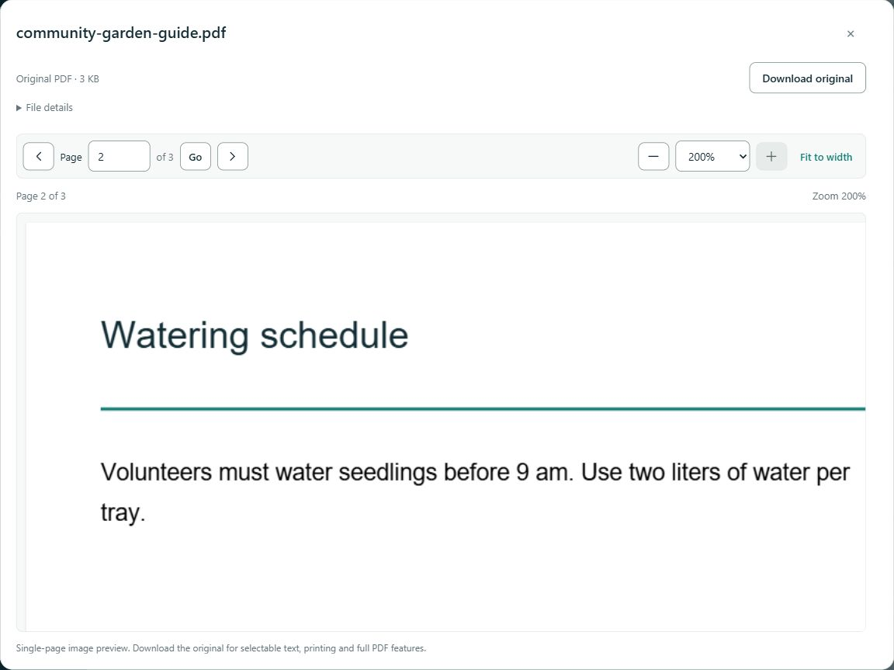
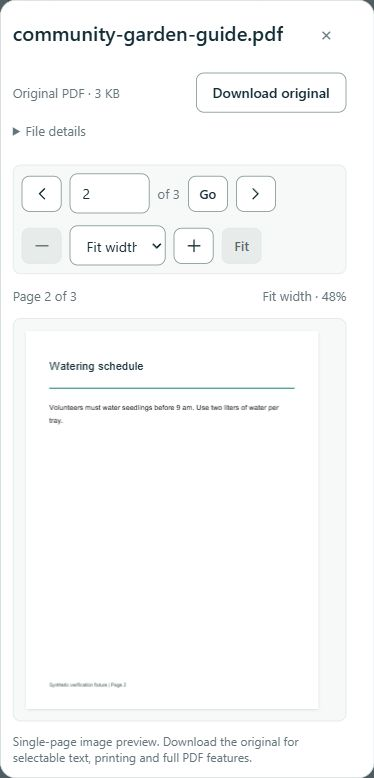
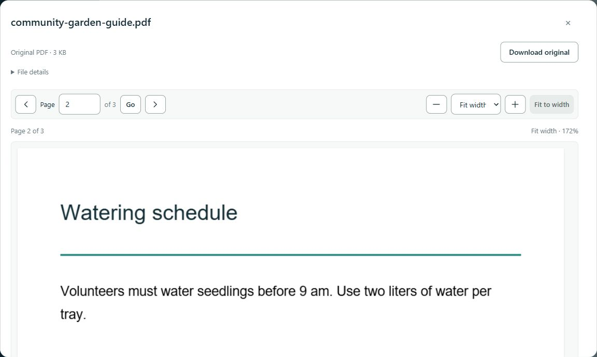

# Stage 8.5 verification — PDF viewer and semantic search

Implemented and verified locally on 27 October 2026 against
`835962fa4e9412f00f202d2dee96c3d83433589b`. The initial implementation checkpoint preceded publication approval. The approved final
review, including the reproduced download-handle issue, is recorded below. Stage 8.6
has not started.

## Design and behavior

Semantic Search now follows the Modern Professional design system with shared controls,
semantic surfaces, comfortable excerpt spacing and responsive filters. Collection and
document scopes, server-side document-option pagination, integer top-K (1–20, default 5),
original excerpts, result ordering, exact document IDs/pages and API contracts remain.
There is no reranking or generated search answer. The results heading keeps the submitted
query while a new draft is typed. Filter failures block submission and expose a retry;
loading, no matches, request errors and incompatible-index warnings remain distinct.

Numbered result cards show the full filename, collection when available, original page,
unaltered passage text and an Open original action. Raw cosine similarity is displayed
to three decimals as secondary metadata, with an explicit explanation that it measures
embedding similarity, not factual confidence or answer correctness. No confidence
percentages or unsafe HTML rendering were added.

Source metadata requests are aborted on a new search, changed scope, option pagination
or unmount. Late obsolete responses cannot open a previous result. The pending source
button retains focus and an accessible name so the asynchronously opened native modal
can restore the correct trigger on close.

## Shared PDF reader

- The original local PDF.js worker, character maps, fonts and WASM remain in use.
  XFA stays disabled. The original PDF download is always available.
- A reader-specific native Dialog size accommodates desktop and phone viewports without
  changing other dialogs. Long headings use two visual lines with full accessible text
  and a native title; File details exposes the complete filename across the dialog width.
- Previous/Next, current/total pages, direct integer entry with Enter/Go and explicit
  validation support navigation. Invalid cited pages produce a warning alongside the
  safely bounded page; the reader does not silently claim that page is the cited page.
- Visual zoom offers 50/75/100/125/150/175/200%, step buttons and Fit width. It persists
  across page changes within the mounted preview only. Fit responds to viewport width;
  numeric zoom does not rerender merely because the viewport width changes.
- Only one page/canvas is rendered. Raster scale remains at most 1.5, bitmap width 1200,
  height 1600, and device pixel ratio at most 2 subject to those same ceilings. Larger
  visual zoom magnifies this bounded bitmap rather than allocating an unbounded canvas.
- Rendering is serialized: cancelled render work settles before canvas reuse. Late page
  lookups are ignored and cleaned; pages and document loading tasks/workers are cleaned
  on changes/close. Separate original-file, PDF-load and page-render failures have retries.
- Canvas layout remains reserved while rendering. Stable scrollbar gutters avoid a
  resize/render feedback loop found during live invalid-page testing. Successful retry
  clears a previous render error, including returning to a previously failed page.
- Zoom pans inside a named, keyboard-focusable viewport. The page/zoom toolbar is sticky
  during outer dialog scrolling. PDF paper/content is intentionally not recolored.

## Automated verification

Final commands executed in `frontend` after the final source changes:

| Check | Actual result |
| --- | --- |
| `npm test` | **268 passed, 21 files**, 26.66 seconds |
| `npm run lint` | Passed |
| `npm run format:check` | Passed |
| `npm run typecheck` | Passed |
| `npm run build` | Passed; 133 modules, build 1.08 seconds |
| `git diff --check` | Passed |

The complete frontend suite includes existing dashboard, library, search, saved/single
chat and citation regressions. Added/expanded tests cover filter failure/retry and scope
preservation, query association, loading/empty/error results, raw cosine explanation,
hostile filenames/excerpts as inert text, exact source IDs/pages, aborted obsolete source
requests and unmount cleanup. Reader tests cover direct page validation, bad source bounds,
session zoom/fit and resize, bounded bitmaps, loader/render retries, serialized cancellation,
late lookup/load cleanup, recovery on a previously failed page, and fixed zoom ignoring
width changes. Shared-dialog tests cover file retry, old-blob suppression under a new ID,
abort behavior, long filenames, initial focus, Escape and trigger restoration.

At the initial implementation checkpoint no backend source changed, and backend unit/
PostgreSQL suites were not rerun. The approved final review below adds a narrowly scoped
PDF-response cleanup fix and reruns those suites. API contracts, model, retrieval,
generation, citation validator, conversation persistence, dependencies and migrations
remain unchanged. Initial live checks below are distinct from those final suites.

## Service recovery and live synthetic verification

Initially Docker Engine, PostgreSQL and FastAPI were unavailable because Docker Desktop
was stopped. Starting the installed Docker Desktop and the existing Compose PostgreSQL
service recovered the existing healthy container. No container recreation, volume deletion,
schema migration or configuration rewrite was needed. Unchanged FastAPI and normal Vite
development servers were started; `/api/health` returned 200 with PostgreSQL and Ollama
connected. The normal application remains available at `http://localhost:5173`.

All task-created content used one disposable three-page community-garden PDF: two portrait
pages and one landscape page. No original PDF was modified or used in the screenshots.

| Live action | Actual result |
| --- | --- |
| Upload and original download | Passed; downloaded SHA-256 matched generated bytes |
| Processing and indexing | Passed; uploaded/not indexed → processed/not indexed → indexed |
| Scoped semantic search, top-K 3 | Three hits from the exact synthetic document; watering evidence ranked first on page 2 |
| Browser search | Passed; raw similarities 0.818, 0.611, 0.481; observed requests 2187 and 4469 ms |
| Saved synthetic question | Answered, two accepted claims; retrieval 125 ms, generation 10875 ms, checks 31 ms, total 11031 ms |
| Duplicate saved request UUID | Same assistant message returned, no extra turn; two total messages |
| Single-question mode | Answered; retrieval 4360 ms, generation 10688 ms, checks 15 ms; two of three passages used |
| Library source entry | Exact original, initial page 1; direct entry opened landscape page 3 |
| Search source entry | Exact original document, page 2 watering evidence |
| Saved chat source entry | Citation 2 opened exact original page 2 |
| Single-question source entry | Citation 1 opened exact original page 1; Escape restored its button focus |
| Page/zoom navigation | Previous/Next, Enter/Go, fit and 150/200%; zoom retained across pages |
| Invalid page 4 in three-page PDF | Explicit validation; current page 2 remained rendered, no render loop |
| Source rename | Historical state became stale, original-page buttons disabled |
| Source deletion | Historical state became unavailable; links and new scoped questions disabled |
| Fixture cleanup | Only owned conversation, document and collection removed; original state matched baseline |

One initial deletion of the disposable document returned HTTP 503. FastAPI logged
`PermissionError` in document deletion; a later retry returned 204 and cleanup/preservation
checks passed. The underlying temporary Windows file-access cause was not established.
This is an observed local backend/file-system limitation, not presented as a clean
first-attempt deletion. No backend behavior was changed to mask it.

Both real-model questions about morning pruning also returned an additional watering
claim from another retrieved page. The source-supported statements were readable and
navigable, but the extra statement was not needed to answer the question. This illustrates
the existing relevance/completeness limitation: citation wording checks and similarity
do not prove answer accuracy. Context limits, evidence selection and all grounding and
prompt-injection safeguards remain unchanged.

## Themes, accessibility and responsive checks

Light and Dark Search and reader surfaces were visually inspected. Dark persisted after
reload. System persisted as the selected mode after reload and resolved to Dark with the
current OS preference. Light was restored after verification. Existing theme tests cover
bootstrap/provider behavior, OS changes and storage synchronization.

Native labels, forms, buttons, disclosures, validation associations and modal behavior are
retained. The reader initially focuses Close. Escape and explicit Close restore connected
source triggers; Library, Search and single-question triggers were checked live. No new
automatic motion was introduced. The existing reduced-motion CSS removes smooth scrolling
and reduces animations/transitions; that rule was inspected. An OS reduced-motion toggle,
full screen-reader traversal, forced colors and real-device testing were not exercised.
This is not a claim of complete WCAG certification.

Responsive checks covered 1440×900, 390×844, 320×740 and 844×390. The dialog and document
had no horizontal overflow; high-zoom panning stays inside the PDF viewport. At 200%, the
portrait page bitmap stayed 918×1188 while its CSS size was 1224×1584, with one canvas.
At 320 px a long synthetic filename remained fully accessible in File details without
horizontal overflow. The expanded filename disclosure uses the full available width.
In short landscape, normal vertical dialog scrolling is necessary; the page/zoom toolbar
remained within the dialog while scrolled. At the narrowest width controls wrap to more
rows. The close button remains reachable through native keyboard navigation/scrolling.

## Privacy and preservation

The final candidate-source scan checks configured secret values (including encoded forms),
private-key/token patterns, personal Windows paths, private email patterns and forbidden
generated/upload/database files. The production build is checked for configured secrets
and accidental development/fixture endpoints. Screenshots contain only synthetic garden
content and closed scoped selectors; reader screenshots are cropped to the dialog so
unrelated saved conversation titles are not captured. JPEG metadata is inspected for EXIF.
Scripts, raw synthetic PDFs, private snapshots and logs stay in ignored `.artifacts`.

The completed audit scanned **235 tracked/unignored candidate files**, including the
exact 19-file change set, and reported **zero findings**. All eight screenshots had no
EXIF metadata and were visually inspected. The generated production assets contained no
configured secret values or disposable fixture API endpoints; the development component
preview was absent. No uploads, raw PDFs, environment files, virtual environments,
database files, build output or investigation scripts enter the candidate inventory.

Before synthetic writes, a fresh private baseline recorded original `.env`/upload hashes,
all six public-table row digests, database cluster identity, Docker mounts, tracked backend
file hashes and Git state. After owned-fixture cleanup these matched. Existing PDF bytes,
processing/indexing states, saved conversations/messages and other records are preserved.
No Docker volume was removed; no Git history, branches or settings were rewritten.
At the initial checkpoint, `main` and `origin/main` remained at the base SHA above,
with nine modified and ten untracked intended files, all unstaged. Final review adds
only the two backend files listed below for the reproduced cleanup defect.

## Deferred functionality and limitations

- The preview is a single-page image, not a full PDF application. No text layer/selection,
  search highlighting, annotations, OCR, thumbnails, full-document rendering or in-preview
  printing was added. Download the original for selectable text and full PDF capabilities.
- Highlighting is deferred because the existing retrieved text/page data does not reliably
  identify visual glyph positions. No approximate or misleading highlights were invented.
- High visual zoom may look soft because the physical bitmap deliberately remains bounded.
  Very short/narrow windows need vertical scrolling and wrapped controls.
- Source availability is distinct from factual verification. Existing evidence-budget,
  greedy-selection, extractive-generation and answer-relevance limitations remain.
- External Windows sharing locks can still cause a recoverable 503. The cancelled-download
  handle defect was reproduced and corrected during the final review below.

## Approved final publication review

The final review reran frontend and available backend/PostgreSQL checks against the
intended source. Fresh synthetic data was isolated by recorded IDs, and a fresh private
baseline was taken before writes. No original documents were modified.

### Final local results

| Check | Actual final result |
| --- | --- |
| Complete backend `pytest` | **319 passed, 21 skipped**, 405.00 seconds |
| Explicit PostgreSQL/pgvector `pytest -m postgres` | **21 passed, 319 deselected**, 216.31 seconds |
| Complete frontend `npm test` | **268 passed in 21 files**, 23.73 seconds |
| Backend Ruff lint and formatting | Passed; 72 files formatted |
| Backend `pip check` | Passed; no broken requirements |
| Frontend ESLint, Prettier, TypeScript | Passed |
| Frontend production build | Passed; 133 modules, 891 ms |
| Alembic revision/schema check | `0004_conversations (head)`; no drift |
| Compose configuration/container | Config passed; existing PostgreSQL healthy |
| Whitespace/error check | `git diff --check` passed |

The 21 tests skipped in the ordinary backend run are the opt-in PostgreSQL cases;
all 21 were executed successfully in the separate integration run. All 340 backend
cases therefore ran across the two final commands. One existing Starlette/TestClient
HTTPX deprecation warning remains; no unrelated dependency changes were made. Full
assistive-technology/OS reduced-motion toggling and real-device tests remain unperformed
as documented above. Existing reduced-motion CSS was reviewed; no new reader motion
was introduced.

### Deletion investigation and focused correction

The original log recorded `PermissionError` but deliberately did not retain a full
traceback or file path. This investigation reproduced the failure with synthetic files
and examined the storage path, response lifetime and Windows file owners:

- The route opens the file before constructing a synchronous generator. The generator's
  `finally` closes it after normal iteration, but a disconnected or cancelled response can
  leave that generator suspended, or never start it. Cleanup then depends on generator
  finalization rather than the response ending.
- Before the fix, immediate deletion after cancelling a 4 MB original download failed
  with 503 in two of three trials. Adding a 300 ms pause still failed in all three trials.
  A separate three-trial OS-level probe found the handle still unavailable after eight
  seconds in every trial. Windows Restart Manager identified the FastAPI Python process
  as the owner. No external process was inferred to be responsible for those failures.
- A deliberately held test-process handle independently reproduced `PermissionError`,
  Windows error 32 (sharing violation), at `DocumentStorage.quarantine` → `Path.rename`.
  This controlled traceback explains the rename failure mechanism; it is not represented
  as a recovered traceback from the earlier uninstrumented request.
- Every failed deletion preserved a snapshot of all six tables and original files,
  including the synthetic record/file. The synthetic file checksum matched, no quarantine
  orphan appeared, and retry succeeded with 204. Database-failure restore and move-failure
  tests remain in the complete backend suite.

The focused correction wraps the existing streaming response with an explicit file close
in its ASGI-call `finally`. The generator retains its own normal close. This guarantees
cleanup when response headers/body fail, the task is cancelled, or the peer disconnects,
including before iteration begins. Download bytes, headers, API shape, access controls,
content disposition and content length are unchanged. No deletion, transaction,
quarantine, rollback, retry, RAG or persistence semantics changed.

Five regression cases retain the response object and check closure **before** the test
loop shuts down generators: normal completion, header-send failure, body-send failure,
cancellation and ASGI disconnect. Before the fix: **four failed, one passed**. After:
**five passed**, including subsequent deletion and absence of leftover files/metadata.
They use real disposable files and cover ASGI 2.3 disconnect and 2.4 send failures.

The repeated live Windows probes after the fix performed **six completed-download plus
cancelled-download/deletion cycles**. All six deletions returned **204 on their first
attempt**, with no file or quarantine orphan. In three OS-level measurements, the
cancelled-stream handle became available in **94–110 ms**, without a delete request
or garbage-collection trigger. A deliberately held external handle still correctly
returned 503, preserved the full snapshot/file checksum, and succeeded on retry after
release. This verifies recovery without bypassing Windows locks.

Final browser checks again used the synthetic three-page garden PDF and confirmed exact
source navigation from Library, Search, saved conversations and unsaved chat. Search
returned page 2 first with raw similarities 0.818, 0.611 and 0.481 (2188 ms). Saved chat
retrieval/generation/checks were 125/12625/31 ms, total 12781 ms. Unsaved chat measured
2219/11468/16 ms. Both returned the same extra watering claim, so the existing relevance
limitation remains. Direct Enter page entry opened landscape page 3; zoom/fit, Escape
and source-trigger focus restoration worked. At 320 px there was one canvas and no
horizontal document/dialog overflow. Dark and System choices persisted after reload;
System matched the current dark OS setting. Light and the normal viewport were restored.
The saved citation reader was rechecked against the corrected/restarted server.

All owned records and raw files were removed, and the fresh six-table/file/cluster/mount
baseline matched. Unrelated backend files and local settings remain unchanged. The only
backend changes are the PDF response wrapper and its five regression cases. No migration
was applied: `alembic current` reported `0004_conversations (head)` and `alembic check`
reported no new operations. Compose config validation passed; the existing PostgreSQL
container was healthy. Docker builds are verified by the publication CI job rather than
claimed as a new local build.

Final publication audit: **235 candidate files**, the exact **21-file inventory**, eight
visually inspected JPEGs without EXIF, and the cleaned `main` history (13 pre-existing
commits and 395 blobs) had **zero privacy/credential/personal-path findings**. History
scanning is restricted to objects reachable from `main`; private recovery refs are neither
scanned for publication nor included in the explicit branch push. Raw fixtures, probe
scripts, logs and snapshots remain ignored under `.artifacts`. The new commit is also
scanned after creation. GitHub Actions for the actual publication SHA is reported
separately; this report records the local review performed before that commit.

## Changed files and screenshots

Changed-file inventory (21 files):

- `backend/app/api/library.py`
- `backend/tests/test_library.py`

- `README.md`
- `docs/design-system.md`
- `docs/verification-milestone-8-5.md`
- `frontend/src/components/Dialog.tsx`
- `frontend/src/components/Icon.tsx`
- `frontend/src/features/documents/LibraryDialogs.tsx`
- `frontend/src/features/documents/PdfPreview.tsx`
- `frontend/src/features/documents/PdfPreview.test.tsx`
- `frontend/src/features/documents/PreviewDialog.test.tsx`
- `frontend/src/pages/SearchPage.tsx`
- `frontend/src/pages/SearchPage.test.tsx`
- `docs/screenshots/search-light.jpg`
- `docs/screenshots/search-dark.jpg`
- `docs/screenshots/search-results.jpg`
- `docs/screenshots/pdf-reader-fit.jpg`
- `docs/screenshots/pdf-reader-150.jpg`
- `docs/screenshots/pdf-reader-200.jpg`
- `docs/screenshots/pdf-reader-mobile.jpg`
- `docs/screenshots/citation-pdf.jpg`

