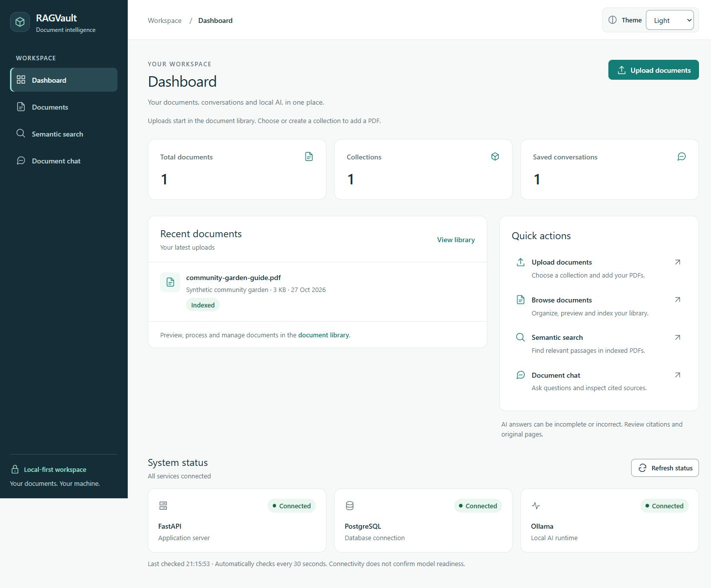
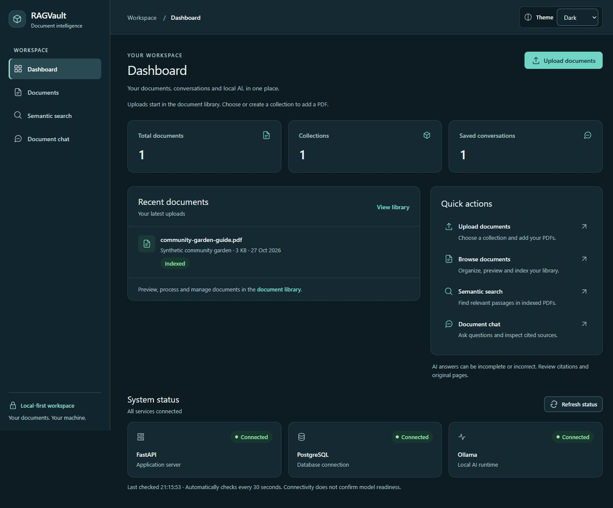
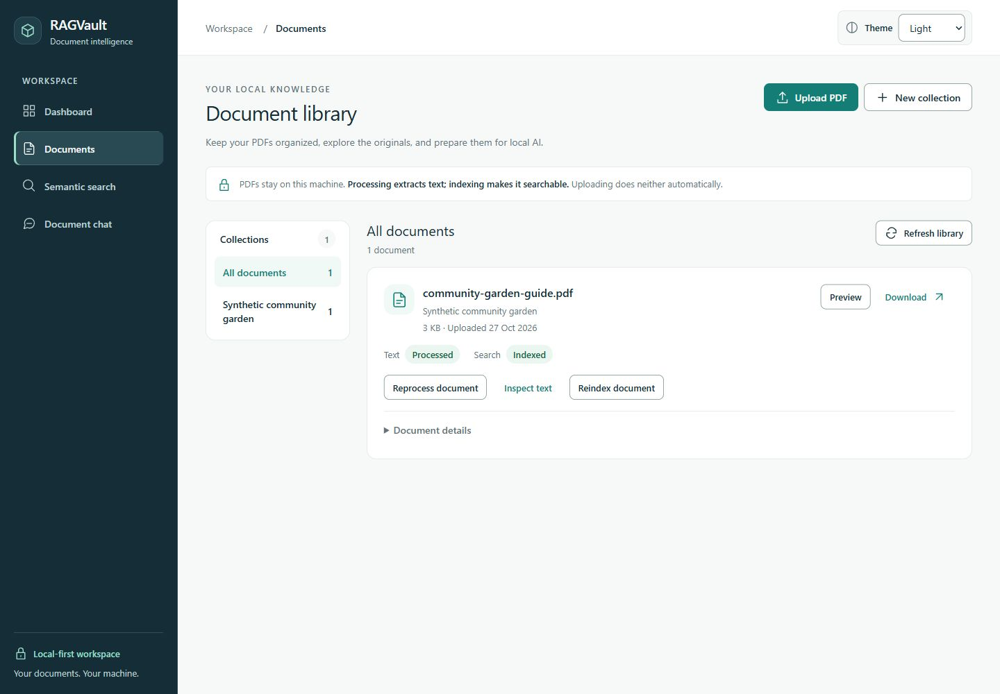
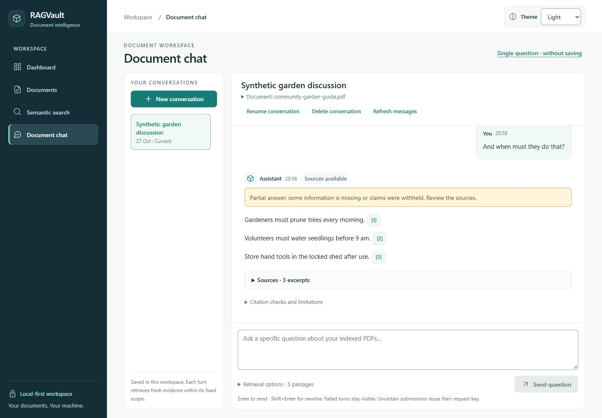
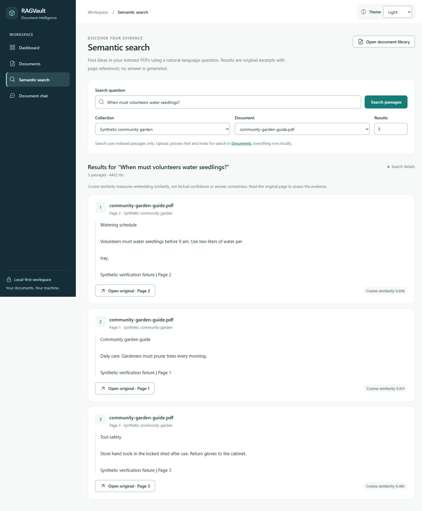
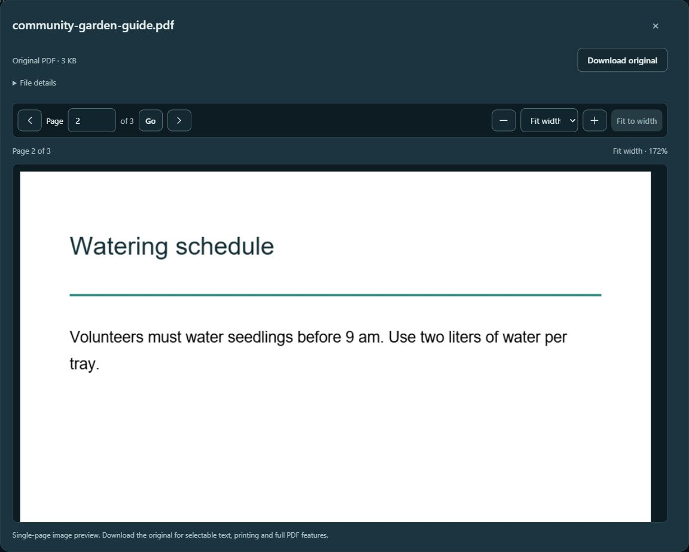
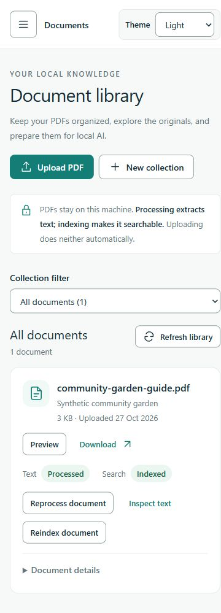

# Stage 8.6 — final UI, accessibility and QA verification

Implemented and checked on **27 October 2026 (Asia/Singapore)**, based on
`fac0c4db8a85c238616d8fe45130b93c28d0e7d0`. The final publication review reran the checks
below after user approval. Milestones 9 and 10 remain unstarted. See the
[Milestone 8 completion summary](milestone-8-summary.md) for all six stages.

## Confirmed findings and focused fixes

| Finding | Evidence and correction |
| --- | --- |
| Search empty-state heading skipped h2 | Axe flagged h1 → h3. EmptyState accepts headingLevel 2/3; the introductory Search state uses h2, while nested states keep h3. |
| Original-page action names omitted their visible wording | Populated Search produced three label-content-name-mismatch violations. Search, retrieved-source and expanded-citation controls now begin their accessible names with the exact visible “Open original · Page N” phrase, retaining filenames/source numbers afterward. IDs and pages are unchanged. |
| Redundant result-rank labels | Generic spans with aria-label produced incomplete ARIA checks. The decorative numbers are hidden from accessibility APIs; the native ordered list supplies ordinal semantics. |
| Light metadata contrast missed the accent surface | Chat timestamp and selected-history date failed at **4.4795:1**. Changing muted text from `#64757B` to `#63747A` yields **4.5446:1** on `#F0F9F6`. Tests now cover muted and body text on that surface in both themes, without rounding before assertions. |
| Message times used unsupported name attributes | Axe flagged incomplete prohibited-attribute checks on time. Native time/dateTime now contains full screen-reader date text; the short visual time is aria-hidden, with the complete date retained in title. |
| Browser tabs had one generic title | All routes were “RAGVault · Workspace.” AppShell now sets a route-specific title such as “Documents · RAGVault”; route/focus regression tests cover navigation. |
| Rejected naming forms lost keyboard focus | A real duplicate-collection response left focus at the document root. The shared name dialog now refocuses its invalid, described input after failure; correction/retry succeeds. |
| Library network failures used browser jargon | The unreachable-API workspace showed only “Failed to fetch.” Network TypeErrors now explain starting FastAPI and retrying. Aborted requests retain their original exceptions; safe HTTP validation/recovery messages are unchanged. |
| Portfolio/guide introduction was stale | The guide still described Search/Reader as awaiting redesign. README now has a concise feature overview, synthetic gallery, limitations and compatible startup guidance; the guide reflects all six stages. |

No new design framework or speculative rendering optimization was introduced. Existing
shared tokens, controls, borders, spacing, drawers and page structures are retained.
There are no backend source, model, retrieval, generation, citation-validator, database
schema, migration or persistence changes in this stage.

## Automated results actually executed

| Check | Actual result |
| --- | --- |
| Complete frontend Vitest suite | **287 passed, 22 files**, 25.93 seconds |
| ESLint | Passed |
| Prettier check | Passed |
| TypeScript build/type check | Passed |
| Production build | Passed; 133 modules, 1.27 seconds |
| Complete backend Pytest suite | **319 passed, 21 skipped**, 346.39 seconds |
| Explicit PostgreSQL/pgvector integration | **21 passed, 319 deselected**, 218.83 seconds |
| Backend Ruff lint/format | Passed |
| Backend pip dependency consistency | Passed; no broken requirements |
| npm dependency audit | **0 vulnerabilities** at the time of this check |
| Alembic current | `0004_conversations (head)` |
| Alembic schema/model check | No new upgrade operations detected; no migration applied |
| Compose configuration | Passed with quiet validation, without printing resolved secrets |
| Docker images | PostgreSQL, backend and frontend all built successfully |
| Frontend container smoke | Page, SPA `/documents` fallback and local PDF font asset passed |
| Backend container smoke | Liveness 200, PostgreSQL connected, dependency health 200, Ollama connected |
| Whitespace check | `git diff --check` passed |

The 21 cases skipped by the ordinary backend command are opt-in PostgreSQL tests; all
21 ran successfully in the separate integration command. All **340 backend cases** ran
across those commands. PostgreSQL tests use disposable schemas and temporary uploads.
One existing Starlette/TestClient HTTPX deprecation warning remains. No unrelated
dependency upgrade was attempted. The first container TestClient used its default
`testserver` host and was rejected by the retained TrustedHost policy; rerunning against
the permitted localhost host passed. The security policy was not weakened.

Axe-core 4.14.0 is a **development-only** dependency. Ten automated accessibility smoke
cases cover the main pages, naming/PDF dialogs, populated Search, expanded citations and
semantic message dates. jsdom lacks layout/contrast support, so its color-contrast rule
is explicitly disabled; separate token tests and real-browser checks cover contrast.
The new network tests preserve cancellation identity and safe server errors. The naming
regression covers focus, aria-invalid, error description and successful correction.

## Real-browser accessibility and responsive review

The isolated browser ran 25 axe checks during investigation. Considering the latest
settled result for each page/theme state, **16 distinct states had zero violations**.
This includes Light/Dark Dashboard, Library, Search, populated/expanded saved and unsaved
chat, mobile navigation/chat and the shared reader. History selection/focus was checked manually. Three incomplete
check instances remained in reader views: icon-name heuristics on the Close glyph and
one Dark metadata-contrast inference. These are not counted as automated passes. The
Close button's accessible name, focus, Escape and return behavior were checked manually;
the theme colors are also covered by contrast tests.

Initial Library/chat contrast alerts during loading-to-enabled transitions disappeared
when rerun after controls settled. The diagnostic audit waited for finite animations
before final checks; no product colors were changed to suppress those transient results.
The independently reproducible muted-on-accent contrast failure above was corrected.
Temporary browser diagnostics were removed before the final quality checks and build.

Twenty-four page measurements covered Dashboard, Library, Search and a loaded saved
conversation at **320×740, 375×812, 768×1024, 1024×768, 1280×800 and 1920×1080**.
Document and main-content scroll widths did not exceed their client widths in any case.
A 214-character synthetic filename and expanded checksum/details were reviewed at 320 px;
the reader exposed the full filename without horizontal overflow. The reader was also
checked at **844×390 landscape**, with normal vertical dialog scrolling and wrapped
controls. Wider numeric zoom pans inside the PDF viewport rather than widening the page.

Keyboard checks included navigation Enter/Escape, drawer focus/scroll release, selection
from mobile history, page-route headings, dialog initial focus and Shift+Tab/Tab containment,
source-trigger restoration, page entry with Enter, invalid naming correction and source
disclosures. The conversation's manual scroll exposed **Jump to latest**, which returned
to the newest content. Saved messages survived refresh. Native control labels and the
browser accessibility tree were inspected; this is not spoken screen-reader testing.

System persisted as a mode after reload and resolved to Dark with the current dark OS
preference. Light was restored in the QA origin. The normal workspace's theme preference
was not changed by the isolated-origin tests. Existing theme initialization/storage
tests ran in the full suite. The OS reports reduced motion off; existing reduced-motion
CSS was inspected and no new motion was added. The available browser controls do not
offer media-preference emulation, and the OS preference was not changed.

Actual Narrator/NVDA/VoiceOver output, physical iOS/Android keyboards, forced colors,
every zoom/device combination and OS reduced-motion switching were **not** exercised.
A shortened viewport can require outer-page scrolling to reach the composer; viewport
emulation is not proof of real software-keyboard behavior. The bounded image PDF preview
does not expose selectable page text; use the original download or processed text
inspector for text. These limits prevent a claim of complete WCAG 2.2 AA conformance.

## Services, isolation and live workflows

Initially Docker Desktop/Engine was stopped and FastAPI refused connections. Starting
the installed Docker Desktop and **starting the existing** PostgreSQL container recovered
the retained database. The baseline was captured only after recovery and before QA data
writes. No volume/container reset, schema upgrade or `.env` rewrite was performed.
Normal FastAPI/React development servers were started with existing settings.

Browser QA used the unchanged real backend on a separate loopback port with a uniquely
owned PostgreSQL schema and an ignored synthetic-upload directory. Real Ollama supplied
embeddings and generation. A separate frontend origin exposed only that QA workspace.
No original user PDF, collection, conversation or processing/indexing state was used as
a disposable fixture or included in screenshots.

| Live verification | Actual observation |
| --- | --- |
| Collection creation | Both API fixture setup and keyboard-driven UI creation passed. Duplicate-name validation retained the value and focused its associated invalid field. |
| Upload, preview and download | Three-page synthetic PDF uploaded via API and native UI chooser. Downloaded bytes matched the generated PDF; Library opened the exact original and navigated to landscape page 3. |
| Processing versus indexing | UI showed Uploaded/Not indexed → Processed/Not indexed → Processed/Indexed, with 3 chunks/pages and 3 vectors. These remained explicit separate actions. |
| Search and original page | Filtered search returned watering page 2 first, with raw similarities 0.818/0.611/0.481. Original excerpts and document/page IDs remained unchanged. |
| Saved fixed-scope question | Answered with 2 accepted claims; retrieval/generation/checks 141/10907/15 ms, total 11063 ms. Duplicate request replay returned the same assistant and no extra turn. |
| Contextual follow-up | “And when must they do that?” persisted a second turn and retained the exact document scope. It returned a partial answer with extra watering/tool-storage statements; retrieval/generation/checks 5969/13453/16 ms, total 19438 ms. |
| Single-question mode | “When must volunteers water seedlings?” produced the correct one-claim 9 am quotation and page-2 citation; retrieval/generation/checks 2156/11031/32 ms. No saved turn was created. |
| Shared reader | Library, Search, saved conversation and unsaved citation entries opened their exact original page; close/Escape and trigger focus were checked. |
| Rename/delete | UI renamed only disposable PDFs/conversations. The 214-character PDF name remained fully accessible and kept its processed/indexed state. Conversation renaming persisted after reload; Cancel preserved it. Document and conversation confirmations then removed only their owned records; only an empty collection could be deleted. |
| Historical source removal | Deleting the synthetic scoped PDF retained its four historical messages, disabled all citation links and disabled new questions without broadening scope. Confirmed conversation deletion then removed its messages. |
| Invalid uploads | Invalid PDF signature returned 422 and wrong extension 415; no metadata rows were left behind. |
| Unindexed scope | Search restricted to an uploaded, unindexed disposable PDF returned no passages and did not broaden to the indexed garden document. |
| Cancelled downloads | Three 4 MB responses were closed after their first KB. All three immediate deletions returned 204 without retry; metadata, stored file and quarantine file were absent afterward. Measured delete-plus-confirmation intervals were 2046–2062 ms. |
| Offline API | A temporary frontend pointed at an unused loopback API port showed unavailable totals, FastAPI unavailable and PostgreSQL/Ollama not checked. No false success or invented zero counts appeared. Library Retry displayed the new actionable message. Working services were not stopped. |

Dependency-specific 503 states, PDF load/render failure and retry, obsolete response
cancellation, missing/stale/invalid historical sources, pagination, failed/uncertain chat
submissions, request-key recovery, partial/withheld output and fallback wording were
also reviewed through the complete regression suites. PostgreSQL and Ollama were not
deliberately stopped to simulate those dependency failures. Successful source checks are
never described as factual verification. Broad/follow-up answers can still be irrelevant
or incomplete; the partial-answer gallery capture preserves that warning.

## Performance and resource handling

| Production asset | Before bytes | After bytes | Change |
| --- | ---: | ---: | ---: |
| Main application JS | 355579 | 356015 | +436 (about 0.12%) |
| Application CSS | 35879 | 36151 | +272 (about 0.76%) |
| Lazy PDF reader chunk | 7578 | 7578 | Same byte count |
| PDF.js renderer | 430170 | 430170 | Unchanged |
| Local PDF worker | 1264342 | 1264342 | Unchanged |

The accessibility engine and temporary diagnostics are absent from production assets.
There is no new runtime framework, reranking, polling or prefetch behavior. Dashboard
retains three bounded workspace requests plus its separate health check; its existing
tests verify totals rather than scanning all records. History/document choices retain
pagination and existing scroll/abort behavior. PDF.js remains lazy, local and bounded to
one page/canvas, with its existing raster ceiling, serialized cancellation and cleanup.
At live 200% zoom, one portrait canvas was 918×1188 bitmap pixels while CSS size was
1224×1584; the reader did not allocate a larger bitmap.
No speculative React memoization or optimization was applied, and no runtime speedup is
claimed. The measured model timings above are observations, not comparable benchmarks.
The QA browser had no recorded warning/error console entries when checked.

## Privacy, preservation and remaining limitations

The final review checks candidate source/lock/docs/screenshots for configured `.env`
secret values and encoded variants, credentials/private-key patterns, personal Windows
paths/emails, private document identifiers in new changes, and generated/upload data.
Production assets are checked for secrets, the accessibility engine/audit hook and
temporary QA API endpoints. All seven gallery images are visually inspected synthetic
content, with no EXIF metadata. Raw PDFs, scripts, logs, snapshots and test uploads remain
ignored under `.artifacts`; copied PDF.js assets and build output remain ignored.

The fresh baseline records hashes for `.env`, original uploads and tracked backend files,
six public-table row digests, database identity, Docker mounts, Git HEAD and references.
Final comparison **passed**: original files/records, tracked backend files, cluster identity,
Docker mounts and user refs matched. The isolated QA's six tables were empty before its
recorded schema was removed; no synthetic upload/quarantine file remained. Temporary QA
services and tabs were closed, while normal FastAPI/React, PostgreSQL and Ollama remained
healthy. A redundant cleanup check raced with schema teardown; the reported cleanup
uses explicitly qualified pre-drop checks and final schema-absence/filesystem/public-baseline
checks rather than that redundant check.

The final audit scanned **245 candidate files**, the exact **30-file change inventory**,
and **14 reachable main commits / 416 history blobs**, with **zero findings**. All seven
screenshots had no EXIF metadata. No upload, raw PDF, generated build output, virtual
environment, disposable script, QA endpoint or audit hook enters the candidate inventory.
The reviewed publication inventory is **20 modified and 10 new intended files**. Only
that inventory is eligible for staging. The exact publication commit and GitHub Actions
result are reported after the push; local checks alone do not establish CI success.
No backend source/schema change or Git history rewrite occurred.

Remaining limitations include local single-user access without authentication, the
existing 4K context/evidence budget, greedy/bounded selection, heuristic follow-ups,
conservative citation wording checks and imperfect answer relevance/completeness. No
dedicated whole-document summarization, new model selection, OCR, annotation editing,
accurate visual source highlighting, streaming or deployment readiness was added.

## Final publication review

The user approved publication after the implementation review. All **30 files** in the
inventory below were reviewed individually, including all seven synthetic screenshots.
The automated table above records the fresh publication rerun, rather than relying on
the earlier implementation pass. Backend Ruff checked/formatted 72 files; `pip check`
reported no broken requirements. npm audit reported zero vulnerabilities. These are
point-in-time checks, not a guarantee against undiscovered dependency issues.

Fresh live tests used another uniquely owned schema, the same unchanged application
backend and real Ollama. The original workspace remained separate:

- Upload/original-byte verification, explicit processing then indexing, and document/
  collection-scoped search passed. Watering page 2 ranked first among three hits.
- The saved pruning question returned three accepted source-wording matches. It also
  included watering statements beyond the requested pruning question. Retrieval,
  generation and checks took **141 / 11797 / 31 ms**, total **11984 ms**.
- The ambiguous follow-up returned three source-supported claims including extra
  watering/tool-storage information, with **2265 / 11032 / 0 ms** and total **13297 ms**.
  The response status was `answered`; that status does not establish relevance. Four
  saved messages persisted, and duplicate-request replay returned the existing turn.
- A specific unsaved watering question returned the correct single 9 am claim and
  page-2 citation, with **2156 / 4016 / 15 ms**. It created no saved conversation/message.
- Dashboard counts matched the isolated workspace and all services connected. System
  mode persisted after reload and resolved to Dark; Light was restored on the QA origin.
- Library, Search, saved and unsaved citations opened the exact synthetic original.
  Direct page 3 entry, 200% zoom, fit-to-width, Escape and trigger restoration passed.
- The 375 px mobile history/navigation controls opened with keyboard access. Native
  modal Tab progression and Escape worked; at the native boundary the embedded browser
  briefly moved focus outside document content before Tab returned to Close. No
  background application control became focused. This is not assistive-technology proof.
- Three fresh 4 MB downloads cancelled after their first KB deleted with HTTP 204;
  metadata/files/trash were absent, no retry needed (**2047–2063 ms**). Invalid uploads
  returned 422/415 without records; an unindexed scope returned no passages.
- All three Docker images rebuilt. Container checks passed for backend liveness,
  PostgreSQL/Ollama health, frontend root/SPA route and the actual PDF.js standard font
  `FoxitFixed.pfb` (**17597 bytes**). An initial probe used an absent font filename and
  received the SPA fallback; the corrected check asserted binary length as well as HTTP
  status. This was a smoke-test path correction, with no application change.

The earlier browser/axe/responsive investigation above remains supporting evidence;
its 25 audit runs and 24 measurements were not repeated as additional results in this
publication rerun. The known accessibility and answer-quality gaps remain unchanged.
Only documentation completion wording and this evidence record were adjusted during
final review. Disposable helpers, synthetic PDFs, logs, private baselines and browser
proof captures remain under ignored `.artifacts/`; the frontend audit hook is absent.

The precommit privacy scan checked **245 candidate files**, all **14 existing main
commits** and **416 history blobs**, with no configured-secret, private-email, personal-
path, private-key or token-pattern findings. All seven screenshots contain synthetic
data and no EXIF metadata. The preservation audit passed original six-table digests,
upload/configuration hashes, backend hashes, PostgreSQL cluster identity and volume
mounts. All QA records were removed, their six empty tables were checked, and only the
owned disposable schema and servers were cleaned up. Publication uses only the reviewed inventory and a normal
`main` update, with no tags or recovery refs. The commit hash, final remote equality and
GitHub Actions result must be checked after publication and reported with its outcome.

## Changed files and screenshots

Changed-file inventory (30 files):

- `README.md`
- `docs/design-system.md`
- `docs/milestone-8-summary.md`
- `docs/verification-milestone-8-6.md`
- `frontend/package.json`
- `frontend/package-lock.json`
- `frontend/src/components/AppShell.tsx`
- `frontend/src/components/AppShell.test.tsx`
- `frontend/src/components/ui/EmptyState.tsx`
- `frontend/src/features/chat/ChatMessage.tsx`
- `frontend/src/features/chat/ClaimAnswer.tsx`
- `frontend/src/features/chat/ClaimAnswer.test.tsx`
- `frontend/src/features/documents/LibraryDialogs.tsx`
- `frontend/src/lib/api.ts`
- `frontend/src/lib/api.test.ts`
- `frontend/src/pages/ChatPage.test.tsx`
- `frontend/src/pages/DocumentsPage.test.tsx`
- `frontend/src/pages/SearchPage.tsx`
- `frontend/src/pages/SearchPage.test.tsx`
- `frontend/src/pages/SingleQuestionChat.tsx`
- `frontend/src/styles.css`
- `frontend/src/test/accessibility.test.tsx`
- `frontend/src/theme/contrast.test.ts`
- `docs/screenshots/stage-8-6/dashboard-light.jpg`
- `docs/screenshots/stage-8-6/dashboard-dark.jpg`
- `docs/screenshots/stage-8-6/library-light.jpg`
- `docs/screenshots/stage-8-6/chat-light.jpg`
- `docs/screenshots/stage-8-6/search-light.jpg`
- `docs/screenshots/stage-8-6/pdf-reader-dark.jpg`
- `docs/screenshots/stage-8-6/mobile-library.jpg`

