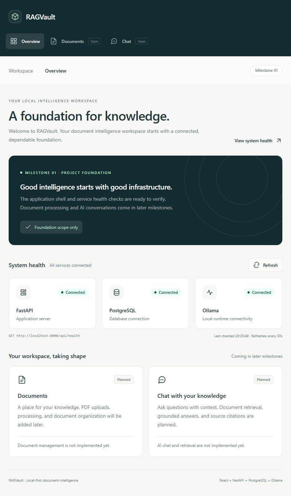

# Milestone 1 verification evidence

Verified on **24 October 2026 (Asia/Singapore)** using the existing Windows project and the user's configured root `.env`.

**Result: the local Milestone 1 setup is verified and ready for Milestone 2. Milestone 2 has not been started.** Both native development servers remain running, with the dashboard at `http://localhost:5173` and the API at `http://localhost:8000`.

## Environment and setup

| Check | Observed result |
| --- | --- |
| Python / virtual environment | Python 3.12.10; existing `backend/.venv` reused |
| Node.js / npm | Node 24.16.0, npm 11.13.0 |
| Docker Engine / Compose | Engine 29.9.2 accessible; Compose v5.6.1 |
| Ollama | CLI 0.40.10; configured HTTP endpoint reachable |
| Settings | Pydantic validation passed; development environment, native backend port 8000, configured frontend origin `http://localhost:5173` |
| Backend dependencies | Editable installation of `backend[dev]` succeeded |
| Frontend dependencies | `npm.cmd ci` succeeded; 190 packages installed; npm audit reported 0 vulnerabilities at installation time |
| Compose configuration | `docker compose --profile app config --quiet` exited 0 |
| PostgreSQL startup | `docker compose up -d --wait postgres` succeeded and reused the existing healthy container |
| PostgreSQL readiness | `pg_isready` reported accepting connections |
| PostgreSQL volume | Existing `ragvault_postgres_data` named volume mounted at `/var/lib/postgresql/data` |

No Docker volumes, databases, existing application tables, or user data were deleted. The `.env` file was not edited or printed. Its SHA-256 fingerprint matched before and after setup.

## Database and migrations

| Check | Observed result |
| --- | --- |
| Authenticated SQLAlchemy connection | Connected using the configured private credentials |
| `SELECT 1` | Returned `1` |
| PostgreSQL server version | 17.11 |
| Alembic `upgrade head` | Passed against live PostgreSQL |
| Alembic `current` | Passed; no revision ID, as expected for this milestone |
| Alembic `check` | `No new upgrade operations detected.` |
| Alembic `history` | Passed; no revisions |
| Schema after migration initialization | Only `alembic_version`; no document or other application tables |

No artificial empty revision was created. Alembic initialized its normal version tracking table; application models and schema changes remain for later milestones.

## Ollama connectivity and model availability

The configured Ollama client successfully checked `/api/tags`. The locally installed model names match configuration:

| Setting | Configured value | Result |
| --- | --- | --- |
| Chat model | `gemma3:4b` | Installed |
| Embedding model | `nomic-embed-text` | Installed; default `:latest` tag accepted |

This verifies connectivity and model presence only. No generation, embedding calls, or model downloads were performed.

## Live API and browser checks

| Check | Observed result |
| --- | --- |
| FastAPI startup | Uvicorn development server started with reload enabled |
| React startup | Vite development server started successfully |
| `GET /` | HTTP 200 |
| `GET /api/health` | HTTP 200 with application `ok`, database `connected`, and Ollama `connected` |
| Health caching | `Cache-Control: no-store` |
| Configured frontend CORS | Correct `Access-Control-Allow-Origin` header |
| Untrusted-origin CORS preflight | HTTP 400, as expected |
| `http://localhost:5173` | HTTP 200; rendered RAGVault dashboard |
| Frontend-to-backend communication | Browser displayed All services connected and Connected for all three services |
| Manual Refresh | Entered Checking state, then returned to All services connected |
| Planned features | Documents and Chat remained explicitly planned without upload/chat controls |

Observed health response:

```json
{
  "status": "ok",
  "application": "ok",
  "database": { "status": "connected" },
  "ollama": { "status": "connected" }
}
```



Development server output is kept in ignored `.artifacts/backend.stdout.log`, `.artifacts/backend.stderr.log`, `.artifacts/frontend.stdout.log`, and `.artifacts/frontend.stderr.log`.

## Automated checks

All checks below were actually rerun during this verification:

| Command | Observed result |
| --- | --- |
| Backend `python -m pytest` | **34 passed**, 1 upstream deprecation warning |
| Backend `python -m ruff check .` | All checks passed |
| Backend `python -m ruff format --check .` | 23 files already formatted |
| Backend `python -m pip check` | No broken requirements found |
| Frontend `npm.cmd run lint` | Passed, no diagnostics |
| Frontend `npm.cmd run format:check` | All matched files use Prettier code style |
| Frontend `npm.cmd test` | **5 passed**, 1 test file |
| Frontend `npm.cmd run typecheck` | Passed, no diagnostics |
| Frontend `npm.cmd run build` | Passed; Vite transformed 22 modules and generated `dist/` |

The passing backend suite covers startup/shutdown, healthy and degraded health responses, independent and combined dependency failures, recovery, safe failure messages, HTTP failures, timeouts, settings precedence/validation, and CORS. Failure scenarios use mocks; running PostgreSQL and Ollama were not deliberately interrupted.

## Docker image and container checks

| Check | Observed result |
| --- | --- |
| `docker compose --profile app build --quiet` | Backend and frontend images built successfully |
| Backend temporary container | App startup/shutdown passed; root and dependency health returned HTTP 200 through TestClient |
| Backend container to PostgreSQL | Connected using the existing Compose network/service |
| Backend container to Windows Ollama | Connected through configured `host.docker.internal` address |
| Frontend temporary container | `nginx -t` passed; Nginx served HTTP 200 with the RAGVault page |

Temporary smoke-test containers published no host ports and were removed automatically after their checks. Persistent database containers and volumes were preserved. Native development servers continue to own ports 8000 and 5173.

## Git and credential checks

- The repository still has no commits and no staged files; no commit or push was performed.
- Root `.env` is neither tracked nor staged and is excluded by `.gitignore`.
- Git's 61 commit-candidate files contained **zero matches** for the configured private PostgreSQL password.
- No `.env`, virtual environment, node_modules, build output, uploaded/generated data, or `.artifacts` paths appeared among commit candidates.
- The generated frontend build also contained **zero matches** for the private password.
- `.env.example` remains eligible for version control and contains example values only.
- No resolved configuration dump, connection URL, private password, or raw database error was printed.

## Remaining notes and limits

The installed Starlette TestClient emits: `Using httpx with starlette.testclient is deprecated; install httpx2 instead.` This warning also appeared in the backend container smoke test. It is non-blocking, was not suppressed, and all tests passed. No dependency changes were needed to complete the local setup.

Docker named-pipe access and local service access were initially blocked by the execution sandbox. Commands were rerun with the required execution permissions and then succeeded; neither Docker nor Ollama remained inaccessible.

The optional full Compose application profile was **not started together on published ports**, because the native development servers are running there. Both images, container-level connectivity, and frontend serving were checked separately. GitHub Actions has **not been executed remotely** because the repository has not been pushed. These are optional deployment/remote checks, not failures of the verified local development setup.

No application source changes were necessary. Only the README, this verification record, and the dashboard screenshot were updated; local verification helpers and logs remain ignored. Milestone 2 implementation has not begun.
